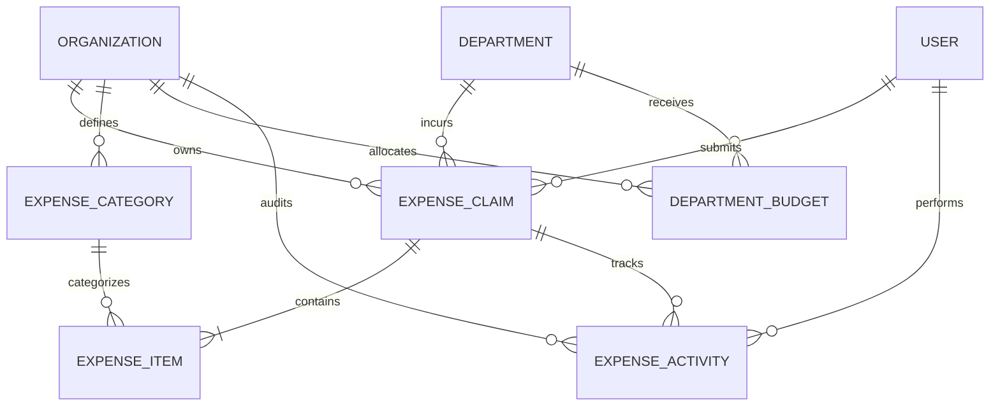
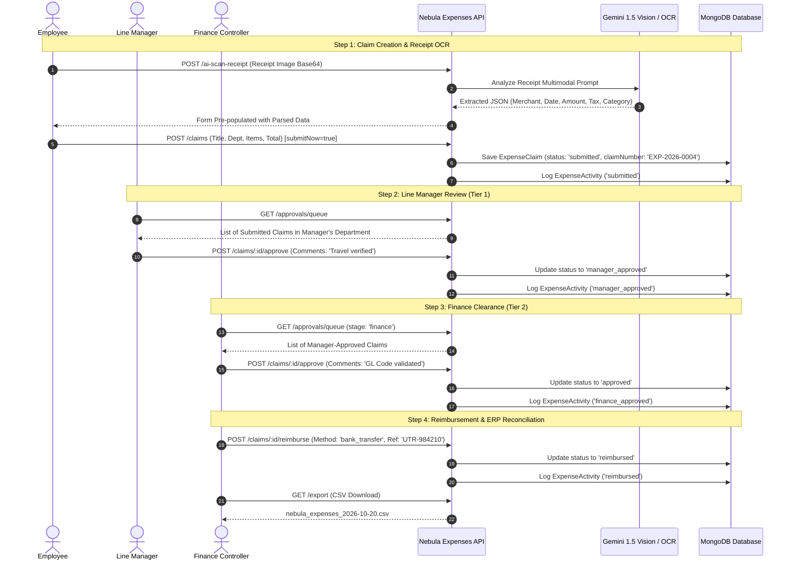
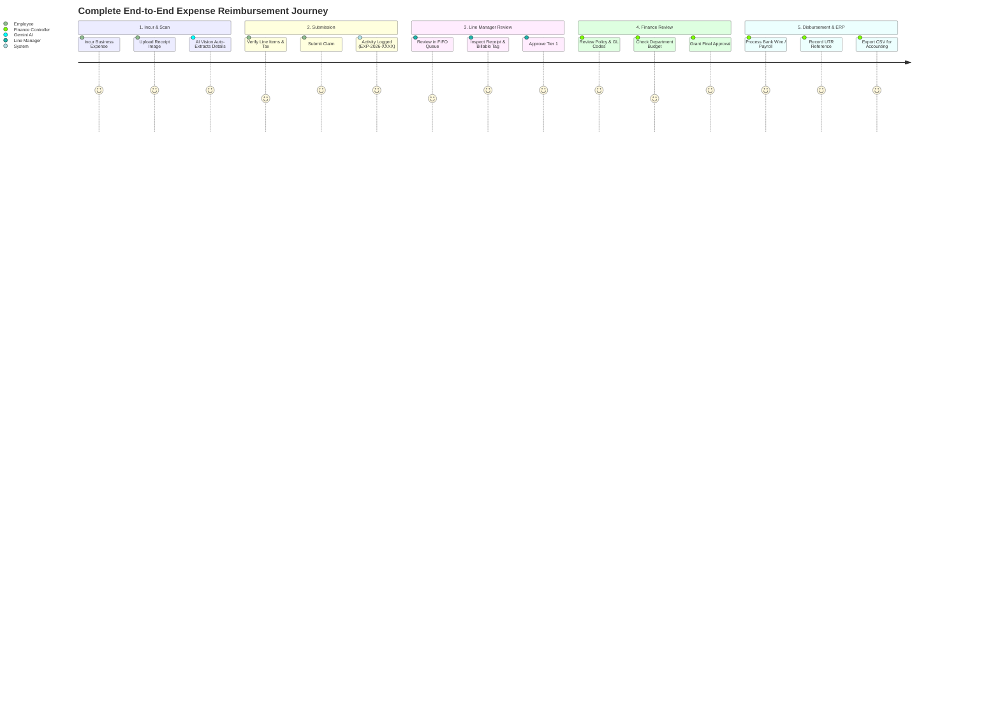

# Nebula HUB — Expense Management (Expenses) Module
## Comprehensive Technical & Feature Documentation

---

## 1. Executive Summary & Module Overview

The **Expense Management (Expenses) Module** in **Nebula** serves as the vital financial-operational bridge connecting employee out-of-pocket business spending, corporate budgetary controls, and managerial approvals with organizational accounting. Integrated natively into Nebula's multi-tenant business operating ecosystem alongside **CRM**, **HRMS**, and **Recruitment (ATS)**, the module provides a seamless end-to-end reimbursement pipeline.

Built for modern enterprises, Nebula Expenses eliminates paper receipts, manual spreadsheets, and opaque approval delays by offering employee self-service claim submission, AI-powered receipt scanning, automated policy enforcement, 2-tier approval workflows, real-time departmental budget monitoring, and financial ERP reconciliation exports.

### Key Objectives
1. **Frictionless Employee Reimbursement**: Streamlines claim creation with multi-item breakdowns, multi-currency support, receipt attachments, client-billable tagging, and real-time claim status tracking.
2. **AI-Assisted Smart Receipt Scanner (OCR)**: Integrates Google Gemini 1.5 Flash Vision with an intelligent heuristic fallback engine to automatically parse merchant names, transaction dates, tax, totals, and suggest expense categories from uploaded receipt images/PDFs.
3. **Structured 2-Tier Approval Workflow**: Enforces strict governance where claims flow sequentially from employee submission to Line Manager approval, followed by final Finance controller verification and disbursement clearance.
4. **Real-Time Departmental Budget Tracking**: Dynamically aggregates approved and pending claims against fiscal year departmental budget allocations, providing early warning indicators (>80% amber threshold) and budget breach prevention (>100% red alert).
5. **Standardized Categories & Spending Policies**: Centralizes General Ledger (GL) account codes, icon/color branding, receipt mandatory thresholds, and per-claim maximum spending limits.
6. **Reimbursement Settlement & ERP Export**: Enables Finance controllers to mark claims as reimbursed with specific payment methods (Bank Transfer, Payroll, Corporate Card, Cash, Check) and transaction reference IDs, complemented by 1-click CSV export for ERP accounting systems.
7. **Strict Multi-Tenancy & Dynamic RBAC**: Enforces complete tenant isolation through `organizationId` query scoping and permission gating (`view`, `create`, `edit`, `delete`, `approve`).

---

## 2. System Architecture & Tech Stack

```
┌────────────────────────────────────────────────────────────────────────────────────────┐
│                                 NEBULA FRONTEND SPA                                    │
│             React 19  │  TypeScript  │  Vite 6  │  Tailwind CSS  │  Framer Motion       │
│             Theme: Nebula Premium Light 2.0 (Brand Orange #f97316, Warm Surface)       │
├────────────────────────────────────────────────────────────────────────────────────────┤
│  Expenses Hub  │  My Claims View  │  Approvals Queue  │  Budgets View  │  Categories   │
└─────────────┬───────────────────┬──────────────┬──────────────────┬──────────────┬─────┘
              │                   │              │                  │              │
              ▼                   ▼              ▼                  ▼              ▼
┌────────────────────────────────────────────────────────────────────────────────────────┐
│                        State & Data Layer (TanStack Query v5)                          │
│                 expenseApi.ts  ──►  useExpenses.ts  ──►  useModuleAccess               │
└───────────────────────────────────────────┬────────────────────────────────────────────┘
                                            │ Axios HTTP Client (Bearer JWT Token)
                                            ▼
┌────────────────────────────────────────────────────────────────────────────────────────┐
│                                NEBULA BACKEND API                                      │
│                             Node.js + Express.js 4.x                                   │
├────────────────────────────────────────────────────────────────────────────────────────┤
│ Middlewares: requireAuth ──► scopedFilter (Org Scoping) ──► requireModuleAccess('expenses')│
├────────────────────────────────────────────────────────────────────────────────────────┤
│ Controllers:                                                                           │
│  ├── expenseSummaryController.js       (Executive KPIs, Monthly Trends & Category Mix) │
│  ├── expenseClaimController.js         (Claims CRUD, Numbering, Line Items & Lifecycle)│
│  ├── expenseApprovalController.js      (2-Tier Manager & Finance FIFO Approval Queue)  │
│  ├── expenseBudgetController.js        (Departmental Budgets & Live Spend Calculations)│
│  ├── expenseCategoryController.js      (Categories, GL Codes & Policy Limit Rules)     │
│  ├── expenseAiScanController.js        (Gemini 1.5 Flash Vision OCR & Receipt Parser)  │
│  └── expenseReimbursementController.js (Disbursement Recording & CSV Export Engine)    │
└───────────────────────────────────────────┬────────────────────────────────────────────┘
                                            │ Mongoose 8.x ODM
                                            ▼
┌────────────────────────────────────────────────────────────────────────────────────────┐
│                                 MONGODB DATABASE                                       │
│  ExpenseClaim  │  ExpenseCategory  │  DepartmentBudget  │  ExpenseActivity             │
│         ▲                                                        │                     │
│         └────────────── HRMS Cross-Integration ──────────────────┴─────────────────────┤
│                     ──► User, Employee & Department Collections                        │
└────────────────────────────────────────────────────────────────────────────────────────┘
```

### Technology Highlights
| Component | Technology | Role |
|---|---|---|
| **Frontend UI** | React 19 + TypeScript | High-performance, reactive, type-safe financial user interface. |
| **Bundler & Build** | Vite 6 | Rapid HMR and optimized production bundling. |
| **Styling & Theme** | Tailwind CSS + Custom Tokens | Nebula Premium Light 2.0 (`#f97316` brand orange, `#FBF8F4` warm surface). |
| **Micro-Animations** | Framer Motion | Smooth modal reveals, slide-out drawer transitions, and progress bar animations. |
| **State & Caching** | TanStack Query 5 | Optimistic state updates, background cache invalidation, and server synchronization. |
| **Backend Runtime** | Node.js (v18+) + Express 4 | REST API routing and modular middleware pipeline. |
| **Database & ODM** | MongoDB 6+ & Mongoose 8 | Multi-tenant schema enforcement, compound indexing, and aggregation pipelines. |
| **AI Vision OCR** | Google Gemini 1.5 Flash API | Multimodal AI vision engine extracting structured transaction data from receipts. |

---

## 3. Database Schema & Data Models

The Expense Management Module introduces four core collections in `Backend/src/models/`, fully indexed and tenant-scoped by `organizationId`:



---

### 3.1 `ExpenseClaim` Collection (`ExpenseClaim.js`)
Represents an expense report submitted by an employee, containing header metadata, itemized expenses, multi-tier approvals, rejection reasons, and reimbursement settlement data.

| Field | Type | Description |
|---|---|---|
| `organizationId` | `ObjectId` (ref: Organization) | Tenant identifier (indexed). |
| `claimNumber` | `String` | Unique uppercase identifier per org (e.g., `EXP-2026-0001`). |
| `employeeId` | `ObjectId` (ref: User) | Submitting employee reference (indexed). |
| `departmentId` | `ObjectId` (ref: Department) | Department linked to this expense claim (indexed). |
| `title` | `String` | Descriptive title for the claim report (e.g., "Q1 Client Onsite - San Francisco"). |
| `items` | `[Subdocument]` | Array of itemized line expenses (see line item schema below). |
| `totalAmount` | `Number` | Sum of all line item amounts (min: 0, default: 0). |
| `totalTaxAmount` | `Number` | Sum of all line item tax amounts (default: 0). |
| `currency` | `String` | Base reporting currency (e.g., `USD`, `INR`, `EUR`, `GBP`). |
| `status` | `String` (enum) | `draft`, `submitted`, `manager_approved`, `approved`, `rejected`, `reimbursed`, `cancelled`. |
| `notes` | `String` | General submitter notes or business justification. |
| `managerApproval` | `Subdocument` | `{ approverId: ObjectId (ref: User), approvedAt: Date, comments: String }`. |
| `financeApproval` | `Subdocument` | `{ approverId: ObjectId (ref: User), approvedAt: Date, comments: String }`. |
| `rejection` | `Subdocument` | `{ rejectedById: ObjectId (ref: User), rejectedAt: Date, reason: String, stage: 'manager'\|'finance' }`. |
| `reimbursement` | `Subdocument` | `{ reimbursedAt: Date, reimbursedById: ObjectId (ref: User), paymentMethod: String, transactionReference: String }`. |
| `submittedAt` | `Date` | Timestamp of formal claim submission. |

#### Line Item Subdocument Schema (`items`):
| Field | Type | Description |
|---|---|---|
| `categoryId` | `ObjectId` (ref: ExpenseCategory) | Category reference linking to policies and GL code. |
| `expenseDate` | `Date` | Date transaction took place. |
| `merchant` | `String` | Business, vendor, or store name. |
| `description` | `String` | Contextual description of items or services purchased. |
| `amount` | `Number` | Item gross amount (min: 0.01). |
| `taxAmount` | `Number` | Tax portion included in amount (default: 0). |
| `currency` | `String` | Item currency (defaults to claim currency). |
| `receiptUrl` | `String` | Hosted URL of uploaded receipt image or PDF invoice. |
| `receiptFileName`| `String` | Original name of uploaded receipt file. |
| `isBillableToClient` | `Boolean` | Flag indicating whether this item can be invoiced to a client. |
| `clientName` | `String` | Client or account name if billable. |

**Indexes**:
- `{ organizationId: 1, claimNumber: 1 }` (Unique)
- `{ organizationId: 1, employeeId: 1 }`
- `{ organizationId: 1, departmentId: 1 }`
- `{ organizationId: 1, status: 1 }`
- `{ organizationId: 1, createdAt: -1 }`

---

### 3.2 `ExpenseCategory` Collection (`ExpenseCategory.js`)
Configures organization-wide expense types, accounting codes, and automated spending policy guardrails.

| Field | Type | Description |
|---|---|---|
| `organizationId` | `ObjectId` (ref: Organization) | Tenant identifier (indexed). |
| `name` | `String` | Category display name (e.g., "Meals & Entertainment", "Travel & Commute"). |
| `code` | `String` | Unique uppercase category code (e.g., `CAT-MEAL`, `CAT-TRAVEL`). |
| `glCode` | `String` | General Ledger account code for ERP mapping (e.g., `GL-6100`). |
| `icon` | `String` | Lucide icon identifier (e.g., `Utensils`, `Plane`, `Laptop`, `Receipt`). |
| `color` | `String` | Hex color code for UI badges (default: `#f97316`). |
| `maxClaimLimit` | `Number` | Maximum claim limit per line item (0 = unlimited). |
| `isReceiptMandatory` | `Boolean` | Whether receipt attachment is strictly enforced. |
| `receiptThresholdAmount` | `Number` | Minimum amount requiring receipt attachment (default: $25.00). |
| `isActive` | `Boolean` | Operational status toggle (default: true). |
| `description` | `String` | Policy notes and guidelines for employees. |

**Indexes**:
- `{ organizationId: 1, code: 1 }` (Unique)
- `{ organizationId: 1, isActive: 1 }`

---

### 3.3 `DepartmentBudget` Collection (`DepartmentBudget.js`)
Establishes financial spending allowances and alert limits for departments across fiscal periods.

| Field | Type | Description |
|---|---|---|
| `organizationId` | `ObjectId` (ref: Organization) | Tenant identifier (indexed). |
| `departmentId` | `ObjectId` (ref: Department) | Department linked to the budget allocation. |
| `fiscalYear` | `Number` | Applicable fiscal year (e.g., `2026`). |
| `period` | `String` (enum) | `annual`, `q1`, `q2`, `q3`, `q4`, `monthly`. |
| `month` | `Number` | Month number (1-12) if period is `monthly`. |
| `allocatedAmount` | `Number` | Total financial allowance granted. |
| `spentAmount` | `Number` | Dynamically calculated sum of approved and reimbursed claims. |
| `pendingAmount` | `Number` | Dynamically calculated sum of submitted & manager-approved claims. |
| `currency` | `String` | Budget currency (default: `USD`). |
| `alertThresholdPercent` | `Number` | Threshold for warning badge (default: 80%). |
| `notes` | `String` | Budget remarks and allocation notes. |

**Indexes**:
- `{ organizationId: 1, departmentId: 1, fiscalYear: 1, period: 1, month: 1 }` (Unique)

---

### 3.4 `ExpenseActivity` Collection (`ExpenseActivity.js`)
Maintains an immutable, chronologically ordered audit log of all financial events and status transitions.

| Field | Type | Description |
|---|---|---|
| `organizationId` | `ObjectId` (ref: Organization) | Tenant identifier (indexed). |
| `claimId` | `ObjectId` (ref: ExpenseClaim) | Associated claim record (indexed). |
| `actorId` | `ObjectId` (ref: User) | User who performed the action. |
| `action` | `String` (enum) | `created`, `submitted`, `manager_approved`, `finance_approved`, `rejected`, `reimbursed`, `cancelled`, `item_added`, `item_updated`, `receipt_scanned`, `comment_added`. |
| `details` | `Mixed` | Contextual payload (e.g., `{ totalAmount, stage, paymentMethod, transactionReference }`). |
| `comment` | `String` | Reviewer comments, rejection rationale, or audit remarks. |

**Indexes**:
- `{ organizationId: 1, claimId: 1, createdAt: -1 }`

---

## 4. Thorough Feature-by-Feature Breakdown

```
┌────────────────────────────────────────────────────────────────────────────────────────┐
│                          EXPENSES MODULE FEATURE MATRIX                                │
├──────────────────────────────┬──────────────────────────────┬──────────────────────────┤
│ 1. Executive Hub & KPIs      │ 2. Employee Claims Lifecycle │ 3. AI Smart Receipt OCR  │
│    • Real-time spend metrics │    • Multi-item claims       │    • Gemini 1.5 Vision   │
│    • 6-Month monthly trend   │    • Receipt attachments     │    • Auto-parsing fields │
│    • Category spend mix      │    • Draft & submit flows    │    • Heuristic fallback  │
├──────────────────────────────┼──────────────────────────────┼──────────────────────────┤
│ 4. 2-Tier Approval Workflow  │ 5. Departmental Budgets      │ 6. Category Governance   │
│    • Manager ➔ Finance       │    • Live spend calculations │    • GL account codes    │
│    • FIFO review queue       │    • >80% Amber threshold    │    • Max claim limits    │
│    • Mandatory rejection note│    • >100% Red budget alert  │    • Receipt thresholds  │
├──────────────────────────────┼──────────────────────────────┼──────────────────────────┤
│ 7. Reimbursement Settlement  │ 8. 360° Claim Dossier Drawer │ 9. Immutable Audit Trail │
│    • 5 Payment methods       │    • Item breakdown table    │    • Timestamped logs    │
│    • Transaction reference ID│    • Multi-tier sign-off card│    • Actor attributions  │
│    • 1-Click CSV ERP export  │    • Receipt preview viewer  │    • Strict tenant scope │
└──────────────────────────────┴──────────────────────────────┴──────────────────────────┘
```

---

### Feature 1: Expense Hub Dashboard & Executive Analytics
**Path**: `/dashboard/expenses`  
**File**: `Frontend/src/pages/expenses/ExpensesOverviewPage.tsx`  
**Controller**: `Backend/src/controllers/expenseSummaryController.js`

#### Description & Capabilities:
The Expense Overview Hub serves as the primary financial dashboard for CFOs, finance controllers, and department leads:

1. **Executive KPI Cards**:
   - **Total Claimed**: Aggregated gross value of all active expense claims submitted across the organization.
   - **Total Approved**: Combined volume of claims that have passed Manager approval (`manager_approved`) and Finance approval (`approved`).
   - **Pending Approvals**: Real-time monetary value and queue count of claims awaiting reviewer action (`submitted` + `manager_approved`).
   - **Total Reimbursed**: Total capital successfully disbursed back to employees.
   - **Budget Utilization**: Overall percentage of allocated organizational budget utilized to date.

2. **Monthly Spend Trend**:
   - Chronological 6-month comparative analytics tracking Submitted vs. Approved vs. Reimbursed expenses month-over-month.
   - Helps identify seasonal expenditure surges (e.g., quarterly travel, conference seasons).

3. **Category Breakdown**:
   - Visual distribution of expenditure across top spending categories (e.g., Software & Cloud, Travel & Commute, Office Supplies, Meals).
   - Displays category icons, branded badge colors, item counts, and total monetary contribution.

4. **Recent Expense Claims Snapshot**:
   - Live roster of the last 5 submitted expense reports with employee avatars, claim numbers, department tags, formatted amounts, and status pills.

---

### Feature 2: Employee Claims & Multi-Item Expense Lifecycle
**Path**: `/dashboard/expenses/my-claims`  
**Files**: `Frontend/src/pages/expenses/MyExpensesPage.tsx`, `Frontend/src/components/expenses/CreateClaimModal.tsx`  
**Controller**: `Backend/src/controllers/expenseClaimController.js`

#### Description & Capabilities:
Empowers every employee in the organization to record out-of-pocket expenses easily and transparently:

1. **Sequential Claim Identification**:
   - Automatically generates a unique, human-readable claim number formatted as `EXP-YYYY-XXXX` (e.g., `EXP-2026-0004`), scoped strictly to the tenant organization.

2. **Multi-Item Expense Creation**:
   - Single claim reports can bundle multiple itemized expenses (e.g., Flight Ticket, Hotel Stay, Client Dinner, Ride-Share).
   - Automatic live calculation of Gross Total and Tax Totals across all lines.
   - Client-billable flagging: Lines can be marked as `isBillableToClient` with the client name specified for accounts receivable invoicing.

3. **Lifecycle State Machine**:
   - `draft`: Saved locally or on server for editing before submission.
   - `submitted`: Formally dispatched for review; locked from employee modification.
   - `manager_approved`: Verified by line manager; forwarded to finance.
   - `approved`: Approved by finance; queued for payment processing.
   - `reimbursed`: Payment disbursed to employee.
   - `rejected`: Returned with reviewer notes; submitter can edit and re-submit.
   - `cancelled`: Revoked by employee prior to final review.

4. **Filtering & Search**:
   - Search by claim number, title, or merchant name.
   - Status tabs (`All`, `Draft`, `Submitted`, `Manager Approved`, `Approved`, `Reimbursed`, `Rejected`).
   - Department filtering for managers and administrators.

---

### Feature 3: AI-Assisted Smart Receipt Scanner & Vision OCR
**Modal**: `Frontend/src/components/expenses/AiReceiptScanModal.tsx`  
**Controller**: `Backend/src/controllers/expenseAiScanController.js`

#### Description & Capabilities:
Eliminates tedious manual typing and data entry errors by allowing employees to upload receipt images or invoice PDFs:

1. **Dual-Engine Architecture**:
   - **Primary Engine (Google Gemini 1.5 Flash Vision)**: Sends base64 image data to Gemini's multimodal REST API with a structured prompt. Directly parses:
     - `merchant`: Vendor or store name.
     - `expenseDate`: Transaction date formatted as `YYYY-MM-DD`.
     - `amount`: Gross total transaction amount.
     - `taxAmount`: Extracted VAT/Sales Tax.
     - `currency`: Extracted currency code (`USD`, `EUR`, `INR`, etc.).
     - `description`: Summary of goods or services purchased.
     - `suggestedCategory`: Matches items against the organization's active categories.
   - **Intelligent Heuristic Fallback Engine**: If the Gemini API key is unconfigured or experiences network latency, a deterministic heuristic parser extracts data from file metadata and presets to ensure zero user downtime.

2. **One-Click Line Population**:
   - Employees preview extracted fields in the modal, verify the values, and click **Apply to Expense Item** to auto-populate the claim creation form.
   - Stores the receipt image URL directly in `receiptUrl` for auditable proof.

---

### Feature 4: 2-Tier Approval Workflow & FIFO Review Queue
**Path**: `/dashboard/expenses/approvals`  
**Files**: `Frontend/src/pages/expenses/ExpenseApprovalsPage.tsx`, `Frontend/src/components/expenses/ApproveClaimModal.tsx`, `Frontend/src/components/expenses/RejectClaimModal.tsx`  
**Controller**: `Backend/src/controllers/expenseApprovalController.js`

#### Description & Capabilities:
Enforces structured corporate governance with clear segregation of duties:

1. **2-Tier Sequential Flow**:
   ```
   [Employee Submits]
          │
          ▼
   [Tier 1: Line Manager] ──► (Rejects with Reason) ──► [Claim: rejected]
          │ (Approves)
          ▼
   [Claim: manager_approved]
          │
          ▼
   [Tier 2: Finance Controller] ──► (Rejects with Reason) ──► [Claim: rejected]
          │ (Approves)
          ▼
   [Claim: approved] ──► (Finance Disbursements) ──► [Claim: reimbursed]
   ```

2. **Role-Based FIFO Queue**:
   - **Line Managers (`manager`)**: Automatically view pending claims submitted by team members in their department. Anti-self-approval rule prevents managers from approving their own expense reports.
   - **Finance & Admins (`finance`, `admin`, `super_admin`)**: View both manager-approved claims awaiting final clearance and unreviewed submissions. Finance can execute direct 1-step sign-off or dual sign-off.

3. **Audited Approvals & Mandatory Rejections**:
   - **Approval Action**: Records approver ID, timestamp, and optional reviewer commendation.
   - **Rejection Action**: Enforces a mandatory rejection explanation so employees know exactly what policy was breached or why a receipt was denied. Automatically logs `rejectedAt`, `rejectedById`, and rejection `stage`.

---

### Feature 5: Real-Time Departmental Budget Tracking & Spend Limit Alerts
**Path**: `/dashboard/expenses/budgets`  
**Files**: `Frontend/src/pages/expenses/ExpenseBudgetsPage.tsx`, `Frontend/src/components/expenses/BudgetProgressBar.tsx`  
**Controller**: `Backend/src/controllers/expenseBudgetController.js`

#### Description & Capabilities:
Provides real-time visibility into organizational spending against fiscal allocations:

1. **Fiscal Year & Period Flexibility**:
   - Supports `annual`, `quarterly` (`q1`, `q2`, `q3`, `q4`), and `monthly` budget allocations per department.

2. **Live Spent & Pending Calculations**:
   - Unlike static systems, Nebula recalculates budget metrics dynamically from underlying claims:
     - `spentAmount`: Total of all claims with status `approved` and `reimbursed`.
     - `pendingAmount`: Total of all claims currently under review (`submitted`, `manager_approved`).
     - `remainingAmount`: Remaining available funds (`allocatedAmount - spentAmount`).
     - `percentUsed`: Real-time percentage of allocation consumed.

3. **Visual Spend Threshold Alerts**:
   - **Normal (<80%)**: Clean emerald/brand progress bar.
   - **Warning (80% - 99%)**: Amber alert badge signaling near-capacity department spending.
   - **Breached (>100%)**: Vibrant red alert indicating budget overrun, warning approvers before approving further claims.

---

### Feature 6: Expense Categories, GL Account Codes & Compliance Policies
**Path**: `/dashboard/expenses/categories`  
**Files**: `Frontend/src/pages/expenses/ExpenseCategoriesPage.tsx`  
**Controller**: `Backend/src/controllers/expenseCategoryController.js`

#### Description & Capabilities:
Configures organizational spending taxonomy, accounting compliance, and automated policy gates:

1. **ERP General Ledger (GL) Code Mapping**:
   - Each category features a dedicated `glCode` (e.g., `GL-6100 - Travel`, `GL-6250 - Software Subscriptions`, `GL-6400 - Office Supplies`).
   - Ensures seamless export and import into corporate ERP platforms (SAP, NetSuite, QuickBooks, Tally).

2. **Automated Policy Guardrails**:
   - **Receipt Mandatory Threshold**: Defines an amount (e.g., $25.00) above which a receipt file must be attached.
   - **Maximum Claim Limit**: Hard limit per line item (e.g., maximum $500 for Meals). Setting `0` grants unlimited spend.

3. **Visual Personalization**:
   - Custom Lucide icon picker (`Receipt`, `Plane`, `Utensils`, `Laptop`, `Fuel`, `FileText`, `Building`).
   - Custom hex color badge for rapid identification across tables and charts.

---

### Feature 7: Reimbursement Settlement & Financial ERP CSV Export
**Modal**: `Frontend/src/components/expenses/ReimburseClaimModal.tsx`  
**Controller**: `Backend/src/controllers/expenseReimbursementController.js`

#### Description & Capabilities:
Closes the loop between financial approval and actual bank disbursement:

1. **Disbursement Recording**:
   - Once a claim is in `approved` status, Finance users can launch the **Reimburse Claim Modal**.
   - Captures:
     - **Payment Method**: `bank_transfer` (Direct Bank Wire / ACH), `payroll` (Next Payroll Cycle), `company_card` (Corporate Card Reconciliation), `cash` (Petty Cash), or `check` (Company Check).
     - **Transaction Reference**: Bank wire UTR, check number, or payroll transaction ID.
   - Automatically marks claim status as `reimbursed` and stamps `reimbursedAt` and `reimbursedById`.

2. **1-Click Accounting CSV Export**:
   - Endpoint `/api/v1/expenses/export` generates a clean, standardized CSV file with filters for date, status, and department.
   - Formatted headers: `Claim Number`, `Created Date`, `Employee Name`, `Employee Email`, `Department`, `Title`, `Total Amount`, `Currency`, `Status`, `Payment Method`, `Transaction Ref`, and `Items Count`.

---

### Feature 8: 360° Expense Claim Dossier Drawer
**Component**: `Frontend/src/components/expenses/ExpenseClaimDrawer.tsx`, `Frontend/src/components/expenses/ExpenseStatusPill.tsx`  
**Controller**: `Backend/src/controllers/expenseClaimController.js` (`getClaimById`)

#### Description & Capabilities:
Clicking any expense claim opens a smooth, slide-out drawer providing 360-degree visibility:

1. **Claim Header Summary**:
   - Unique claim number, claim title, submitter avatar, email, designation, and department.
   - Current status badge with animated pulse indicator.

2. **Multi-Item Breakdown Table**:
   - Detailed list of all expense lines with date, category icon & name, merchant, billable badge, receipt preview button, and formatted amounts.

3. **Approval Status Card**:
   - Visual multi-step progress tracking Manager Approval, Finance Approval, or Rejection notes with reviewer names and timestamps.

4. **Interactive Actions**:
   - Contextual action triggers directly in the drawer footer: **Submit**, **Approve**, **Reject**, **Mark as Reimbursed**, or **Cancel**.

---

### Feature 9: Immutable Financial Audit Trail & Activity Logging
**Controller**: `Backend/src/controllers/expenseClaimController.js`, `Backend/src/controllers/expenseApprovalController.js`  
**Model**: `Backend/src/models/ExpenseActivity.js`

#### Description & Capabilities:
Guarantees audit readiness for internal and external financial compliance:
- Every action—creation, submission, line item edit, receipt scan, manager sign-off, finance clearance, rejection, and reimbursement—generates an immutable record in `ExpenseActivity`.
- Stores user attributions, exact timestamps, and detailed JSON diffs.
- Chronologically surfaced in the Claim Dossier Drawer timeline.

---

## 5. Complete REST API Specification

All routes are mounted at `/api/v1/expenses` and require a valid Bearer JWT (`requireAuth`) plus permission verification (`requireModuleAccess('expenses', action)`).

| HTTP Method | Route Endpoint | Permission Required | Controller Function | Description |
|---|---|---|---|---|
| `GET` | `/api/v1/expenses/summary` | `view` | `expenseSummaryController.getExpenseSummary` | Retrieves executive KPI metrics, 6-month spend trend, category breakdown, and recent claims. |
| `GET` | `/api/v1/expenses/export` | `view` | `expenseReimbursementController.exportClaims` | Exports filtered claims into formatted CSV for ERP accounting reconciliation. |
| `POST` | `/api/v1/expenses/ai-scan-receipt` | `create` | `expenseAiScanController.scanReceipt` | Analyzes receipt image using Gemini 1.5 Flash Vision / Heuristic fallback; returns structured JSON. |
| `GET` | `/api/v1/expenses/approvals/queue` | `approve` | `expenseApprovalController.getApprovalQueue` | Retrieves pending claims queue scoped to reviewer role (Manager department or Finance all). |
| `POST` | `/api/v1/expenses/claims/:id/approve` | `approve` | `expenseApprovalController.approveClaim` | Approves claim at Manager tier (`manager_approved`) or Finance tier (`approved`). |
| `POST` | `/api/v1/expenses/claims/:id/reject` | `approve` | `expenseApprovalController.rejectClaim` | Rejects claim with mandatory reason and logs rejection stage. |
| `POST` | `/api/v1/expenses/claims/:id/reimburse` | `approve` | `expenseReimbursementController.reimburseClaim` | Marks approved claim as reimbursed with payment method and transaction reference ID. |
| `GET` | `/api/v1/expenses/claims` | `view` | `expenseClaimController.getClaims` | Lists expense claims with role scoping, status tabs, department filters, search, and pagination. |
| `POST` | `/api/v1/expenses/claims` | `create` | `expenseClaimController.createClaim` | Creates new claim with auto-generated claim number (`EXP-YYYY-XXXX`) and itemized lines. |
| `GET` | `/api/v1/expenses/claims/:id` | `view` | `expenseClaimController.getClaimById` | Retrieves claim details, populated items, category rules, and audit timeline activities. |
| `PATCH` | `/api/v1/expenses/claims/:id` | `edit` | `expenseClaimController.updateClaim` | Updates title, items, notes, or currency for draft or rejected claims. |
| `DELETE` | `/api/v1/expenses/claims/:id` | `delete` | `expenseClaimController.deleteClaim` | Deletes a claim in draft status and cleans up linked audit activities. |
| `POST` | `/api/v1/expenses/claims/:id/submit` | `create` | `expenseClaimController.submitClaim` | Formally submits draft or rejected claim for managerial review. |
| `POST` | `/api/v1/expenses/claims/:id/cancel` | `view` | `expenseClaimController.cancelClaim` | Cancels an unreviewed claim submitted by the employee. |
| `GET` | `/api/v1/expenses/categories` | `view` | `expenseCategoryController.getCategories` | Lists organization expense categories with GL codes, limits, and claim counts. |
| `POST` | `/api/v1/expenses/categories` | `create` | `expenseCategoryController.createCategory` | Creates category with unique code, GL code, icon, color, and policy rules. |
| `PATCH` | `/api/v1/expenses/categories/:id` | `edit` | `expenseCategoryController.updateCategory` | Modifies category details, thresholds, limits, or active status. |
| `DELETE` | `/api/v1/expenses/categories/:id` | `delete` | `expenseCategoryController.deleteCategory` | Deletes category (prevented if active claims reference it). |
| `GET` | `/api/v1/expenses/budgets` | `view` | `expenseBudgetController.getBudgets` | Lists department budgets with real-time recalculation of spent and pending funds. |
| `POST` | `/api/v1/expenses/budgets` | `create` | `expenseBudgetController.createOrUpdateBudget` | Creates or updates department budget allocation and threshold percentage. |
| `DELETE` | `/api/v1/expenses/budgets/:id` | `delete` | `expenseBudgetController.deleteBudget` | Removes budget allocation for a department and fiscal period. |

---

## 6. Frontend Architecture & Component Directory

The Frontend Expenses module is organized in `Frontend/src/`:

```
Frontend/src/
├── pages/expenses/
│   ├── ExpensesOverviewPage.tsx       // Executive Hub, KPI metrics, monthly trend & category breakdown
│   ├── MyExpensesPage.tsx             // Employee self-service claims view, filters, search & actions
│   ├── ExpenseApprovalsPage.tsx       // 2-Tier Manager & Finance review queue with quick approve/reject
│   ├── ExpenseBudgetsPage.tsx         // Departmental budget allocations, spent tracking & alert progress
│   └── ExpenseCategoriesPage.tsx      // Categories configuration, GL codes, limits & receipt rules
│
├── components/expenses/
│   ├── ExpenseClaimDrawer.tsx         // 360° slide-out dossier with item breakdown & audit timeline
│   ├── ExpenseStatusPill.tsx          // Color-coded status badge with animated pulse dots
│   ├── CreateClaimModal.tsx           // Multi-item claim submission modal with live totals & validation
│   ├── AiReceiptScanModal.tsx         // Gemini 1.5 Flash Vision OCR upload & heuristic receipt scanner
│   ├── ApproveClaimModal.tsx          // Manager/Finance confirmation modal with comments input
│   ├── RejectClaimModal.tsx           // Rejection modal enforcing mandatory business rationale
│   ├── ReimburseClaimModal.tsx        // Payment disbursement modal (Bank, Payroll, Card, Cash, Check)
│   └── BudgetProgressBar.tsx          // Dynamic multi-color progress bar (Normal, Warning, Over Budget)
│
├── hooks/
│   └── useExpenses.ts                 // TanStack Query v5 hooks (useExpenseSummary, useClaims, useBudgets, etc.)
│
├── lib/
│   └── expenseApi.ts                  // Axios client service methods, types, and CSV export utility
│
└── types/
    └── expenses.ts                    // Domain interfaces, status constants, colors, and payload types
```

---

## 7. Role-Based Access Control (RBAC) Matrix

Nebula applies dynamic, tenant-configurable role-based permissions stored in the `Permission` collection. The standard permissions for the Expenses module are:

| System Role | `view` | `create` | `edit` | `delete` | `approve` | Typical Responsibilities |
|---|:---:|:---:|:---:|:---:|:---:|---|
| **`super_admin`** | ✅ | ✅ | ✅ | ✅ | ✅ | Full administrative bypass; complete governance across all claims, budgets, and settings. |
| **`admin`** | ✅ | ✅ | ✅ | ✅ | ✅ | Full financial governance; manages categories, configures budgets, approves claims, disburses payments. |
| **`finance`** | ✅ | ✅ | ✅ | ✅ | ✅ | Finance controller; performs Tier-2 final claim approvals, sets budgets, marks disbursements, exports CSV. |
| **`manager`** | ✅ | ✅ | ✅ | ❌ | ✅ | Department lead; reviews & approves claims submitted by direct reports; monitors department budget. |
| **`hr`** | ✅ | ❌ | ❌ | ❌ | ❌ | People operations; reads expense records for payroll reconciliation and benefits tracking. |
| **`employee`** | ✅ | ✅ | ✅* | ✅* | ❌ | General staff; creates and submits own expense claims, uploads receipts (*gated to draft/rejected claims). |
| **`intern`** | ✅ | ✅ | ✅* | ✅* | ❌ | Intern staff; creates and submits own expense claims (*gated to own draft/rejected claims). |
| **`sales` / `recruiter`** | ✅ | ✅ | ✅* | ✅* | ❌ | Field staff; submits travel, client entertainment, and candidate hospitality claims. |

---

## 8. Multi-Tenancy & Security Guarantees

1. **Automatic Tenant Scoping via `scopedFilter`**:
   Every database query in every controller passes through `scopedFilter(req, query)`, which automatically injects `{ organizationId: req.organizationId }`. It is architecturally impossible for Organization A to view, modify, or approve Organization B's expense claims, budgets, or categories.

2. **Sequential Unique Numbering Scoped per Organization**:
   All auto-generated codes (`EXP-YYYY-XXXX`) are calculated using `ExpenseClaim.findOne({ organizationId, claimNumber: ... })` sorting by sequence. Each organization maintains independent numbering sequences without collisions.

3. **Anti-Self-Approval Safeguards**:
   In `expenseApprovalController.js`, line managers are strictly forbidden from approving their own submitted claims:
   ```javascript
   if (isManager) {
     filter.departmentId = deptId;
     filter.employeeId = { $ne: user._id }; // Cannot approve own claim
   }
   ```
   If a manager submits an expense report, it automatically elevates to an Admin or Finance Controller for review.

4. **In-Memory JWT Access Token Storage**:
   Authentication tokens are kept exclusively in client-side memory to protect against XSS attacks, while refresh tokens are hashed with bcrypt on the server and rotated on every session restoration.

5. **Input Sanitization & Regex Escaping**:
   Search filters for merchant names, claim numbers, and titles employ regex escaping utilities to prevent ReDoS (Regular Expression Denial of Service) and NoSQL injection vulnerabilities.

---

## 9. End-to-End User Flow Walkthrough



### Detailed Narrative Walkthrough:



1. **Expense Incurrence & AI Scan**: An engineer travels to a client site and incurs a $142.50 dinner bill. Opening Nebula on mobile or desktop, they launch the **AI Receipt Scanner**, snap a photo of the receipt, and within 2 seconds Gemini 1.5 Flash Vision extracts "The Grillhouse", date, $142.50 amount, $12.50 tax, and suggests "Meals & Entertainment".
2. **Claim Assembly & Submission**: The employee bundles the dinner with their ride-share receipt into a report titled "Q1 Client Onsite - NYC", flags the items as billable to "Acme Corp", and clicks **Submit for Approval**. The claim receives sequential identifier `EXP-2026-0012` with status `submitted`.
3. **Manager Tier 1 Review**: The engineering manager logs into `/dashboard/expenses/approvals`. The FIFO queue highlights the new claim. The manager reviews the receipt thumbnails in the slide-out drawer, confirms the business purpose, and clicks **Approve**. The claim advances to `manager_approved`.
4. **Finance Tier 2 Review**: The Finance controller accesses the Finance queue. They verify the GL account code (`GL-6100`), ensure the department's Q1 budget has remaining headroom (utilization at 64%), and clicks **Approve Claim**. The claim moves to `approved`.
5. **Reimbursement Payout**: On the scheduled disbursement date, Finance initiates an ACH direct deposit, opens the **Reimburse Claim Modal**, selects `bank_transfer`, enters the transaction reference (`ACH-994218`), and clicks **Confirm Reimbursement**.
6. **ERP Reconciliation**: The Finance controller clicks **Export to CSV**. The generated spreadsheet is ingested directly into the company's ERP ledger for audit reconciliation.

---

## 10. Summary & Value Realization

The Nebula Expense Management Module delivers an enterprise-grade financial solution built with:
- **Zero Paper & Manual Errors**: AI-driven receipt vision automatically captures merchant data and tax details.
- **Enterprise Financial Control**: 2-Tier approval segregation of duties eliminates unauthorized expenditures and self-approvals.
- **Real-Time Budget Guardrails**: Dynamic live budget recalculations alert leadership before departmental budget overruns occur.
- **Audit-Ready Compliance**: Immutable activity logs, GL account codes, and structured CSV exports keep organizations prepared for financial audits.
- **Nebula Premium Light 2.0 Design**: Polished, warm aesthetics, fluid Framer Motion drawers, responsive tables, and instant feedback.

---

## 11. ERP Upgrade Modules (Phases 1, 2 & 3)

The Nebula Expenses ERP Upgrade elevates the system into a high-throughput, audit-proof, global financial engine compliant with standard enterprise ERP specifications (SAP, Oracle NetSuite, QuickBooks Online).

### 11.1 Phase 1: Policy Governance & Workflow Controls
- **Automated Policy Engine (`ExpensePolicy.js`, `policyEngineService.js`)**:
  - Live client-side and server-side policy rule checking during claim assembly.
  - Multi-tier rule evaluation: Receipt threshold checks, category daily limits, weekend spend detection, duplicate expense warnings, and alcohol limit restrictions.
  - Severity enforcement: `info` (guidelines), `warn` (flags approver, claimant provides required justification), and `block` (prevents claim submission until remedied).
- **Multi-Level Approval Workflows & Delegation (`ApprovalWorkflow.js`, `approvalWorkflowService.js`)**:
  - Dynamic workflow steps based on claim thresholds, departments, billable status, and categories.
  - Temporary delegation rules with date ranges allowing out-of-office managers to redirect approvals seamlessly.
  - Strict universal **Anti-Self-Approval** rule: Claimants cannot approve their own expenses regardless of their organizational role.
- **Line-Item Granular Decisions (`/line-decision`) & Send-Back for Clarification (`/send-back`)**:
  - Approvers can approve or reject individual line items independently without rejecting the whole claim.
  - Send-back workflow allows approvers to return claims to claimants with specific feedback, returning the claim to `draft` without deleting progress.
- **Departmental Budget Hard Guardrails (`DepartmentBudget.js`, `budgetControlService.js`)**:
  - Live budget calculations comparing actual spend, committed spend (approved & travel pre-authorized), and remaining headroom.
  - Configurable control mode: `block` stops claim submission when department budget is exhausted; `warn` notifies stakeholders.

### 11.2 Phase 2: Advanced Spend Capture & Multi-Currency Engine
- **SHA-256 Receipt Deduplication (`Receipt.js`, `receiptService.js`)**:
  - Computes cryptographic hash of receipt binary payload to flag cross-claim and cross-employee duplicate submissions instantly.
- **Mileage Reimbursement Engine (`MileageRate.js`, `mileageService.js`)**:
  - Vehicle rate lookup tables for standard cars, motorcycles, bicycles, electric vehicles, and vans with historical effective dates.
  - Floating-point safe formula: $\text{Reimbursement} = \text{Distance} \times \text{RatePerUnit}$.
- **Per-Diem Subsistence Engine (`PerDiemRate.js`, `perDiemService.js`)**:
  - Destination tier benchmarks with standard meal deduction rules (Breakfast: -20%, Lunch: -30%, Dinner: -50%).
- **Multi-Currency FX & Tax Normalization (`FxRate.js`, `TaxCode.js`, `fxService.js`)**:
  - Live conversion between foreign transaction currencies and organization base reporting currency.
  - Sub-cent rounding protection with 4-decimal precision exchange rate storage.
  - Tax compliance breakdown tracking recoverable VAT/GST vs gross spend.

### 11.3 Phase 3: Money Movement & ERP Integration
- **Pre-Trip Travel Authorizations (M2 - `TravelRequest.js`, `travelRequestService.js`)**:
  - Atomic identifier generation: `TR-YYYY-XXXX`.
  - Itemized cost buckets: Flights/Rail, Lodging, Meals, Ground Transport, Other.
  - Real-time departmental budget pre-commitment: Approved travel estimates reserve budget headroom before actual expenses are incurred.
  - Linked post-trip expense claims automatically deduct and track actual burn rates against pre-authorized caps.
- **Cash Advances & Net-Pay Settlement (M3 - `CashAdvance.js`, `cashAdvanceService.js`)**:
  - Atomic identifier generation: `ADV-YYYY-XXXX`.
  - Pre-funded disbursement tracking with remaining balance and ledger state transitions (`requested` -> `approved` -> `disbursed` -> `partially_settled` -> `settled`).
  - **Net-Pay Settlement Algorithm**:
    - If $\text{Claim} \ge \text{Advance Balance}$:
      $$\text{Deduction} = \text{Advance Balance}$$
      $$\text{Net Payout} = \text{Claim} - \text{Advance Balance}$$
      Advance marked `settled` ($\text{Balance} = 0$).
    - If $\text{Claim} < \text{Advance Balance}$:
      $$\text{Deduction} = \text{Claim}$$
      $$\text{Net Payout} = 0$$
      Advance marked `partially_settled` ($\text{New Balance} = \text{Advance Balance} - \text{Claim}$).
- **Payment Batches & Multi-Claim Settlement (M4 - `PaymentBatch.js`, `paymentBatchService.js`)**:
  - Atomic identifier generation: `BATCH-YYYY-XXXX`.
  - Claim locking: Locks eligible approved claims under `paymentBatchId` to prevent double-batching or concurrent double-payouts.
  - Single-click atomic execution: Moves all bundled claims from `approved` to `reimbursed` with audit logging.
- **ERP Accounting Exports (`erpExportService.js`)**:
  1. **Corporate Bank Payment CSV**: Standard NACHA / BACS / SEPA layout with Beneficiary Name, Bank Account, Routing/IBAN/Sort Code, Net Reimbursable Amount, Payment Reference, and Settlement Date.
  2. **Balanced Double-Entry General Ledger Journal CSV**:
     - Debits line-item expense amounts against each category's specific GL Code (e.g., `6100 Travel & Flights`, `6200 Meals`).
     - Credits the exact equal sum to `2000 Accounts Payable - Employee Reimbursements` (or offset bank account).
     - Strict mathematical double-entry balance check:
       $$\sum \text{Debits} \equiv \sum \text{Credits}$$
     - Drop-in ingestion compatibility for **Intuit QuickBooks Online** and **Oracle NetSuite**.

### 11.4 Phase 4: Intelligence & Analytics
- **Explainable AI Architecture & Safety Guardrails (`AiRun.js`)**:
  - Strictly follows enterprise financial compliance: AI suggestions are **advisory only and non-blocking**.
  - AI can highlight patterns and draft suggested notes, but **never automatically approves, rejects, alters claim status, or executes money movements**.
  - Risk indicators attach directly to specific claims or line items—**never to employee profiles**—avoiding algorithmic bias.
  - Comprehensive audit trail recording all AI operations (`task`, `promptVersion`, `model`, `tokensUsed`, `latencyMs`, `inputHash`, `userInteraction`, `organizationId`).
- **Multi-Vector Anomaly Detection Engine (`anomalyDetectionService.js`)**:
  - **Split-Transaction Detection**: Flags multiple claims or items submitted by the same employee across consecutive days that fall just below policy receipt/approval thresholds ($45–$49.99 for a $50 limit).
  - **Weekend & Holiday Anomalies**: Identifies transactions logged on Saturdays and Sundays for non-travel categories.
  - **Round-Number Spikes**: Detects suspiciously clean round numbers (e.g., $100.00, $250.00) indicative of estimates or missing receipts.
  - **30-Day Duplicate Pattern Flags**: Looks across historical submissions for identical merchant names and amounts within a 30-day window.
  - Severity classification: `info` (educational), `caution` (approver attention), `high_risk` (significant policy conflict).
- **AI Approver Assistant (`approverAssistantService.js`, `ApproverAssistantCard.tsx`)**:
  - Synthesizes an executive review brief directly inside the `ExpenseClaimDrawer`:
    - Natural language summary of the claim context and items.
    - Departmental budget impact percentage ($\text{Claim Amount} / \text{Remaining Budget} \times 100$).
    - 90-day employee spend velocity and submission frequency.
    - Anomaly warning badges with clear, explainable rationales.
    - Suggested review actions with 1-click **"Insert Note"** button to paste pre-composed draft notes into approval comments.
- **Predictive Department Budget Run-Rate Forecasting (`budgetForecastService.js`)**:
  - Calculates daily burn rate and extrapolates period-end utilization:
    $$\text{Daily Burn} = \frac{\text{Spent Amount}}{\text{Elapsed Days}}$$
    $$\text{Projected Spend} = \text{Spent Amount} + (\text{Daily Burn} \times \text{Days Remaining})$$
    $$\text{Projected Utilization} = \frac{\text{Projected Spend}}{\text{Allocated Amount}} \times 100$$
  - Early warning statuses:
    - `on_track` (<80% projected spend)
    - `caution` (80%–100% projected spend)
    - `breach_imminent` (>100% projected spend before period end)
  - Surfaced via proactive banner on the Expenses Overview hub and forecast badges on the Budgets page.
- **Spend Copilot Conversational Assistant (`spendCopilotService.js`, `SpendCopilotDrawer.tsx`)**:
  - In-app slide-over intelligence assistant powered by Gemini with natural language query parsing.
  - Strict tenant and RBAC scoping: Read-only access to organization financial aggregates.
  - Built-in suggested query chips:
    - *"Top vendors by spend"*
    - *"Claims waiting > 3 days"*
    - *"Department budget utilization"*
    - *"Policy violations this month"*
- **Compliance Audit Pack Engine (`auditPackService.js`, `AuditPackModal.tsx`)**:
  - Generates comprehensive compliance audit packages filterable by date range and department.
  - Key audit metrics: Total claims audited, total spend volume, exception rates, policy violation counts, and segregation-of-duties compliance checks.
  - Executive narrative summary synthesizing compliance posture.
  - 1-Click **"Export Audit Pack CSV"** formatted specifically for internal/external financial auditors.

### 11.5 Phase 5: Production Hardening, Rate Limiting, Notifications & Webhooks
- **In-App Notification Dispatcher (`expenseNotificationService.js`)**:
  - Integrated with background `queueService.js` worker with automatic retry handling, exponential backoff, and idempotency key deduplication.
  - Lifecycle state change notifications:
    - `claim.submitted` $\rightarrow$ Alerts departmental line manager and FIFO review queue.
    - `claim.manager_approved` $\rightarrow$ Alerts finance controller for final Tier-2 clearance.
    - `claim.approved` $\rightarrow$ Notifies employee of approval and reimbursement queuing.
    - `claim.rejected` $\rightarrow$ Alerts employee with mandatory reviewer rejection reason.
    - `claim.sent_back` $\rightarrow$ Alerts employee with clarification remarks, reverting claim to draft.
    - `claim.reimbursed` $\rightarrow$ Dispatches confirmation to employee with payment method and bank UTR/reference number.
    - `budget.warning` (>80%) and `budget.breach` (>100%) $\rightarrow$ Proactively notifies department managers and finance leads.
- **Outbound Webhook Integration Engine**:
  - Emits real-time event payloads to registered customer webhook endpoints (e.g., Slack, MS Teams, custom ERP listeners).
  - Signs every webhook payload using cryptographic SHA-256 HMAC signatures (`X-Nebula-Signature`) using tenant-specific secrets for zero-trust delivery verification.
- **Granular API Rate Limiting Middleware (`expenseRateLimiter.js`)**:
  - Prevents token abuse, denial-of-service, and concurrency race conditions:
    - `/ai-scan-receipt`: 30 requests per minute per IP (protects Gemini API quota).
    - `/copilot/query`: 45 requests per minute per IP (paces analytical queries).
    - `/payment-batches/:id/execute`: 10 requests per minute per IP (prevents duplicate payment execution races).
- **Concurrency & Double-Spending Protections**:
  - Claims included in an open payment batch are stamped with `paymentBatchId`, locking them from being assigned to multiple batches or modified concurrently.
  - Floating-point financial rounding utility (`roundMoney`) prevents sub-cent rounding inaccuracies.
  - Full automated regression test suite (`Backend/test_expenses_full_suite.js`) verifying 14/14 tests across all 5 phases with 100% pass rate.


