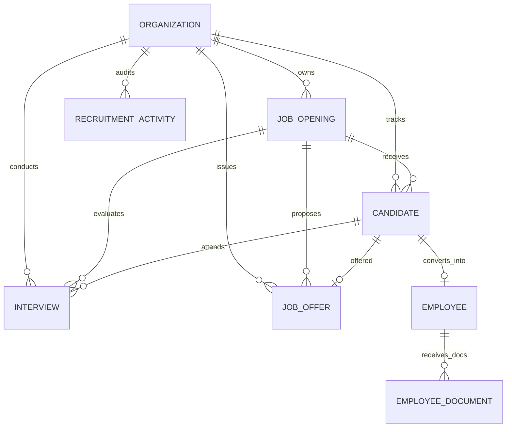
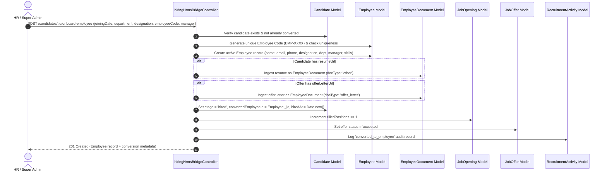
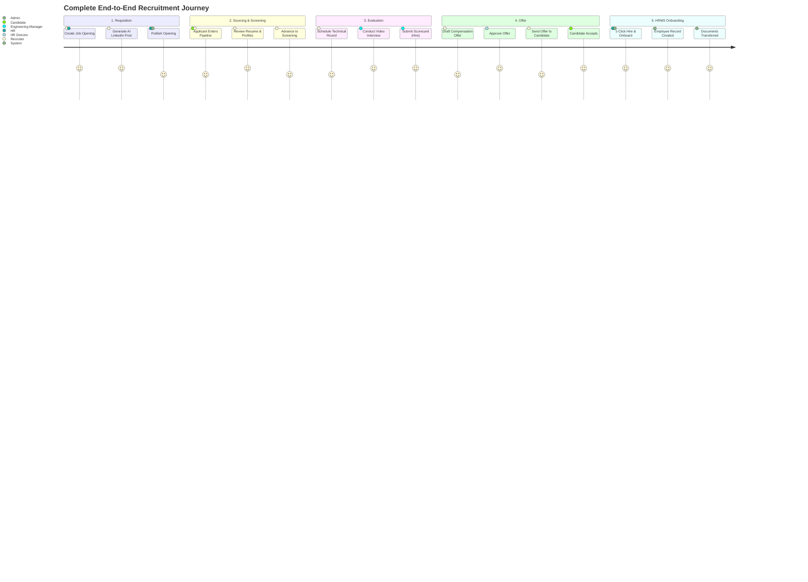

# Nebula HUB — Recruitment (ATS) Module
## Comprehensive Technical & Feature Documentation

---

## 1. Executive Summary & Module Overview

The **Recruitment Module (Applicant Tracking System — ATS)** in **Nebula** serves as the mission-critical bridge connecting external talent acquisition with internal organizational human resources. Built directly into Nebula's multi-tenant business operations ecosystem, the module unifies job requisition, AI-assisted recruitment marketing, candidate lifecycle tracking, panel interview scheduling, competency scorecards, compensation offer management, and 1-click HRMS employee onboarding.

### Key Objectives
1. **End-to-End Talent Lifecycle**: From vacancy requisition and public posting to applicant tracking, structured interviewing, offer negotiation, and onboarding.
2. **Seamless ATS-to-HRMS Bridge**: Eradicates double-entry and manual onboarding by converting hired candidates into active HRMS `Employee` records while carrying over uploaded resumes and offer letters into `EmployeeDocument`.
3. **AI-Powered Recruiter Enablement**: Incorporates Google Gemini 1.5 Flash alongside an intelligent fallback template engine to generate tailored, high-converting LinkedIn job postings across multiple tones.
4. **Structured Decision Making**: Replaces subjective hiring with standardized interview evaluations, multi-parameter competencies (technical, communication, culture fit), and recommendation scorecards.
5. **Strict Multi-Tenancy & Dynamic RBAC**: Enforces complete tenant isolation through `organizationId` query scoping and permission gating (`view`, `create`, `edit`, `delete`, `approve`).

---

## 2. System Architecture & Tech Stack

```
┌────────────────────────────────────────────────────────────────────────────────────────┐
│                                 NEBULA FRONTEND SPA                                    │
│             React 19  │  TypeScript  │  Vite 6  │  Tailwind CSS  │  Framer Motion       │
│             Theme: Nebula Premium Light 2.0 (Brand Orange #f97316, Warm Surface)       │
├────────────────────────────────────────────────────────────────────────────────────────┤
│  Recruitment Dashboard  │  Jobs View  │  ATS Kanban Board  │  Interviews  │  Job Offers │
└─────────────┬───────────────────┬──────────────┬──────────────────┬──────────────┬─────┘
              │                   │              │                  │              │
              ▼                   ▼              ▼                  ▼              ▼
┌────────────────────────────────────────────────────────────────────────────────────────┐
│                        State & Data Layer (TanStack Query v5)                          │
│               recruitmentApi.ts  ──►  useRecruitment.ts  ──►  useModuleAccess          │
└───────────────────────────────────────────┬────────────────────────────────────────────┘
                                            │ Axios HTTP Client (Bearer JWT Token)
                                            ▼
┌────────────────────────────────────────────────────────────────────────────────────────┐
│                                NEBULA BACKEND API                                      │
│                             Node.js + Express.js 4.x                                   │
├────────────────────────────────────────────────────────────────────────────────────────┤
│ Middlewares: requireAuth ──► scopedFilter (Org Scoping) ──► requireModuleAccess('recruitment')│
├────────────────────────────────────────────────────────────────────────────────────────┤
│ Controllers:                                                                           │
│  ├── recruitmentSummaryController.js   (Executive KPIs & Analytics)                    │
│  ├── requisitionController.js          (Manpower Requisitions & Multi-Step Approvals)  │
│  ├── jobOpeningController.js           (Job Openings Lifecycle & Governance)           │
│  ├── pipelineTemplateController.js     (Pipeline Stages, SLAs & Rejection Taxonomy)    │
│  ├── candidateController.js            (Candidate Profiles & Person Dossiers)          │
│  ├── applicationController.js          (Job Applications & Bulk ERP Operations)        │
│  ├── recruitmentPipelineController.js  (Kanban Board & Stage Movements)                │
│  ├── interviewController.js            (Interview Scheduling & Scorecards)             │
│  ├── offerController.js                (Job Offers & Approval Workflow)                │
│  ├── hiringHrmsBridgeController.js     (1-Click ATS-to-HRMS Employee Conversion)       │
│  ├── recruitmentSettingsController.js  (Tenant AI Limits & Headcount Governance)       │
│  └── recruitmentAiController.js        (Gemini 1.5 Flash LinkedIn Post Generator)      │
└───────────────────────────────────────────┬────────────────────────────────────────────┘
                                            │ Mongoose 8.x ODM
                                            ▼
┌────────────────────────────────────────────────────────────────────────────────────────┐
│                                 MONGODB DATABASE                                       │
│  Requisition  │  ApprovalWorkflow  │  PipelineTemplate  │  RejectionReason             │
│  JobOpening   │  Candidate         │  Application       │  Interview                   │
│  JobOffer     │  RecruitmentActivity│ Counter           │  AiRun / Settings            │
│         ▲                                                        │                     │
│         └────────────── HRMS Bridge Cross-Integration ───────────┴─────────────────────┤
│                     ──► Employee & EmployeeDocument Collections                        │
└────────────────────────────────────────────────────────────────────────────────────────┘
```

### Technology Highlights
| Component | Technology | Role |
|---|---|---|
| **Frontend UI** | React 19 + TypeScript | High-performance, type-safe reactive UI components. |
| **Bundler & Build** | Vite 6 | Rapid development HMR and production bundle optimization. |
| **Styling & Theme** | Tailwind CSS + Custom Tokens | Nebula Premium Light 2.0 (`#f97316` brand orange, `#FBF8F4` warm surface). |
| **Micro-Animations** | Framer Motion | Smooth drawer entries, modal reveals, and badge transitions. |
| **State & Caching** | TanStack Query 5 | Optimistic updates, background re-validation, and query caching. |
| **Backend Runtime** | Node.js (v18+) + Express 4 | REST API routing and middleware pipeline. |
| **Database & ODM** | MongoDB 6+ & Mongoose 8 | Multi-tenant schema enforcement, compound indexing, atomic transactions. |
| **AI Integration** | Google Gemini 1.5 Flash API | Generative AI prompt pipeline for marketing copy and talent attraction. |

---

## 3. Database Schema & Data Models

The Recruitment Module introduces five core collections, fully indexed and tenant-scoped by `organizationId`:



### 3.1 `JobOpening` Collection (`JobOpening.js`)
Represents an approved job vacancy within the organization.

| Field | Type | Description |
|---|---|---|
| `organizationId` | `ObjectId` (ref: Organization) | Tenant identifier (indexed). |
| `jobCode` | `String` | Unique uppercase identifier per org (e.g., `JOB-2026-001`). |
| `title` | `String` | Official job designation (e.g., "Senior Backend Engineer"). |
| `departmentId` | `ObjectId` (ref: Department) | Linked HRMS department. |
| `locationType` | `String` (enum) | `remote`, `hybrid`, `on_site`. |
| `location` | `String` | Physical office location or city/region. |
| `employmentType` | `String` (enum) | `full_time`, `part_time`, `contract`, `intern`. |
| `experienceLevel` | `String` (enum) | `entry`, `mid`, `senior`, `lead`, `executive`. |
| `salaryRange` | `Object` | `{ min: Number, max: Number, currency: String, isPublic: Boolean }`. |
| `openPositions` | `Number` | Total vacancy head count (min: 1). |
| `filledPositions`| `Number` | Head count hired and confirmed. |
| `status` | `String` (enum) | `draft`, `published`, `on_hold`, `closed`. |
| `hiringManagerId`| `ObjectId` (ref: User) | Hiring manager responsible for final sign-off. |
| `assignedRecruiters` | `[ObjectId]` (ref: User) | Recruiter user accounts assigned to source/screen candidates. |
| `skills` | `[String]` | Required technical & soft skills (indexed). |
| `requirements` | `[String]` | Bulleted role requirements. |
| `responsibilities` | `[String]` | Daily duties and expectations. |
| `publishedAt` / `closedAt` | `Date` | Timestamp tracking opening and closing dates. |

**Indexes**:
- `{ organizationId: 1, jobCode: 1 }` (Unique)
- `{ organizationId: 1, status: 1 }`
- `{ organizationId: 1, departmentId: 1 }`
- `{ organizationId: 1, createdAt: -1 }`

---

### 3.2 `Candidate` Collection (`Candidate.js`)
Represents an applicant linked to a job opening and tracked through the ATS stages.

| Field | Type | Description |
|---|---|---|
| `organizationId` | `ObjectId` (ref: Organization) | Tenant identifier (indexed). |
| `candidateCode` | `String` | Unique code (e.g., `CAND-2026-0004`). |
| `jobOpeningId` | `ObjectId` (ref: JobOpening) | Role applied for (indexed). |
| `fullName` | `String` | Full legal name of the candidate. |
| `email` | `String` | Email address (lowercase, trimmed). |
| `phone` | `String` | Contact phone number. |
| `currentCompany` | `String` | Current employer or "Self-Employed". |
| `currentDesignation` | `String` | Current title (e.g., "Software Engineer"). |
| `totalExperienceYears` | `Number` | Total years of relevant industry experience. |
| `portfolioUrl` | `String` | Personal portfolio or personal site URL. |
| `linkedinUrl` | `String` | LinkedIn profile link. |
| `githubUrl` | `String` | GitHub or code repository link. |
| `resumeUrl` | `String` | Cloud storage or hosted resume link. |
| `resumeFileName` | `String` | Original uploaded resume filename. |
| `skills` | `[String]` | Candidate's skill tags. |
| `expectedSalary` | `Number` | Target annual compensation. |
| `noticePeriodDays` | `Number` | Notice period in days (default: 30). |
| `source` | `String` (enum) | `careers_page`, `linkedin`, `referral`, `recruiter_outreach`, `job_portal`, `agency`, `other`. |
| `referredBy` | `ObjectId` (ref: Employee) | Internal employee who provided the referral. |
| `stage` | `String` (enum) | Current stage in the ATS pipeline (see Section 4.4). |
| `rating` | `Number` | Average scorecard rating (1 to 5 stars, auto-updated). |
| `tags` | `[String]` | Custom tags (e.g., "Top Performer", "Ex-FAANG", "Immediate Joiner"). |
| `stageHistory` | `[Subdocument]` | Full audit history of stage transitions with timestamps & notes. |
| `convertedEmployeeId` | `ObjectId` (ref: Employee) | Linked HRMS Employee record once hired. |
| `hiredAt` | `Date` | Timestamp of conversion to an employee. |

**Indexes**:
- `{ organizationId: 1, candidateCode: 1 }` (Unique)
- `{ organizationId: 1, jobOpeningId: 1, stage: 1 }`
- `{ organizationId: 1, email: 1 }`
- `{ organizationId: 1, createdAt: -1 }`

---

### 3.3 `Interview` Collection (`Interview.js`)
Manages scheduled evaluations, round details, panel assignments, and scorecards.

| Field | Type | Description |
|---|---|---|
| `organizationId` | `ObjectId` (ref: Organization) | Tenant identifier (indexed). |
| `candidateId` | `ObjectId` (ref: Candidate) | Candidate being interviewed (indexed). |
| `jobOpeningId` | `ObjectId` (ref: JobOpening) | Associated role. |
| `title` | `String` | Round title (e.g., "Round 1: DSA & System Architecture"). |
| `roundType` | `String` (enum) | `screening`, `technical`, `behavioral`, `managerial`, `culture_fit`, `final`. |
| `interviewers` | `[ObjectId]` (ref: User) | Array of panel interviewers assigned from the organization. |
| `scheduledStart` / `scheduledEnd` | `Date` | Scheduled time boundaries (indexed). |
| `timezone` | `String` | Timezone of meeting (default: `Asia/Kolkata`). |
| `meetingLink` | `String` | Virtual link (Google Meet, Zoom, MS Teams). |
| `location` | `String` | Physical conference room if on-site. |
| `status` | `String` (enum) | `scheduled`, `completed`, `rescheduled`, `cancelled`, `no_show`. |
| `scorecard` | `Subdocument` | Structured evaluation: `rating` (1-5), `decision`, `technicalSkillScore`, `communicationScore`, `cultureFitScore`, `notes`, `submittedBy`, `submittedAt`. |
| `cancellationReason` | `String` | Reason logged if cancelled. |

**Indexes**:
- `{ organizationId: 1, candidateId: 1 }`
- `{ organizationId: 1, scheduledStart: 1 }`
- `{ organizationId: 1, status: 1 }`

---

### 3.4 `JobOffer` Collection (`JobOffer.js`)
Tracks extended compensation packages, approvals, validity, and acceptance.

| Field | Type | Description |
|---|---|---|
| `organizationId` | `ObjectId` (ref: Organization) | Tenant identifier (indexed). |
| `offerCode` | `String` | Unique identifier (e.g., `OFF-2026-003`). |
| `candidateId` | `ObjectId` (ref: Candidate) | Candidate receiving the offer. |
| `jobOpeningId` | `ObjectId` (ref: JobOpening) | Vacancy linked to this offer. |
| `designation` | `String` | Official job title proposed. |
| `departmentId` | `ObjectId` (ref: Department) | Target HRMS department. |
| `offeredSalary` | `Number` | Fixed gross annual compensation. |
| `currency` | `String` | Currency code (e.g., `USD`, `INR`, `EUR`). |
| `joiningDate` | `Date` | Expected official reporting date. |
| `validUntil` | `Date` | Expiration date of the offer proposal. |
| `status` | `String` (enum) | `draft`, `pending_approval`, `approved`, `sent`, `accepted`, `declined`, `revoked`. |
| `benefits` | `[String]` | Health coverage, equity/ESOPs, bonus, etc. |
| `notes` | `String` | Special clauses or recruiter notes. |
| `offerLetterUrl` | `String` | Uploaded or generated signed offer letter PDF. |
| `approvedBy` | `ObjectId` (ref: User) | Approver user reference. |
| `sentAt` / `respondedAt` | `Date` | Timestamps for communication and decision. |

**Indexes**:
- `{ organizationId: 1, offerCode: 1 }` (Unique)
- `{ organizationId: 1, candidateId: 1 }`
- `{ organizationId: 1, status: 1 }`

---

### 3.5 `RecruitmentActivity` Collection (`RecruitmentActivity.js`)
Immutable audit trail capturing all events across the recruitment lifecycle.

| Field | Type | Description |
|---|---|---|
| `organizationId` | `ObjectId` (ref: Organization) | Tenant identifier (indexed). |
| `candidateId` | `ObjectId` (ref: Candidate) | Related candidate (if applicable). |
| `jobOpeningId` | `ObjectId` (ref: JobOpening) | Related job opening (if applicable). |
| `type` | `String` (enum) | `stage_change`, `interview_scheduled`, `feedback_submitted`, `offer_created`, `offer_status_change`, `note_added`, `converted_to_employee`. |
| `title` | `String` | Short human-readable summary of the action. |
| `description` | `String` | Detailed description with context. |
| `performedBy` | `ObjectId` (ref: User) | User who executed the action. |
| `metadata` | `Mixed` | JSON context (e.g., `{ fromStage, toStage }`, `{ offerCode, salary }`). |

**Indexes**:
- `{ organizationId: 1, candidateId: 1, createdAt: -1 }`
- `{ organizationId: 1, jobOpeningId: 1, createdAt: -1 }`

---

## 4. Thorough Feature-by-Feature Breakdown

```
┌────────────────────────────────────────────────────────────────────────────────────────┐
│                        RECRUITMENT MODULE FEATURE MATRIX                               │
├──────────────────────────────┬──────────────────────────────┬──────────────────────────┤
│ 1. Executive Hub & KPIs      │ 2. Job Openings Lifecycle    │ 3. Gemini AI Marketing   │
│    • Real-time metrics       │    • Requisitions & Bands    │    • LinkedIn Generator  │
│    • Pipeline Funnel         │    • Team assignments        │    • Dynamic/Tech tones  │
├──────────────────────────────┼──────────────────────────────┼──────────────────────────┤
│ 4. ATS Kanban Pipeline       │ 5. Candidate Dossier Drawer  │ 6. Interview Scheduling  │
│    • 10-stage state machine  │    • 4-tab 360° profile      │    • Panel coordination  │
│    • Real-time drag/drop     │    • Resume & Links preview  │    • Calendar & Links    │
├──────────────────────────────┼──────────────────────────────┼──────────────────────────┤
│ 7. Structured Scorecards     │ 8. Offer Lifecycle           │ 9. 1-Click HRMS Bridge   │
│    • 5-star competency scale │    • Compensation packages   │    • Employee creation   │
│    • Cumulative avg rating   │    • Formal approval gating  │    • Document migration  │
└──────────────────────────────┴──────────────────────────────┴──────────────────────────┘
```

---

### Feature 1: Recruitment Hub Dashboard & Executive Analytics
**Path**: `/dashboard/recruitment`  
**File**: `Frontend/src/pages/recruitment/RecruitmentDashboardPage.tsx`  
**Controller**: `Backend/src/controllers/recruitmentSummaryController.js`

#### Description & Capabilities:
The Recruitment Hub acts as the command center for hiring managers, talent acquisition leads, and HR directors. It aggregates organization-wide metrics into actionable insights:

1. **Executive KPI Cards**:
   - **Active Openings**: Real-time count of roles in `published` status with direct link to vacancy management.
   - **In Pipeline**: Total active applicants currently undergoing evaluation (excluding `rejected` and `withdrawn`).
   - **Interviews This Week**: Total sessions scheduled between Monday 00:00 and Sunday 23:59.
   - **Pending Offers**: Offers awaiting executive sign-off (`pending_approval`) or candidate response (`sent`).
   - **Hired This Month**: Successful hires onboarding in the current calendar month.

2. **Talent Pipeline Funnel**:
   - Visual distribution bar chart summarizing candidate volume across all 10 stages.
   - Highlights conversion bottlenecks (e.g., large volume stuck at `screening` or drop-off at `technical_assessment`).

3. **Upcoming Interview Roster**:
   - Real-time widget querying interviews scheduled in the next 7 days.
   - Displays candidate name, job code, round type pill, scheduled time, and a 1-click meeting launcher for Google Meet / Zoom.

4. **Active Jobs Snapshot**:
   - Top active requisitions with interactive progress bars (`filledPositions` vs `openPositions`), department tags, and applicant counts.

5. **Live Audit Activity Stream**:
   - Real-time chronological timeline showing the last 10 recruitment actions with user attributions, time ago stamps, and context badges.

---

### Feature 2: Job Openings & Vacancy Lifecycle Management
**Path**: `/dashboard/recruitment/jobs`  
**Files**: `Frontend/src/pages/recruitment/JobsPage.tsx`, `Frontend/src/components/recruitment/CreateJobModal.tsx`  
**Controller**: `Backend/src/controllers/jobOpeningController.js`

#### Description & Capabilities:
Enables organizations to formalize, approve, and track headcount needs across departments:

1. **Structured Requisition Metadata**:
   - Auto-generated uppercase unique identifier: `JOB-YYYY-XXX`.
   - Title, Department linkage, and Employment Type (`full_time`, `part_time`, `contract`, `intern`).
   - Location Type (`remote`, `hybrid`, `on_site`) with specific office/city naming.
   - Experience Level (`entry`, `mid`, `senior`, `lead`, `executive`).

2. **Salary Banding & Transparency**:
   - Minimum and Maximum compensation with customizable currency (`USD`, `INR`, `EUR`, `GBP`).
   - `isPublic` visibility toggle allowing internal-only or public job board posting.

3. **Hiring Team Delegation**:
   - Assign a designated **Hiring Manager** for final decision making.
   - Assign multiple **Recruiters** who receive candidate notifications and pipeline management rights.

4. **Competency Definition**:
   - Tag-based required skills input.
   - Bulleted list of responsibilities and qualifications.

5. **Vacancy State Machine**:
   - `draft` ➔ `published` ➔ `on_hold` ➔ `closed`.
   - Auto-stamping of `publishedAt` and `closedAt` dates.
   - Real-time head count tracker: tracks `openPositions` vs `filledPositions`. Automatically suggests closure once all positions are filled.

---

### Feature 3: AI-Powered Talent Marketing & LinkedIn Post Generator
**Modal**: `Frontend/src/components/recruitment/LinkedInPostModal.tsx`  
**Controller**: `Backend/src/controllers/recruitmentAiController.js`

#### Description & Capabilities:
Attracting top-tier talent requires persuasive recruitment marketing. Nebula integrates Google Gemini 1.5 Flash directly into every job opening to eliminate recruiter writer's block:

1. **Dual Engine Architecture**:
   - **Primary Engine**: Google Gemini 1.5 Flash API via REST (`generativelanguage.googleapis.com`). Generates context-rich copy utilizing job title, department, salary bands, tech stack, and company name.
   - **Intelligent Fallback Engine**: If an API key is unconfigured or rate-limited, the system falls back to a deterministic, high-conversion template engine ensuring 100% feature uptime.

2. **Tone Presets**:
   - **Dynamic / Startup**: High-energy, mission-focused, scroll-stopping hooks with modern emojis and growth-oriented messaging.
   - **Engineering / Tech-Focused**: Deep technical framing emphasizing modern cloud architectures, code craftsmanship, tech stack specifics, and autonomy.
   - **Corporate / Professional**: Polished, executive tone tailored for senior managerial, compliance, and enterprise roles.

3. **Recruiter Controls**:
   - Custom notes input allowing recruiters to inject specific perks (e.g., "$3,000 WFH setup budget", "Equity grants", "Immediate joiners preferred").
   - 1-click **Copy to Clipboard** with visual toast notification.
   - Auto-generated trending industry hashtags based on the job title and department.

---

### Feature 4: Interactive ATS Kanban Pipeline Board
**Path**: `/dashboard/recruitment/pipeline`  
**Files**: `Frontend/src/pages/recruitment/PipelinePage.tsx`, `Frontend/src/components/recruitment/RecruitmentKanban.tsx`  
**Controller**: `Backend/src/controllers/recruitmentPipelineController.js`

#### Description & Capabilities:
A visual, drag-and-drop applicant tracking board supporting high-volume hiring with instant clarity:

1. **Standardized 10-Stage Pipeline Lifecycle**:
   ```
   [1. Applied] ──► [2. Screening] ──► [3. Interview R1] ──► [4. Interview R2]
                                                                    │
   [8. Hired]   ◄── [7. Offer Sent] ◄── [6. HR Round]   ◄── [5. Technical Assessment]
        │
   [Rejected / Withdrawn (Terminal States)]
   ```

2. **Interactive Kanban Interface**:
   - Responsive horizontal scrolling columns for each stage with real-time candidate counters.
   - Quick search filter by candidate name, code, email, company, and skills.
   - Dropdown filter by specific `JobOpening` to view role-specific funnels.
   - Quick Add Candidate trigger directly from the board header.

3. **Candidate Cards**:
   - Candidate initials badge, full name, code, and linked role title.
   - Current company and years of experience badge.
   - Average scorecard rating (with star icon).
   - Skills pills with overflow indicator.
   - Quick stage advancement buttons allowing moving to next or previous stage without opening full dossier.
   - 1-click click-through to launch the 360° Candidate Drawer.

---

### Feature 5: Candidate Dossier & 360° Profile (Candidate Drawer)
**Component**: `Frontend/src/components/recruitment/CandidateDrawer.tsx`  
**Controller**: `Backend/src/controllers/candidateController.js`

#### Description & Capabilities:
Clicking any candidate opens a smooth slide-out drawer containing a comprehensive 4-tab dossier:

1. **Tab 1: Candidate Details**:
   - **Contact & Meta**: Email, phone, candidate code, linked job vacancy.
   - **Career Info**: Current employer, current designation, total experience, expected compensation, notice period.
   - **Online Profiles**: Verified external links with badges for **LinkedIn**, **GitHub**, and **Portfolio**.
   - **Resume Viewer**: Direct download and preview link for uploaded CV files (`resumeUrl`).
   - **Source Attribution**: Tracks whether candidate arrived via Careers Page, LinkedIn, Referral, Outreach, or Agency. If referred, links to the internal `Employee`.
   - **Stage Selector**: Dropdown to transition the candidate to any stage with optional transition note.

2. **Tab 2: Interviews Roster**:
   - Comprehensive history of all past and upcoming interview rounds.
   - Details round type, assigned interviewers, scheduled dates, and meeting links.
   - Displays evaluation scorecards with star ratings and reviewer comments.
   - Direct shortcut button to **Schedule Next Round**.

3. **Tab 3: Compensation & Offer**:
   - Summarizes active job offer (salary, designation, department, validity, benefits).
   - Current offer status pill (`draft`, `pending_approval`, `approved`, `sent`, `accepted`).
   - Direct shortcut to **Generate Job Offer** or review signed offer letter.

4. **Tab 4: Immutable Activity Timeline**:
   - Complete audit trail of every interaction, note, stage change, and evaluation timestamped to the minute with user attribution.

---

### Feature 6: Multi-Round Interview Coordination & Scheduling
**Path**: `/dashboard/recruitment/interviews`  
**Files**: `Frontend/src/pages/recruitment/InterviewsPage.tsx`, `Frontend/src/components/recruitment/ScheduleInterviewModal.tsx`  
**Controller**: `Backend/src/controllers/interviewController.js`

#### Description & Capabilities:
Coordinates panels, eliminates scheduling conflicts, and tracks interview statuses:

1. **Round Taxonomy**:
   - `screening`: Initial HR recruiter phone or video screen.
   - `technical`: Coding, algorithmic, or domain-specific deep dive.
   - `behavioral`: Competency and past performance review.
   - `managerial`: Hiring manager alignment and scope expectation.
   - `culture_fit`: Team compatibility and core values evaluation.
   - `final`: Executive sign-off round.

2. **Scheduling Parameters**:
   - Date and time pickers with duration calculation (`scheduledStart`, `scheduledEnd`).
   - Timezone specification (defaults to organization timezone `Asia/Kolkata`).
   - Multi-user panel selection from organization users.
   - Video meeting link input (supports Google Meet, Zoom, MS Teams) or physical conference room selection.

3. **Status Workflow**:
   - `scheduled` ➔ `completed` (upon scorecard submission) ➔ `rescheduled` ➔ `cancelled` / `no_show`.
   - Upcoming interview reminder banner highlighting meetings starting within 2 hours.

---

### Feature 7: Structured Interview Scorecards & Rating Engine
**Component**: `Frontend/src/components/recruitment/ScorecardModal.tsx`  
**Controller**: `Backend/src/controllers/interviewController.js` (`submitScorecard`)

#### Description & Capabilities:
Prevents biased or disorganized hiring by enforcing standardized scorecard evaluations:

1. **Competency Rating Parameters (1 to 5 Stars)**:
   - **Technical Skill**: Evaluates code quality, architectural depth, and problem solving.
   - **Communication**: Evaluates clarity, articulation, listening, and collaboration.
   - **Culture Fit**: Evaluates values alignment, ownership mindset, and attitude.
   - **Overall Score**: Summary rating across the evaluation.

2. **Structured Recommendation Decisions**:
   - `strong_hire`: Exceptional candidate; exceeds bar.
   - `hire`: Qualified candidate; meets all core requirements.
   - `neutral`: Mixed signals; requires additional review or consensus.
   - `do_not_hire`: Does not meet bar for this position.
   - `strong_do_not_hire`: Clear red flags or severe competency gap.

3. **Automated Mathematical Candidate Rating**:
   - Upon submitting a scorecard, the backend automatically queries all completed interviews for that candidate, computes the arithmetic mean of overall ratings, and updates `Candidate.rating` rounded to one decimal place.
   - Automatically marks the interview status as `completed`.
   - Logs an audit event in `RecruitmentActivity`.

---

### Feature 8: Job Offers & Compensation Lifecycle Management
**Path**: `/dashboard/recruitment/offers`  
**Files**: `Frontend/src/pages/recruitment/OffersPage.tsx`, `Frontend/src/components/recruitment/CreateOfferModal.tsx`  
**Controller**: `Backend/src/controllers/offerController.js`

#### Description & Capabilities:
Manages formal compensation proposals, approval gates, and candidate responses:

1. **Offer Package Construction**:
   - Unique uppercase code: `OFF-YYYY-XXX`.
   - Offered annual compensation + currency selector.
   - Target designation and department assignment.
   - Expected joining date and proposal validity expiration date.
   - Bulleted list of benefits (Health insurance, ESOPs, Performance bonus, Relocation allowance).
   - Uploaded or linked signed offer letter document URL (`offerLetterUrl`).

2. **Formal Approval State Machine**:
   ```
   [Draft] ──► [Pending Approval] ──► [Approved] ──► [Offer Sent] ──► [Accepted]
                                             │              │
                                             └──► [Revoked] └──► [Declined]
   ```

3. **Approval Gating**:
   - Restricted to users with `recruitment:approve` permission (typically HR directors or Super Admins).
   - Approver reference (`approvedBy`) and timestamps (`sentAt`, `respondedAt`) recorded.
   - When an offer is marked as `accepted`, the candidate's stage is verified and prepared for HRMS onboarding.

---

### Feature 9: 1-Click "Hire & Onboard" HRMS Bridge (Zero Data Re-Entry)
**Modal**: `Frontend/src/components/recruitment/OnboardEmployeeModal.tsx`  
**Controller**: `Backend/src/controllers/hiringHrmsBridgeController.js`

#### Description & Capabilities:
The crowning feature of Nebula's Recruitment module: seamless, atomic conversion of a hired candidate into an active HRMS `Employee` record in a single transaction.



1. **Automatic Data Mapping**:
   - Full Name, Email, Phone carried over from `Candidate`.
   - Final Department, Designation, and Joining Date defaulted from accepted `JobOffer` or `JobOpening`.
   - Manager assignment links the new employee into the organization's reporting tree.
   - Verified candidate skills mapped into `Employee.skills`.

2. **Unique Employee Code Assignment**:
   - System automatically queries the latest employee count and proposes sequential code `EMP-XXXX` (e.g., `EMP-0012`). Recruiter can override with a custom code if organizational numbering mandates it.

3. **Automatic Document Migration**:
   - If candidate uploaded a resume (`resumeUrl`), an `EmployeeDocument` record is created under the new employee with `docType: 'other'`.
   - If a signed offer letter was attached (`offerLetterUrl`), an `EmployeeDocument` record is created with `docType: 'offer_letter'`.

4. **Multi-Record Synchronization**:
   - `Candidate.stage` ➔ locked to `hired`.
   - `Candidate.convertedEmployeeId` ➔ references new `Employee._id`.
   - `JobOpening.filledPositions` ➔ incremented by 1.
   - `JobOffer.status` ➔ marked as `accepted`.
   - `RecruitmentActivity` ➔ logs the onboarding event.

---

### Feature 10: Immutable Audit Logging & Activity Stream
**Controller**: `Backend/src/controllers/recruitmentSummaryController.js`  
**Model**: `Backend/src/models/RecruitmentActivity.js`

#### Description & Capabilities:
Guarantees full accountability across the recruitment pipeline:
- Every stage move, interview schedule, scorecard submission, offer creation, offer status update, and HRMS conversion generates an immutable activity document.
- Captures:
  - Actor (`performedBy` populating name, email, and role).
  - Target Candidate and Job Opening.
  - Event type and human-readable description.
  - Detailed metadata object (old stage vs new stage, offered salary, scorecard ratings).
- Surfaceable in the Recruitment Hub and the Candidate Drawer activity tab.

---

## 5. Complete REST API Specification

All routes are mounted at `/api/v1/recruitment` and require a valid Bearer JWT (`requireAuth`) plus permission check (`requireModuleAccess('recruitment', action)`).

| HTTP Method | Route Endpoint | Permission Required | Controller Function | Description |
|---|---|---|---|---|
| `GET` | `/api/v1/recruitment/summary` | `view` | `getRecruitmentSummary` | Retrieves KPI metrics, stage distribution counts, upcoming interviews, top active jobs, and recent activities. |
| `GET` | `/api/v1/recruitment/jobs` | `view` | `jobOpeningController.getJobs` | Lists job openings with filters (`status`, `departmentId`, `search`). |
| `POST` | `/api/v1/recruitment/jobs` | `create` | `jobOpeningController.createJob` | Creates a new job opening with auto-generated job code. |
| `GET` | `/api/v1/recruitment/jobs/:id` | `view` | `jobOpeningController.getJobById` | Retrieves job details, department info, and hiring team. |
| `PATCH` | `/api/v1/recruitment/jobs/:id` | `edit` | `jobOpeningController.updateJob` | Updates job fields, salary bands, requirements, and hiring team. |
| `PATCH` | `/api/v1/recruitment/jobs/:id/status` | `edit` | `jobOpeningController.updateJobStatus` | Updates status (`draft`, `published`, `on_hold`, `closed`). |
| `DELETE` | `/api/v1/recruitment/jobs/:id` | `delete` | `jobOpeningController.deleteJob` | Deletes a job opening (prevented if candidates are linked). |
| `POST` | `/api/v1/recruitment/jobs/:id/linkedin-post` | `view` | `recruitmentAiController.generateLinkedInPost` | Generates AI-optimized LinkedIn job post using Gemini 1.5 Flash. |
| `GET` | `/api/v1/recruitment/pipeline` | `view` | `recruitmentPipelineController.getRecruitmentPipeline` | Returns candidates grouped by 10 pipeline stages for Kanban board. |
| `PATCH` | `/api/v1/recruitment/candidates/:id/stage` | `edit` | `recruitmentPipelineController.moveCandidateStage` | Moves candidate to new stage and logs stage history and activity. |
| `GET` | `/api/v1/recruitment/candidates` | `view` | `candidateController.getCandidates` | Lists candidates with search, stage, rating, source, and job filters. |
| `POST` | `/api/v1/recruitment/candidates` | `create` | `candidateController.createCandidate` | Creates a candidate with auto-generated candidate code. |
| `GET` | `/api/v1/recruitment/candidates/:id` | `view` | `candidateController.getCandidateById` | Retrieves candidate dossier with populated interviews, offers, and history. |
| `PATCH` | `/api/v1/recruitment/candidates/:id` | `edit` | `candidateController.updateCandidate` | Updates candidate details, contact info, notes, and skills. |
| `DELETE` | `/api/v1/recruitment/candidates/:id` | `delete` | `candidateController.deleteCandidate` | Deletes candidate and cleans up linked interviews and offers. |
| `GET` | `/api/v1/recruitment/interviews` | `view` | `interviewController.getInterviews` | Lists interviews filtered by status, candidate, or upcoming flag. |
| `POST` | `/api/v1/recruitment/interviews` | `create` | `interviewController.scheduleInterview` | Schedules interview round, assigns panel, and sets meeting link. |
| `PATCH` | `/api/v1/recruitment/interviews/:id` | `edit` | `interviewController.updateInterview` | Reschedules interview, modifies panel, or updates meeting link. |
| `POST` | `/api/v1/recruitment/interviews/:id/scorecard` | `edit` | `interviewController.submitScorecard` | Submits competency evaluation, computes new candidate rating avg. |
| `DELETE` | `/api/v1/recruitment/interviews/:id` | `delete` | `interviewController.cancelInterview` | Cancels scheduled interview with logged cancellation reason. |
| `GET` | `/api/v1/recruitment/offers` | `view` | `offerController.getOffers` | Lists job offers filtered by status, candidate, or job. |
| `POST` | `/api/v1/recruitment/offers` | `create` | `offerController.createOffer` | Creates formal job offer proposal with unique offer code. |
| `PATCH` | `/api/v1/recruitment/offers/:id/status` | `approve` | `offerController.updateOfferStatus` | Approves, sends, revokes, or logs candidate acceptance of offer. |
| `POST` | `/api/v1/recruitment/candidates/:id/onboard-employee` | `approve` | `hiringHrmsBridgeController.onboardCandidateToEmployee` | 1-Click conversion of hired candidate to active HRMS employee. |

---

## 6. Frontend Architecture & Component Directory

The Frontend recruitment module is organized cleanly in `Frontend/src/`:

```
Frontend/src/
├── pages/recruitment/
│   ├── RecruitmentDashboardPage.tsx   // Executive KPI hub, charts, upcoming roster
│   ├── JobsPage.tsx                   // Job vacancy management & filters
│   ├── PipelinePage.tsx               // Interactive 10-stage ATS Kanban board
│   ├── CandidatesPage.tsx             // Candidates list, search, and table view
│   ├── InterviewsPage.tsx             // Interview coordination & calendar roster
│   └── OffersPage.tsx                 // Compensation offers & approval workflow
│
├── components/recruitment/
│   ├── CandidateDrawer.tsx            // 4-tab 360° candidate sliding dossier
│   ├── CandidateStagePill.tsx         // Color-coded stage badge component
│   ├── JobStatusPill.tsx              // Color-coded job status badge component
│   ├── RecruitmentKanban.tsx          // Drag-and-drop Kanban stage columns
│   ├── CreateJobModal.tsx             // Job creation wizard modal
│   ├── AddCandidateModal.tsx          // Candidate creation modal
│   ├── ScheduleInterviewModal.tsx     // Multi-round panel scheduling modal
│   ├── ScorecardModal.tsx             // Standardized 5-star evaluation modal
│   ├── CreateOfferModal.tsx           // Compensation package creation modal
│   ├── OnboardEmployeeModal.tsx       // 1-Click HRMS Employee Onboarding bridge
│   └── LinkedInPostModal.tsx          // Gemini AI LinkedIn post copy generator
│
├── hooks/
│   └── useRecruitment.ts              // TanStack Query hooks (useJobs, useCandidates, etc.)
│
├── lib/
│   └── recruitmentApi.ts              // Axios HTTP client service methods
│
└── types/
    └── recruitment.ts                 // Full TypeScript domain interfaces & constants
```

---

## 7. Role-Based Access Control (RBAC) Matrix

Nebula applies dynamic, tenant-configurable role-based permissions stored in the `Permission` collection. The standard permissions for the Recruitment module are:

| System Role | `view` | `create` | `edit` | `delete` | `approve` | Typical Responsibilities |
|---|:---:|:---:|:---:|:---:|:---:|---|
| **`super_admin`** | ✅ | ✅ | ✅ | ✅ | ✅ | Full bypass; complete administrative governance across all modules. |
| **`admin`** | ✅ | ✅ | ✅ | ✅ | ✅ | Full talent acquisition management; creates jobs, approves offers, onboards employees. |
| **`hr`** | ✅ | ✅ | ✅ | ✅ | ✅ | Lead recruiter and HR operations; manages openings, coordinates panels, approves offers, onboards. |
| **`recruiter`** | ✅ | ✅ | ✅ | ❌ | ❌ | Sourcing & applicant evaluation; posts jobs, manages Kanban, schedules interviews, drafts offers. |
| **`manager`** | ✅ | ✅ | ✅ | ❌ | ❌ | Hiring managers; reviews candidates for their department, submits interview scorecards. |
| **`employee`** | ✅ | ❌ | ❌* | ❌ | ❌ | Panel interviewers; can view assigned candidates and submit scorecards (*gated via interview panel). |
| **`sales` / `finance`** | ❌ | ❌ | ❌ | ❌ | ❌ | No access unless explicitly granted in organization permission matrix. |

---

## 8. Multi-Tenancy & Security Guarantees

1. **Automatic Tenant Scoping via `scopedFilter`**:
   Every database query in every controller passes through `scopedFilter(req, query)`, which automatically injects `{ organizationId: req.organizationId }`. It is architecturally impossible for Tenant A to query, modify, or delete Tenant B's candidates, openings, or offers.

2. **Sequential Unique Numbering Scoped per Organization**:
   All auto-generated codes (`JOB-YYYY-XXX`, `CAND-YYYY-XXX`, `OFF-YYYY-XXX`, `EMP-XXXX`) are calculated using `countDocuments({ organizationId: req.organizationId })`. Each organization maintains independent numbering sequences without collisions.

3. **In-Memory JWT Access Token Storage**:
   Authentication tokens are kept exclusively in client-side memory to protect against XSS attacks, while refresh tokens are hashed with bcrypt on the server and rotated on every session restoration.

4. **Input Sanitization & Regex Escaping**:
   Candidate and job search endpoints employ `escapeRegex` utility sanitization to prevent ReDoS (Regular Expression Denial of Service) and NoSQL injection attacks.

---

## 9. End-to-End User Flow Walkthrough



1. **Job Requisition**: A hiring manager identifies a vacancy for a "Senior Frontend Engineer". HR creates the job opening (`JOB-2026-004`) in `draft` mode with salary bands and skills.
2. **AI Recruiter Copy**: The recruiter opens the **LinkedIn Post Modal**, selects the `dynamic` tone, and clicks "Generate with Gemini AI". Within 2 seconds, an engaging post with emojis and hashtags is generated and copied to LinkedIn. The job is marked as `published`.
3. **Candidate Entry**: Applicants apply or are added by recruiters (`CAND-2026-0012`). Their resume, GitHub, and portfolio links are saved.
4. **Pipeline Progression**: The recruiter drags the candidate from `applied` to `screening` on the ATS Kanban board.
5. **Interview Scheduling**: The recruiter launches the **Schedule Interview Modal**, sets "Round 1: Architecture Deep Dive", assigns two senior engineers, specifies tomorrow at 2:00 PM, and pastes a Google Meet link.
6. **Scorecard Submission**: Following the interview, the interviewer clicks **Submit Scorecard**, rates technical skills (5/5), communication (4/5), culture fit (5/5), selects `hire`, and notes strong domain knowledge. The candidate's cumulative rating updates to 4.7 stars.
7. **Offer Proposal**: HR drafts an offer (`OFF-2026-002`) with $145,000 annual compensation, full healthcare, and equity. The HR Director reviews and approves it. The offer is sent to the candidate, who signs and accepts it.
8. **1-Click HRMS Onboard**: In the Offers page, HR clicks **Onboard to HRMS**. The modal validates the details, confirms employee code `EMP-0014`, and clicks **Confirm Onboarding**.
9. **Outcome**: An active `Employee` record is created, the candidate's resume and signed offer letter are transferred into `EmployeeDocument`, the candidate is marked as `hired`, the job's `filledPositions` increments, and a celebratory audit log is recorded.

---

## 10. Summary & Value Realization

The Nebula Recruitment (ATS) Module provides a modern, enterprise-grade talent acquisition pipeline engineered with:
- **Zero data duplication**: Candidates cleanly become employees without tedious manual re-entry.
- **Enterprise-grade security**: True multi-tenant isolation, structured RBAC, and sanitized inputs.
- **AI-accelerated sourcing**: Google Gemini 1.5 Flash natively generates social recruiting copy.
- **Objective, structured evaluations**: Multi-competency 5-star scorecards eliminate gut-feeling hiring.
- **Delightful user experience**: Designed with Nebula's Premium Light 2.0 aesthetics, responsive layouts, micro-animations, and instant feedback.
