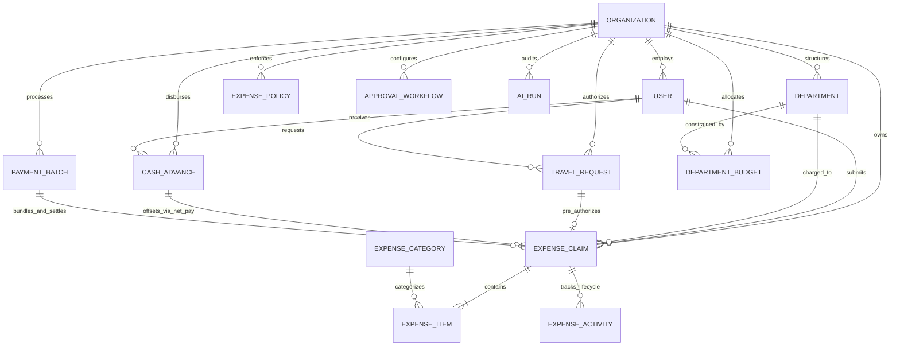

# Nebula Expenses ERP: Backend Architecture, APIs & Data Models

---

## 1. System Architecture Overview

The **Nebula Expenses ERP Engine** is built as an enterprise-grade financial core on Node.js and Express.js with MongoDB/Mongoose. Designed to meet compliance requirements of Fortune 500 ERPs (SAP, Oracle NetSuite, Workday), it governs corporate spending, multi-tiered approvals, pre-trip travel reservations, cash advances, bank disbursements, and AI-assisted financial auditing.

```
┌────────────────────────────────────────────────────────────────────────────────────────┐
│                                NEBULA BACKEND API CORE                                 │
│                               Node.js v18+  │  Express 4.x                             │
├────────────────────────────────────────────────────────────────────────────────────────┤
│ Middlewares: requireAuth ──► scopedFilter (Org Isolation) ──► requireModuleAccess     │
│ Rate Limiters: aiScanRateLimiter  │  copilotRateLimiter  │  paymentExecutionRateLimiter│
├────────────────────────────────────────────────────────────────────────────────────────┤
│ Micro-Services Layer:                                                                  │
│  ├── policyEngineService.js        (Rule Evaluation: Per-Item, Receipt, Weekend, Dups)│
│  ├── approvalWorkflowService.js    (Matrix Routing, Anti-Self-Approval, Delegations)   │
│  ├── receiptService.js             (SHA-256 Binary Hash & Cross-Claim Deduplication)   │
│  ├── mileageService.js             (Vehicle Rate Cards & Unit-Normalized Calculations) │
│  ├── perDiemService.js             (Destination Tiers & Statutory Meal Deductions)    │
│  ├── fxService.js                  (Multi-Currency FX Rates & 2-Decimal Normalization) │
│  ├── travelRequestService.js       (Pre-Trip Authorizations & Budget Pre-Commitments)  │
│  ├── cashAdvanceService.js         (Pre-Funding Disbursements & Net-Pay Settlement)    │
│  ├── paymentBatchService.js        (Claim Locking & Atomic Multi-Claim Settlement)     │
│  ├── erpExportService.js           (Bank CSV & Balanced Double-Entry GL Journal CSV)   │
│  ├── anomalyDetectionService.js    (Split Transactions, Weekend Spikes, Round Figures) │
│  ├── approverAssistantService.js   (Executive Review Briefs & One-Click Draft Notes)   │
│  ├── budgetForecastService.js      (Linear Burn Velocity & Proactive Breach Forecast)  │
│  ├── spendCopilotService.js        (Tenant-Isolated Natural Language Analytics Engine) │
│  ├── auditPackService.js           (Period Compliance Sampling & Auditor CSV Exports)  │
│  └── expenseNotificationService.js (In-App Notifications & Outbound Webhook Engine)    │
├────────────────────────────────────────────────────────────────────────────────────────┤
│ Data Layer (Mongoose 8.x ODM with Multi-Tenant Compound Indexes):                      │
│  ExpenseClaim  │ ExpenseCategory │ DepartmentBudget │ ExpenseActivity │ Counter        │
│  ExpensePolicy │ ApprovalWorkflow│ Receipt          │ MileageRate     │ PerDiemRate    │
│  TravelRequest │ CashAdvance     │ PaymentBatch     │ FxRate / TaxCode│ AiRun          │
└────────────────────────────────────────────────────────────────────────────────────────┘
```

### Core Architectural Principles
1. **Multi-Tenant Isolation**: Every database interaction is scoped to `organizationId`. Cross-tenant data leakage is architecturally impossible.
2. **Atomic Collision-Free Sequence Numbering**: Sequence generation uses atomic MongoDB `$inc` operations in `Counter.js` for `EXP-`, `TR-`, `ADV-`, and `BATCH-` identifiers, eliminating race collisions even under high concurrency.
3. **Universal Anti-Self-Approval**: Under no circumstances can any user—regardless of role—approve, send back, or disburse funds for their own submitted expense claims or cash advances.
4. **Explainable & Advisory AI**: AI operations (anomaly flags, brief summaries, suggested notes) are strictly advisory. AI cannot change claim status, reject, approve, or execute payouts. Risk scores attach to claims and line items, never to employee profiles.
5. **Strict Double-Entry GL Balance**: General Ledger journal exports mathematically enforce $\sum \text{Debits} \equiv \sum \text{Credits}$ before files can be downloaded.

---

## 2. Entity Relationship Diagram (ERD)



---

## 3. Database Schema & Data Models

### 3.1 `ExpenseClaim` Collection (`ExpenseClaim.js`)
Represents the central expense claim report.
- **Fields**:
  - `organizationId` (`ObjectId`, ref: `Organization`, indexed)
  - `claimNumber` (`String`, e.g., `EXP-2026-0004`, unique per org)
  - `employeeId` (`ObjectId`, ref: `User`, indexed)
  - `departmentId` (`ObjectId`, ref: `Department`, indexed)
  - `projectId` (`ObjectId`, ref: `Project`, optional)
  - `costCenterId` (`ObjectId`, ref: `CostCenter`, optional)
  - `travelRequestId` (`ObjectId`, ref: `TravelRequest`, optional)
  - `cashAdvanceId` (`ObjectId`, ref: `CashAdvance`, optional)
  - `paymentBatchId` (`ObjectId`, ref: `PaymentBatch`, optional)
  - `title` (`String`, required)
  - `items` (`Array` of subdocuments: `categoryId`, `merchant`, `expenseDate`, `amount`, `taxAmount`, `currency`, `baseAmount`, `fxRate`, `receiptUrl`, `receiptHash`, `expenseType`, `mileageDetails`, `perDiemDetails`, `lineStatus`)
  - `totalAmount` (`Number`, gross sum)
  - `advanceDeductedAmount` (`Number`, cash advance deduction)
  - `netReimbursableAmount` (`Number`, amount payable after advance deduction)
  - `status` (`draft`, `submitted`, `manager_approved`, `approved`, `rejected`, `sent_back`, `reimbursed`, `cancelled`)
  - `managerApproval`, `financeApproval`, `rejection`, `reimbursement` subdocuments

### 3.2 `ExpensePolicy` Collection (`ExpensePolicy.js`)
Configures enterprise compliance rules.
- **Fields**: `organizationId`, `name`, `ruleType` (`per_item_limit`, `daily_category_limit`, `receipt_required`, `weekend_spend`, `duplicate_window`), `severity` (`info`, `warn`, `block`), `limitAmount`, `currency`, `scope` (`departmentId`, `categoryId`, `employmentType`), `requiresJustification`, `active`.

### 3.3 `ApprovalWorkflow` Collection (`ApprovalWorkflow.js`)
Defines multi-tiered dynamic approval chains.
- **Fields**: `organizationId`, `name`, `criteria` (`minAmount`, `maxAmount`, `departmentId`), `steps` (`stepOrder`, `approverType`: `manager`, `finance`, `admin`, `specific_user`), `autoApproveBelow`, `active`.

### 3.4 `TravelRequest` Collection (`TravelRequest.js`)
Pre-trip authorization requests.
- **Fields**: `organizationId`, `requestNumber` (`TR-YYYY-XXXX`), `employeeId`, `departmentId`, `destination`, `startDate`, `endDate`, `purpose`, `estimatedExpenses` (`flights`, `lodging`, `meals`, `groundTransport`, `other`), `estimatedTotal`, `spentAmount`, `status` (`draft`, `submitted`, `approved`, `rejected`, `closed`).

### 3.5 `CashAdvance` Collection (`CashAdvance.js`)
Pre-funded employee disbursements with net-pay settlement.
- **Fields**: `organizationId`, `advanceNumber` (`ADV-YYYY-XXXX`), `employeeId`, `travelRequestId`, `amount`, `disbursedAmount`, `settledAmount`, `remainingBalance`, `disbursementMethod`, `status` (`requested`, `approved`, `disbursed`, `partially_settled`, `settled`, `rejected`), `settlementHistory`.

### 3.6 `PaymentBatch` Collection (`PaymentBatch.js`)
Multi-claim settlement batching.
- **Fields**: `organizationId`, `batchNumber` (`BATCH-YYYY-XXXX`), `claimIds`, `totalClaimsCount`, `totalAmount`, `currency`, `paymentMethod`, `bankReference`, `executedAt`, `executedBy`, `status` (`draft`, `locked`, `executed`, `failed`).

### 3.7 `AiRun` Collection (`AiRun.js`)
Audit log for explainable AI governance.
- **Fields**: `organizationId`, `userId`, `task` (`risk_analysis`, `approver_summary`, `spend_copilot`, `audit_pack`), `model`, `tokensUsed`, `latencyMs`, `inputHash`, `claimId`, `resultSummary`.

---

## 4. Micro-Services Layer Architecture

### 4.1 Policy Engine (`policyEngineService.js`)
Evaluates items against active rules. Checks thresholds, missing receipts, weekend transactions, and category caps. Emits violations with severity (`info`, `warn`, `block`).

### 4.2 Cash Advance Net-Pay Settlement (`cashAdvanceService.js`)
Calculates settlement math when an employee submits an expense claim with an active cash advance balance:
- If $\text{Claim} \ge \text{Advance Balance}$:
  $$\text{Advance Deduction} = \text{Advance Balance}$$
  $$\text{Net Reimbursement} = \text{Claim} - \text{Advance Balance}$$
  $$\text{New Advance Balance} = 0 \quad (\text{Status}: \text{settled})$$
- If $\text{Claim} < \text{Advance Balance}$:
  $$\text{Advance Deduction} = \text{Claim}$$
  $$\text{Net Reimbursement} = 0$$
  $$\text{New Advance Balance} = \text{Advance Balance} - \text{Claim} \quad (\text{Status}: \text{partially\_settled})$$

### 4.3 General Ledger & Bank Export Engine (`erpExportService.js`)
- **Bank Payment CSV**: Generates standard NACHA / BACS / SEPA compliant rows.
- **Double-Entry General Ledger CSV**: Formats debits to line-item GL codes and equal credit to AP account (`2000 Accounts Payable - Employee Reimbursements`), asserting strict balance:
  $$\sum \text{Debits} \equiv \sum \text{Credits}$$

### 4.4 Anomaly Detection Engine (`anomalyDetectionService.js`)
Inspects claims for:
- Split transactions ($45–$49.99 for a $50 limit across consecutive days).
- Weekend transactions on non-travel categories.
- Suspicious round-number amounts ($100.00, $250.00, $500.00).
- 30-day identical merchant and amount matches.

### 4.5 In-App Notifications & Webhooks (`expenseNotificationService.js`)
- Integrated with background `queueService.js` worker.
- Triggers events: `claim.submitted`, `claim.manager_approved`, `claim.approved`, `claim.rejected`, `claim.sent_back`, `claim.reimbursed`, `budget.warning`, `budget.breach`.
- Outbound webhooks include SHA-256 HMAC signatures (`X-Nebula-Signature`) for secure customer integrations.

---

## 5. Complete REST API Specification

Mounted at `/api/v1/expenses`. All routes require JWT authentication (`requireAuth`).

| Method | Endpoint | Permissions | Description |
|---|---|---|---|
| `GET` | `/summary` | `view` | Executive KPIs, spend trends, category mix |
| `GET` | `/export` | `view` | Filtered CSV export of claims |
| `POST` | `/ai-scan-receipt` | `create` | Gemini 1.5 Flash Vision receipt OCR (Rate limited: 30/min) |
| `POST` | `/ai-parse-text` | `create` | Natural language expense text extraction (Rate limited: 30/min) |
| `POST` | `/receipts/check-hash` | `create` | SHA-256 duplicate receipt check |
| `GET` | `/approvals/queue` | `approve` | Role-scoped FIFO pending review queue |
| `POST` | `/claims/:id/approve` | `approve` | Manager Tier 1 or Finance Tier 2 approval |
| `POST` | `/claims/:id/reject` | `approve` | Rejection with mandatory business rationale |
| `POST` | `/claims/:id/send-back` | `approve` | Returns claim to draft with reviewer notes |
| `POST` | `/claims/:id/line-decision` | `approve` | Approve/reject individual line items |
| `POST` | `/claims/:id/reimburse` | `approve` | Record bank/payroll payout with UTR |
| `GET` | `/claims` | `view` | Filtered claims list with search & pagination |
| `POST` | `/claims` | `create` | Create claim report with atomic number |
| `GET` | `/claims/:id` | `view` | Detailed 360° claim dossier & activity log |
| `PATCH` | `/claims/:id` | `edit` | Update draft/rejected claim report |
| `DELETE` | `/claims/:id` | `delete` | Delete draft claim report |
| `POST` | `/claims/:id/submit` | `create` | Submit report for managerial review |
| `POST` | `/claims/:id/cancel` | `view` | Revoke submitted unreviewed claim |
| `GET` | `/travel-requests` | `view` | List pre-trip travel authorizations |
| `POST` | `/travel-requests` | `create` | Create travel authorization (`TR-YYYY-XXXX`) |
| `POST` | `/travel-requests/:id/approve` | `approve` | Approve travel & pre-commit budget |
| `GET` | `/cash-advances` | `view` | List cash advances (`ADV-YYYY-XXXX`) |
| `POST` | `/cash-advances` | `create` | Request cash advance |
| `POST` | `/cash-advances/:id/approve` | `approve` | Approve cash advance |
| `POST` | `/cash-advances/:id/disburse` | `approve` | Disburse advance funds |
| `GET` | `/payment-batches` | `view` | List settlement batches (`BATCH-YYYY-XXXX`) |
| `POST` | `/payment-batches` | `create` | Create batch & lock eligible claims |
| `POST` | `/payment-batches/:id/execute` | `approve` | Execute batch settlement (Rate limited: 10/min) |
| `GET` | `/payment-batches/:id/export/bank-file` | `view` | Download NACHA/BACS/SEPA bank CSV |
| `GET` | `/payment-batches/:id/export/gl-journal` | `view` | Download balanced double-entry GL CSV |
| `POST` | `/claims/:id/risk-analysis` | `view` | Run multi-vector anomaly detection |
| `POST` | `/claims/:id/approver-summary` | `view` | Generate AI executive review brief |
| `GET` | `/budgets/forecast` | `view` | Run-rate velocity forecasts & breach alerts |
| `POST` | `/copilot/query` | `view` | Spend Copilot NLP query (Rate limited: 45/min) |
| `POST` | `/audit-pack` | `view` | Compile period compliance audit pack |
| `POST` | `/audit-pack/export-csv` | `view` | Download compliance auditor CSV |
| `GET` | `/notifications` | `view` | In-app notifications history |
| `POST` | `/webhooks` | `create` | Register outbound webhook endpoint |
| `GET` | `/webhooks/events` | `view` | List available financial event triggers |

---

## 6. Security, Rate Limiting & Concurrency Protections

1. **Granular Rate Limiters (`expenseRateLimiter.js`)**:
   - `aiScanRateLimiter`: 30 requests/min per IP to prevent Gemini API quota exhaustion.
   - `copilotRateLimiter`: 45 requests/min per IP to pace analytical queries.
   - `paymentExecutionRateLimiter`: 10 requests/min per IP to prevent accidental double-execution of payment batches.
2. **Locking During Batch Execution**: Claims assigned to an open `PaymentBatch` are stamped with `paymentBatchId`, preventing other controllers or concurrent batch operations from double-paying the same claim.
3. **Compound Multi-Tenant Indexes**: Every query utilizes compound indexes prefixed with `organizationId` for $O(\log N)$ index scans.
