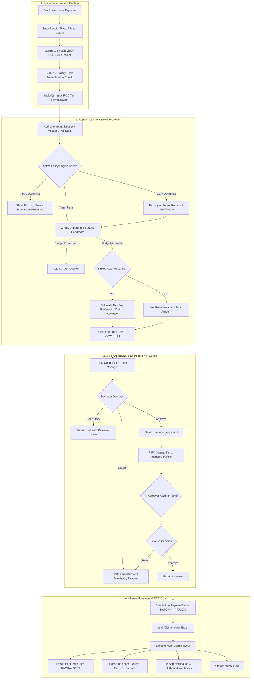
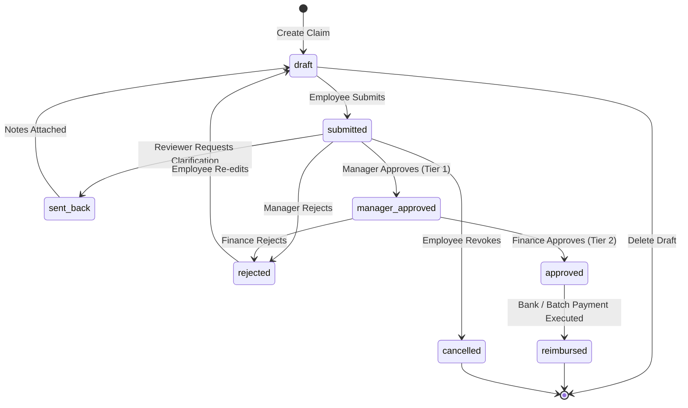
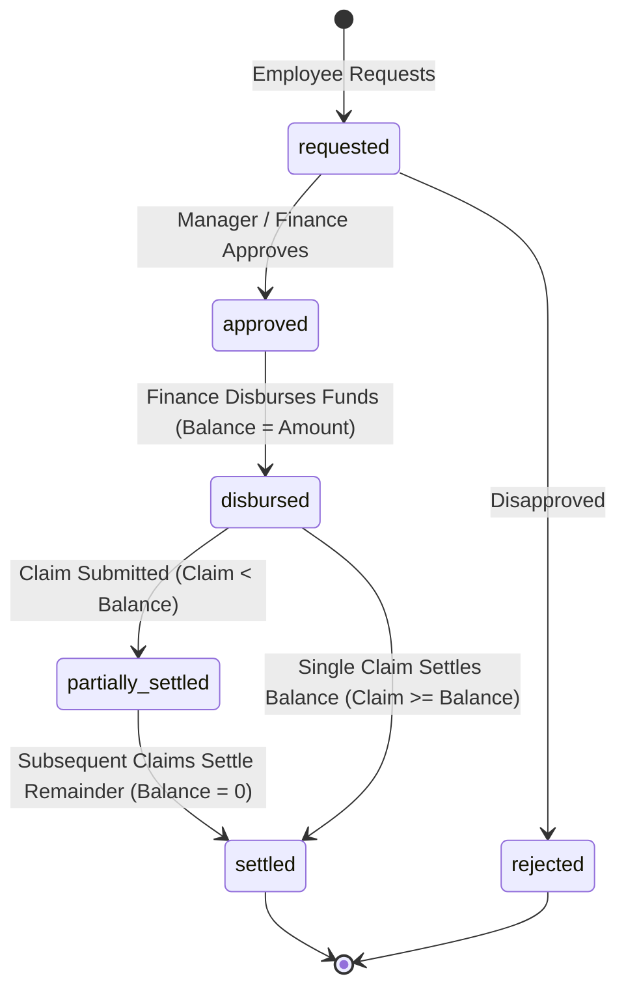
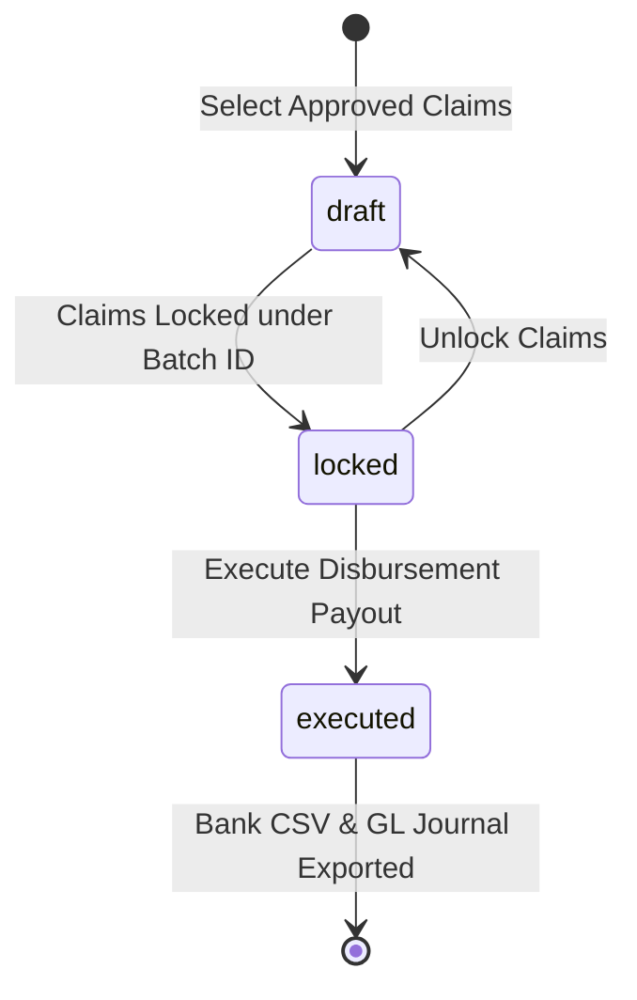

# Nebula Expenses ERP: Flow, Sub-Menu Architecture & System Governance

---

## 1. Module Purpose & Functional Scope

The **Nebula Expense Management (Expenses ERP) Module** manages the complete lifecycle of corporate spending, reimbursement claims, travel authorizations, and accounting ledger synchronization:

1. **Intelligent Spend Capture**: Employee claim submission with AI vision receipt OCR, mileage rate formulas, per-diem allowances, and multi-currency FX conversions.
2. **Automated Policy Governance**: Real-time evaluation of receipt requirements, spending limits, weekend transaction detection, and duplicate checks with `info`, `warn`, and `block` enforcement.
3. **2-Tier Segregation-of-Duties Approvals**: Line Manager review followed by Finance controller verification, backed by strict universal anti-self-approval and out-of-office delegations.
4. **Travel & Cash Advance Management**: Pre-trip authorizations with departmental budget pre-commitments and cash advance disbursements with net-pay settlement math.
5. **Corporate Payment Batches & ERP Reconciliation**: Multi-claim batch execution with standard bank payment files (NACHA/BACS/SEPA) and balanced double-entry General Ledger journal CSVs (QuickBooks, NetSuite).
6. **Intelligence & Predictive Analytics**: Anomaly detection, AI Approver Assistant review briefs, linear budget burn run-rate forecasts, Spend Copilot conversational queries, and compliance audit packages.

---

## 2. End-to-End System Architecture Flowchart



---

## 3. UI Navigation & Sub-Menu Architecture

The module lives under `/dashboard/expenses` within the authenticated application shell:

```mermaid
graph TD
    Root[/dashboard/expenses] --> Hub[Executive Overview Hub]
    Root --> Claims[My Expenses View]
    Root --> Approvals[Approvals FIFO Queue]
    Root --> Budgets[Department Budgets]
    Root --> Categories[Categories & Policies]
    Root --> Travel[Travel Authorizations]
    Root --> Advances[Cash Advances]
    Root --> Batches[Payment Batches]

    Hub --> CopilotDrawer[Spend Copilot Drawer]
    Hub --> AuditModal[Compliance Audit Pack Modal]
    Claims --> CreateModal[Create Claim Modal]
    Claims --> ScanModal[AI Receipt Scanner Modal]
    Approvals --> Drawer360[360° Claim Dossier Drawer]
    Drawer360 --> ApproverCard[AI Approver Assistant Card]
    Batches --> BankExport[Download Bank File CSV]
    Batches --> GlExport[Download Balanced GL CSV]
```

### Route & Component Directory:
| UI Route | Page Component | Key Functionality |
|---|---|---|
| `/dashboard/expenses` | `ExpensesOverviewPage.tsx` | Executive KPI metrics, 6-month spend trend, budget breach alerts, Copilot launcher |
| `/dashboard/expenses/my-claims` | `MyExpensesPage.tsx` | Employee claims table, status tabs, search, draft editing, claim creation modal |
| `/dashboard/expenses/approvals` | `ExpenseApprovalsPage.tsx` | Line Manager & Finance FIFO review queues, quick actions, send-back dialog |
| `/dashboard/expenses/budgets` | `ExpenseBudgetsPage.tsx` | Department budget cards, live spend tracking, predictive run-rate burn badges |
| `/dashboard/expenses/categories` | `ExpenseCategoriesPage.tsx` | Category taxonomy, GL codes, receipt thresholds, spending policies |
| `/dashboard/expenses/travel-requests` | `TravelRequestsPage.tsx` | Pre-trip travel authorizations, estimated cost buckets, budget pre-commitments |
| `/dashboard/expenses/cash-advances` | `CashAdvancesPage.tsx` | Cash advance requests, disbursements, and real-time net-pay balances |
| `/dashboard/expenses/payment-batches` | `PaymentBatchesPage.tsx` | Payment batch creation, claim locking, batch execution, bank CSV & GL exports |

---

## 4. Lifecycle State Machines

### 4.1 Expense Claim State Machine


### 4.2 Cash Advance State Machine


### 4.3 Payment Batch State Machine


---

## 5. Role-Based Access Control (RBAC) Matrix

| System Role | View | Create | Edit | Approve | Delete | Financial Scope & Governance |
|---|:---:|:---:|:---:|:---:|:---:|---|
| **`super_admin`** | ✅ | ✅ | ✅ | ✅ | ✅ | Complete administrative bypass across all departments, budgets, and policies. |
| **`admin`** | ✅ | ✅ | ✅ | ✅ | ✅ | Full financial governance; configures categories, budgets, approves claims, disburses payments. |
| **`finance`** | ✅ | ✅ | ✅ | ✅ | ✅ | Finance controller; performs Tier-2 final approval, manages cash advances, executes payment batches, exports GL journals. |
| **`manager`** | ✅ | ✅ | ✅ | ✅ | ❌ | Department lead; reviews & approves claims submitted by direct reports (strictly blocked from self-approving). |
| **`employee`** | ✅ | ✅ | ✅* | ❌ | ✅* | General staff; creates and submits own claims, requests travel & advances (*gated to draft/rejected records). |

---

## 6. Cross-Module Enterprise Integrations

1. **HRMS & Department Bridge**:
   - Claims, travel requests, and budgets dynamically resolve departments via `departmentId`.
   - Employee designations and managers are fetched from `User` / `Employee` collections for organizational hierarchy resolution.
2. **General Ledger (GL) Accounting Mapping**:
   - Each `ExpenseCategory` maps to a standardized enterprise GL code (e.g., `GL-6100 Travel & Flights`, `GL-6200 Meals`, `GL-6300 Software`).
   - Journal CSV exports debits to these specific accounts and equal credit to Accounts Payable (`2000 AP - Employee Clearing`).
3. **Multi-Tenancy Engine**:
   - Complete partition of data using `organizationId`. Organizations never share counters, categories, budgets, or audit logs.
