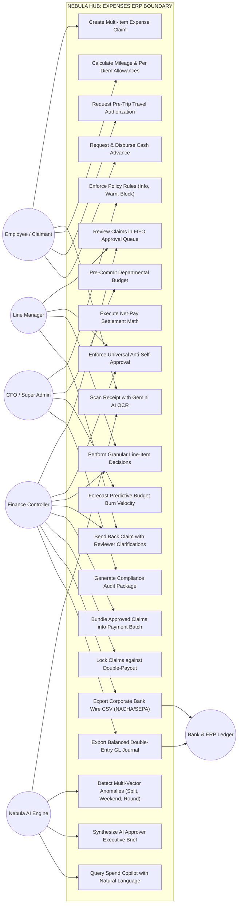

# Nebula Expenses ERP: Use Case Diagrams & Teacher Presentation Guide

---

## 1. Overview for College Viva & Project Evaluation

This document is specifically structured for you to **present, defend, and explain your Expenses ERP project to your teacher, professor, or project examiner**.

It includes:
1. **Mermaid Use Case Diagrams** clearly depicting all system actors, system boundaries, and core use cases.
2. **Actor Descriptions & Roles**.
3. **Use Case Specifications & Business Rules**.
4. **Teacher Presentation Script**: A step-by-step speaking walkthrough you can follow during your project presentation or live demonstration.
5. **Anticipated Viva Questions & Technical Answers**: The exact questions teachers commonly ask during minor/major project evaluations, with technically sound answers.

---

## 2. Overall System Use Case Diagram

---

## 3. Actor Descriptions & Responsibilities

| Actor | Category | Primary Responsibilities |
|---|---|---|
| **Employee (Claimant)** | Human User | Incurs business expenses, snaps receipt photos, creates itemized claims, requests pre-trip travel authorizations and cash advances, tracks reimbursement statuses. |
| **Line Manager** | Human User | Reviews claims submitted by direct departmental reports in a FIFO queue. Checks business justification, approves Tier 1, or sends back for clarification. Blocked from self-approving. |
| **Finance Controller** | Human User | Performs Tier 2 final accounting clearance, validates GL codes, checks department budget headroom, disburses cash advances, executes payment batches, and exports bank/GL files. |
| **CFO / Super Admin** | Human User | Sets organizational spending policies, allocates department budgets, monitors predictive run-rate burn alerts, inspects AI compliance audit packages, and configures approval workflows. |
| **Nebula AI Engine** | System Service | Multimodal Gemini 1.5 Flash Vision for receipt OCR, multi-vector anomaly detection, executive approver brief synthesis, linear burn forecasting, and Spend Copilot natural language processing. |
| **Bank & ERP Ledger** | External System | Corporate banking direct deposit networks (NACHA/BACS/SEPA) and accounting general ledgers (QuickBooks Online, Oracle NetSuite, SAP). |

---

## 4. Key Use Case Specifications & Business Rules

### Use Case 1: Create Claim with AI Receipt Scan
- **Actor**: Employee, Gemini AI
- **Pre-conditions**: Employee is logged in with active tenant credentials.
- **Main Flow**:
  1. Employee clicks "New Expense Claim", enters title, and selects department.
  2. Employee uploads a receipt image.
  3. Gemini 1.5 Flash Vision parses merchant, date, amount, tax, and category.
  4. System computes SHA-256 hash of the binary file and checks for duplicates across all claims in the organization.
  5. Form line items are populated automatically.
  6. The claim receives an atomic identifier (`EXP-YYYY-XXXX`).

### Use Case 4: Policy Enforcement Engine
- **Actor**: Employee, System Policy Engine
- **Pre-conditions**: Active `ExpensePolicy` records exist for the organization.
- **Business Rules**:
  - `info`: Informs the user of advice (e.g., round amounts).
  - `warn`: Permits submission only if the employee provides a written justification for the reviewer.
  - `block`: Completely prevents claim submission until the violating item is removed or adjusted.

### Use Case 8: Cash Advance Net-Pay Settlement
- **Actor**: Employee, Finance Controller, System Math Engine
- **Business Rule**:
  - If $\text{Claim} \ge \text{Advance Balance}$:
    $$\text{Deduction} = \text{Advance Balance}, \quad \text{Net Reimbursable} = \text{Claim} - \text{Advance Balance}, \quad \text{Advance} = \text{settled}$$
  - If $\text{Claim} < \text{Advance Balance}$:
    $$\text{Deduction} = \text{Claim}, \quad \text{Net Reimbursable} = 0, \quad \text{Advance} = \text{partially\_settled}$$

### Use Case 16: Balanced Double-Entry General Ledger Export
- **Actor**: Finance Controller, Accounting ERP
- **Business Rule**:
  - Generates journal entry rows debiting individual category GL codes (`GL-6100`, `GL-6200`, etc.) and crediting Accounts Payable (`2000 AP - Employee Clearing`).
  - Mathematically guarantees balance before export:
    $$\sum \text{Debits} \equiv \sum \text{Credits}$$

---

## 5. Teacher Presentation Track & Speaking Script

When presenting this project to your professor, follow this structured track:

### Step 1: Introduction (1 Minute)
> *"Good morning, Professor. Today I am presenting the **Nebula Expenses ERP Module**, an enterprise-grade corporate financial management system. In most companies, expense reporting is broken: employees lose paper receipts, managers miss policy violations, and finance teams struggle to reconcile cash advances and corporate budgets. Nebula transforms this into a modern, audit-proof, AI-assisted ERP platform."*

### Step 2: Architecture & Tech Stack (1 Minute)
> *"Our architecture follows a clean multi-tenant model. On the backend, we use Node.js and Express with MongoDB and Mongoose. Every query is strictly isolated by `organizationId`. We built a dedicated micro-services layer for policy rules, travel authorizations, cash advances, and double-entry accounting. On the frontend, we use React 19, TypeScript, Vite, Tailwind CSS, and Framer Motion under our custom **Nebula Premium Light 2.0** design system."*

### Step 3: Demonstrating the Core Workflow (2 Minutes)
> *"Let me demonstrate the end-to-end workflow:
> 1. First, an employee submits an expense claim. Instead of typing manual data, they upload a receipt image. Our multimodal Gemini 1.5 Flash Vision engine extracts the merchant, date, amount, and tax in under 2 seconds. Simultaneously, we compute a SHA-256 hash to prevent duplicate submissions.
> 2. Second, notice our policy engine in action. If an item exceeds daily caps or occurs on a weekend, Nebula evaluates the rule and flags the approver.
> 3. Third, if the employee took a cash advance prior to the trip, our Net-Pay math automatically offsets the advance balance from the reimbursement total, ensuring the company never loses track of loaned funds."*

### Step 4: Governance, Approvals & ERP Export (1.5 Minutes)
> *"Next is governance. We enforce a 2-tier approval workflow: Line Manager review followed by Finance controller verification. We implement a strict **universal anti-self-approval rule**—no user can ever approve their own expense report.
> Once approved, Finance bundles claims into a **Payment Batch**. With one click, they can execute the batch and export both a corporate bank direct deposit file (NACHA/SEPA) and a balanced double-entry General Ledger journal for QuickBooks or NetSuite, where debits mathematically equal credits."*

### Step 5: Intelligence & Analytics (1.5 Minutes)
> *"Finally, our Phase 4 and 5 features deliver cutting-edge financial intelligence:
> - **AI Approver Assistant** gives managers an executive brief with employee 90-day history, budget impact %, and suggested draft review notes.
> - **Predictive Budget Burn Forecasting** extrapolates daily burn rates to warn leadership before a department exceeds its annual budget.
> - **Spend Copilot** allows natural-language queries like 'Who are our top vendors this quarter?'
> - And our **Compliance Audit Pack** compiles a complete audit package with exception rates and CSV export for financial auditors."*

---

## 6. Anticipated Viva Questions & Technical Answers

### Q1: "How do you ensure multi-tenant security? What prevents Company A from seeing Company B's expenses?"
**Answer**:
> *"We enforce multi-tenancy at the middleware and database layer. Every incoming HTTP request must have a verified JWT containing the tenant's `organizationId`. Our `scopedFilter` middleware automatically injects `{ organizationId: req.organizationId }` into every Mongoose query. Additionally, all database collections utilize compound indexes prefixed with `organizationId`, making it impossible for queries to cross tenant boundaries."*

### Q2: "What happens if two employees submit a claim at the exact same millisecond? How do you prevent duplicate claim numbers?"
**Answer**:
> *"We do not rely on counting existing rows (`countDocuments`), because that creates race conditions. Instead, we use an atomic sequence generator modeled in `Counter.js`. We perform a MongoDB `findOneAndUpdate` with `{ $inc: { seq: 1 } }` and `{ new: true, upsert: true }` keyed by `(organizationId, year)`. MongoDB locks the document at the database engine level during the increment, guaranteeing that sequential identifiers like `EXP-2026-0001` and `EXP-2026-0002` are 100% collision-free."*

### Q3: "What prevents an employee from committing fraud by submitting the same receipt twice?"
**Answer**:
> *"We implement cryptographic SHA-256 binary deduplication in `receiptService.js`. When a receipt image or PDF is uploaded, we compute the SHA-256 checksum of its binary payload. We store this hash in our `Receipt` collection. If an employee tries to re-upload the same file—even with a different file name, on a different claim, or across different employees—the system flags the duplicate hash immediately."*

### Q4: "How does your Net-Pay Settlement algorithm handle cash advances?"
**Answer**:
> *"In `cashAdvanceService.js`, we evaluate two mathematical conditions:
> - If the claim amount is greater than or equal to the remaining advance balance, we deduct the entire advance balance, pay out the net remainder, and mark the advance as fully `settled`.
> - If the claim amount is less than the advance balance, the net payout is $0.00, we deduct the claim amount from the advance, and transition the advance status to `partially_settled` with the remaining balance preserved for future claims."*

### Q5: "How do you ensure that your AI features don't hallucinate or make unauthorized financial decisions?"
**Answer**:
> *"We adhere to the **Explainable & Advisory AI** principle. The AI is architecturally restricted from modifying claim statuses, approving reports, rejecting claims, or moving money. All AI outputs—such as anomaly risk badges, approver briefs, and suggested notes—are strictly advisory. A human reviewer must always inspect the brief and explicitly click 'Approve'. Furthermore, every AI call is audited in our `AiRun` collection with token count, latency, and input hashes."*

### Q6: "Why is balanced double-entry accounting important in the General Ledger export?"
**Answer**:
> *"In corporate accounting, every financial transaction must follow double-entry bookkeeping so the balance sheet remains in equilibrium. In our `erpExportService.js`, we debit the itemized expense accounts according to their category GL codes and credit the total amount to Accounts Payable (`2000 AP - Employee Clearing`). We have an automated assertion verifying that $\sum \text{Debits} \equiv \sum \text{Credits}$ with 2-decimal floating-point safety before the CSV is generated."*
