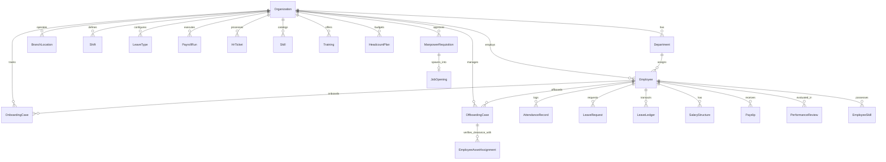
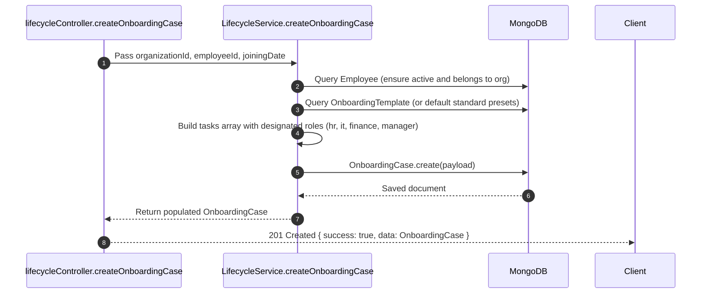
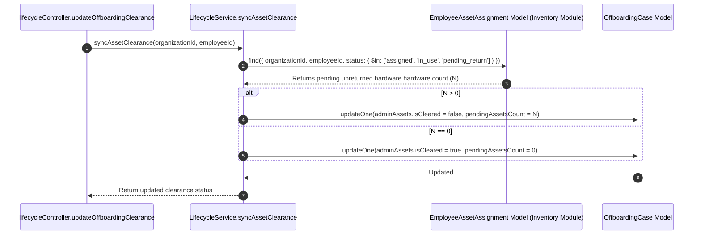
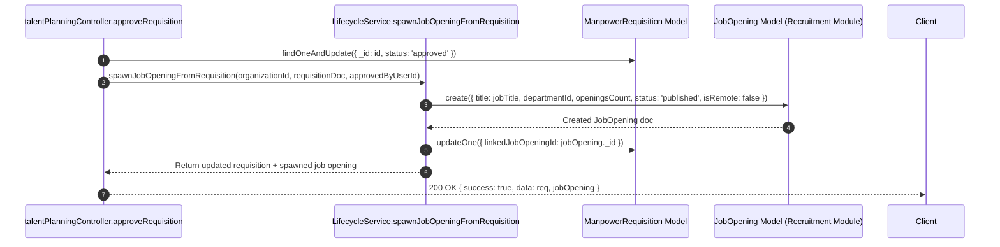

# Nebula HUB — HRMS ERP Backend Data & API Flow Architecture

This document details the backend architectural patterns, database schemas, controller workflows, and transaction boundaries across the HRMS module.

---

## 1. Domain Model Entity-Relationship Architecture



---

## 2. Controller-Service Flow Pipelines

### 2.1 Multi-Department Onboarding Engine



---

### 2.2 Inventory Asset Clearance Synchronization



---

### 2.3 Vector PDF Generation via PDFKit

```mermaid
sequenceDiagram
    autonumber
    participant Controller as lifecycleController.generateLetterPdf
    participant Service as LifecycleService.generateLetterPdf
    participant DB as MongoDB
    participant PDF as PDFKit Document Stream

    Controller->>Service: generateLetterPdf(organizationId, templateId, employeeId, customVars)
    Service->>DB: Fetch LetterTemplate & Employee Dossier
    Service->>Service: Interpolate {{employeeName}}, {{designation}}, {{salary}}, {{date}}
    Service->>PDF: Initialize doc({ margin: 50, size: 'A4' })
    Service->>PDF: Render Company Header, Branded Bar (#f97316), Subject & Body
    Service->>PDF: Render Formal Sign-off & Digital Stamp
    PDF-->>Controller: Pipe buffer directly into HTTP response headers
    Controller-->>Client: Content-Type: application/pdf; Content-Disposition: attachment
```

---

### 2.4 Manpower Requisition to ATS Job Opening Spawning



---

## 3. Transaction Boundaries & Guard Blocks

1. **Multi-Tenant Isolation:** All operations enforce `query.organizationId = req.user.organizationId`. Direct cross-tenant data manipulation is impossible at the database driver level.
2. **RBAC Guard (`requireModuleAccess`):** Every endpoint strictly gates access via `('hrms', 'view')`, `('hrms', 'create')`, `('hrms', 'edit')`, or `('hrms', 'approve')`.
3. **Atomic Balance Ledgers:** All leave allocations, deductions, and cancellations write dual immutable audit records in `LeaveLedger` before mutating `LeaveBalance.usedDays`.
