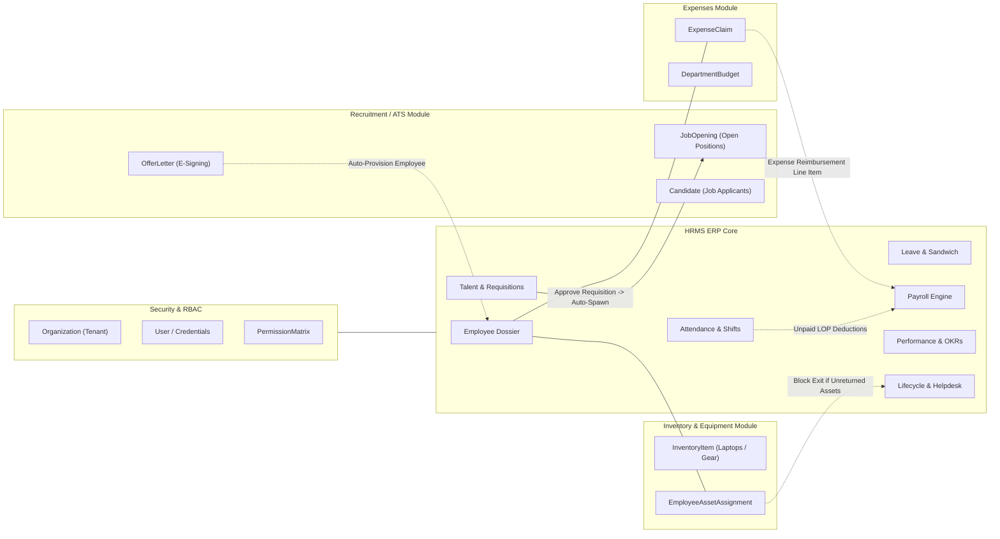
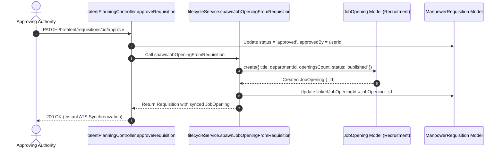
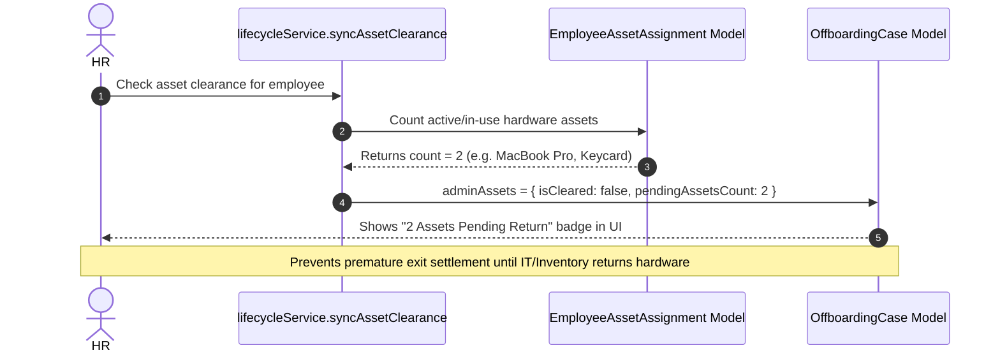

# Nebula HUB — HRMS ERP Cross-Module Integration Map

This document details the cross-module integrations, data synchronizations, event hooks, and foreign key references linking the HRMS ERP suite with all other modules across Nebula HUB.

---

## 1. Global Cross-Module Integration Map

---

## 2. Integration Protocols & Data Contracts

### 2.1 Recruitment ATS ↔ HRMS Bridge

| Direction | Event / Trigger | Mechanism | Target Entity / Result |
|---|---|---|---|
| **ATS → HRMS** | Candidate e-signs and accepts Offer Letter | `recruitmentService.convertCandidateToEmployee` | Creates `Employee` record with employee code, department, designation, salary structure, and triggers `OnboardingCase`. |
| **HRMS → ATS** | Manpower Requisition is approved | `lifecycleService.spawnJobOpeningFromRequisition` | Creates published `JobOpening` in ATS Recruitment module with department, budget, and openings count. |

---

## 2.2 Inventory Assets ↔ HRMS Exit Clearance Bridge

| Trigger | Service Method | Query / Condition | Outcome |
|---|---|---|---|
| HR initiates employee exit or updates clearance | `lifecycleService.syncAssetClearance` | Query `EmployeeAssetAssignment` where `{ organizationId, employeeId, status: { $in: ['assigned', 'in_use', 'pending_return'] } }` | If count > 0, sets `adminAssets.isCleared = false` and records `pendingAssetsCount`. Blocks final HR relieving sign-off until physical inventory return is confirmed. |

---

## 2.3 Attendance & Leaves ↔ Payroll LOP Engine Bridge

- **Loss of Pay (LOP) Automation:**
  - When monthly payroll run is triggered (`payrollService.calculateRun`), the system fetches all `AttendanceRecord` entries for the calendar month.
  - Days where `status === 'absent'` or `status === 'leave'` without an approved `LeaveRequest` (or where the leave type is configured with `isPaid: false`) are tallied as `unpaidDays`.
  - Formula:
    $$\text{Per Day Deduction} = \frac{\text{Gross Salary}}{\text{Total Days in Month}}$$
    $$\text{LOP Deduction} = \text{Per Day Deduction} \times \text{Unpaid Days}$$
  - The deducted amount is added to `Payslip.deductions` under the label `Loss of Pay (LOP)`, guaranteeing financial reconciliation.

---

## 2.4 Expenses ↔ Payroll Reimbursement Bridge

- Approved non-reimbursed expense claims are aggregated by employee ID.
- During the payroll run, the approved expense amount is added as a non-taxable reimbursement line item in `Payslip.earnings`, allowing single-disbursement bank processing.

---

## 3. Security & Multi-Tenant Audit Integrity

1. **Strict Tenant Segregation:** Every query filter and update mutation incorporates `organizationId: req.user.organizationId`.
2. **Deterministic Role Actions:**
   - Employees have read access to their own records and write access only to self-service endpoints (`check-in`, `leave request`, `self review`, `ticket raise`, `policy acknowledgement`).
   - Managers have access to their direct reports.
   - HR & Admins hold full configuration, calibration, and approval capabilities.
3. **Audited Lifecycle:** Every state change across Onboarding, Offboarding, Regularization, Leave, Payroll, and Requisition records the executing `userId` and high-resolution timestamp.
