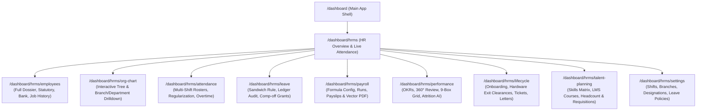
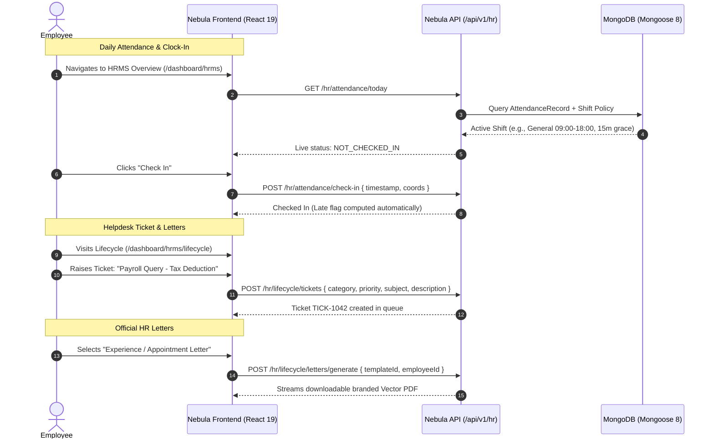
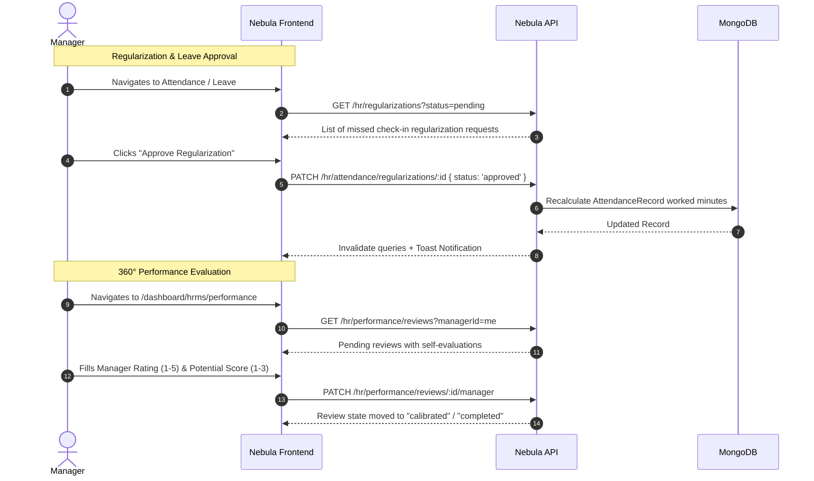
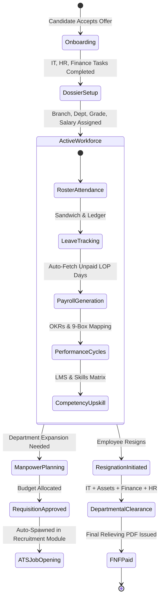

# Nebula HUB — HRMS ERP UI Flow Architecture

This document maps the end-to-end navigational hierarchy, screen flows, state transitions, and user personas across the complete HRMS ERP suite in Nebula HUB.

---

## 1. System Navigation Hierarchy

---

## 2. Persona-Based Journey Flows

### 2.1 Employee Self-Service (ESS) Journey

---

### 2.2 Manager Approval & Team Oversight Journey

---

### 2.3 HR Administrator & Executive Journey

---

## 3. Screen State & Modal Transitions

| Screen | Primary Views / Tabs | Key Interactive Modals |
|---|---|---|
| **Employees Dossier** (`/hrms/employees`) | Grid / Table view with Department, Grade, and Status filters | Add/Edit Employee Drawer, Promote/Transfer Modal, Document Upload Modal |
| **Org Chart** (`/hrms/org-chart`) | Recursive Tree Chart, Department Grouping, Reporting Chain | Node Detail Flyout with Direct Reports Count and Manager hierarchy |
| **Attendance** (`/hrms/attendance`) | Shift Rosters, Daily Logs, Regularizations Queue, Overtime Tracker | Regularization Request Modal, Shift Assignment Drawer |
| **Leave Management** (`/hrms/leave`) | Balances Overview, Leave Requests Queue, Ledger History, Comp-off Grants | Apply Leave Modal with Live Sandwich Rule Preview, Grant Comp-off Modal |
| **Payroll Engine** (`/hrms/payroll`) | Monthly Runs, Salary Structures, Formula Rules, My Payslips | Process Payroll Modal, Salary Structure Config Drawer, Vector PDF Preview |
| **Performance Hub** (`/hrms/performance`) | Goals / OKRs, Review Cycles, 9-Box Grid, Attrition Predictor, AI Copilot | New Goal Modal, Self-Review Modal, Manager Evaluation Modal, Calibration Modal |
| **Lifecycle & Desk** (`/hrms/lifecycle`) | Onboarding Checklist, Offboarding Clearances, Helpdesk Tickets, Letters & Policies | Initiate Onboarding Modal, Exit Clearance Drawer, New Ticket Modal, Broadcast News Modal |
| **Talent Planning** (`/hrms/talent-planning`) | Skills Matrix, LMS Courses, Headcount Targets & Requisitions | Add Skill Modal, Rate Competency Modal, Schedule Program Modal, Raise Requisition Modal |
