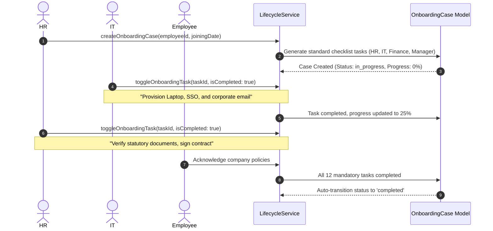
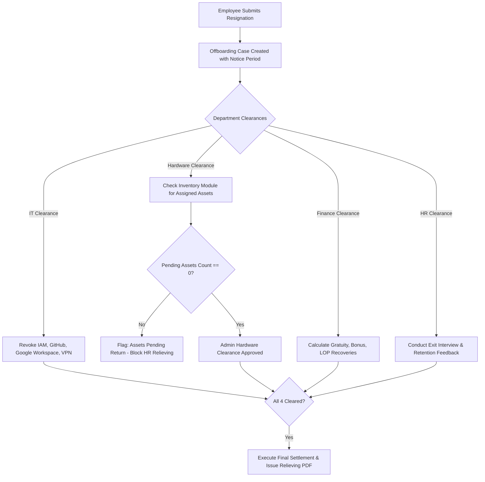
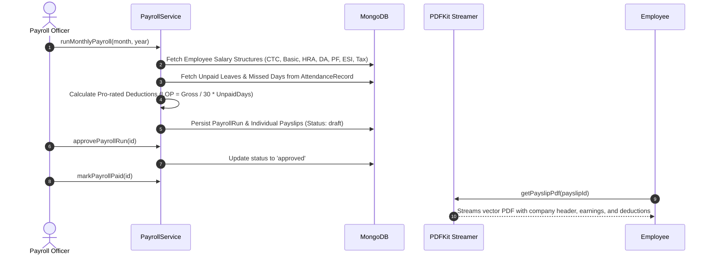
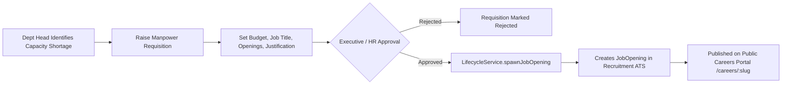

# Nebula HUB — HRMS ERP Comprehensive Use Cases

This document details the core enterprise use cases across Nebula HRMS ERP, covering pre-conditions, trigger events, step-by-step flows, exception paths, and cross-module business logic.

---

## UC-01: Multi-Department Onboarding & Task Orchestration

- **Primary Actor:** HR Executive / Onboarding Specialist
- **Secondary Actors:** IT Admin, Finance Officer, Direct Manager, New Hire
- **Pre-Conditions:** Candidate marked as `offered` or `hired` in Recruitment ATS module.
- **Trigger:** HR clicks "Initiate Onboarding" on candidate dossier.

---

## UC-02: Inventory Asset Exit Clearance & F&F Settlement

- **Primary Actor:** Exiting Employee
- **Secondary Actors:** Department Manager, IT Lead, Inventory Admin, Finance Manager
- **Cross-Module Link:** Directly queries `EmployeeAssetAssignment` in Inventory module.

---

## UC-03: Attendance Tracking, Grace Windows & Overtime Computation

- **Primary Actor:** Employee
- **Secondary Actors:** Line Manager, Attendance Admin
- **Business Logic:**
  - Standard shift: 09:00 to 18:00 (540 min total).
  - Grace period: 15 minutes (clock-in up to 09:15 marked on-time; 09:16+ flagged `isLate: true`).
  - Overtime threshold: Clock-out after 18:30 computes overtime in 30-minute intervals.
  - Missed clock-out auto-regularized or requested via Regularization form.

---

## UC-04: Leave Ledger, Sandwich Rule & Comp-Off Grants

- **Primary Actor:** Employee
- **Secondary Actors:** Approving Manager, HR Admin
- **Sandwich Rule Enforcement:**
  - If an employee takes Leave on Friday and Monday with Saturday/Sunday as weekly-offs, the system previews and deducts 4 calendar days (Friday, Saturday, Sunday, Monday) from leave balance.
- **Comp-off Granting:**
  - Overtime or weekend work can be submitted as a Comp-off request. Once approved by the manager, credits are deposited into the employee's `LeaveLedger`.

---

## UC-05: Payroll Engine, Loss of Pay (LOP) & Payslip Generation

- **Primary Actor:** Payroll Specialist
- **Pre-Conditions:** Monthly attendance finalized; unpaid leaves counted.
- **Execution Flow:**

---

## UC-06: 360° Review, 9-Box Calibration & Attrition Predictor

- **Primary Actor:** Manager / Talent Lead
- **Process:**
  1. Review cycle initiated (Annual / Mid-Year).
  2. Employee submits Self-Review with achievements and growth areas.
  3. Direct Manager rates Performance (1-5) and Potential (1-3).
  4. System plots employee on the interactive **9-Box Grid**:
     - Star (High Performance, High Potential)
     - High Performer (High Performance, Medium Potential)
     - Core Player (Medium Performance, Medium Potential)
     - Underperformer (Low Performance, Low Potential)
  5. **Attrition Predictor Model** aggregates tenure, promotion staleness, attendance volatility, and leave trends to assign Risk Score (Low, Medium, High, Critical) with suggested retention interventions.

---

## UC-07: Workforce Planning, Skills Matrix & ATS Requisition Bridge

- **Primary Actor:** Department Head / Chief Talent Officer
- **Integration Bridge:** Approved Manpower Requisitions automatically spawn and publish Job Openings in the Recruitment ATS.

