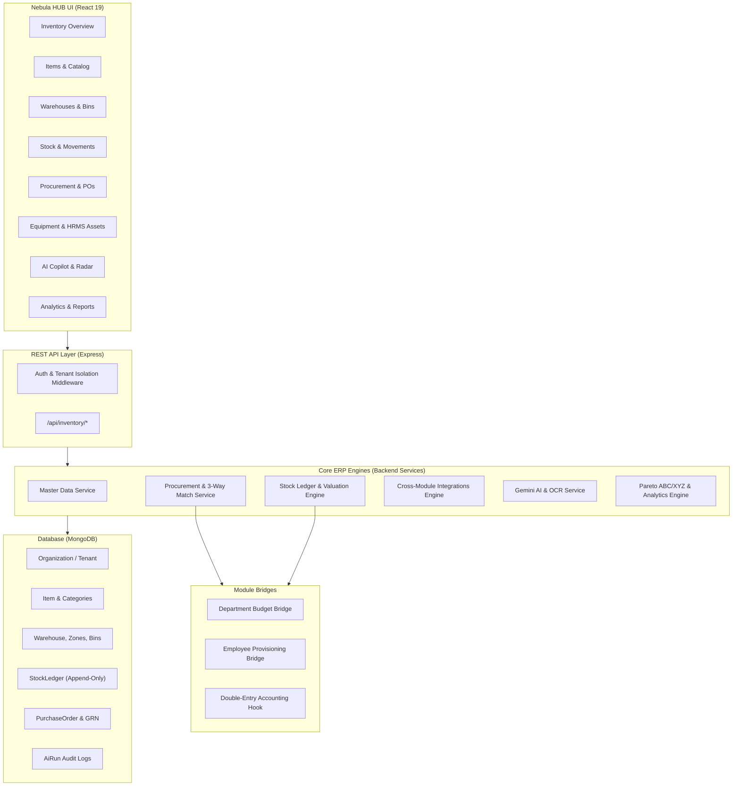
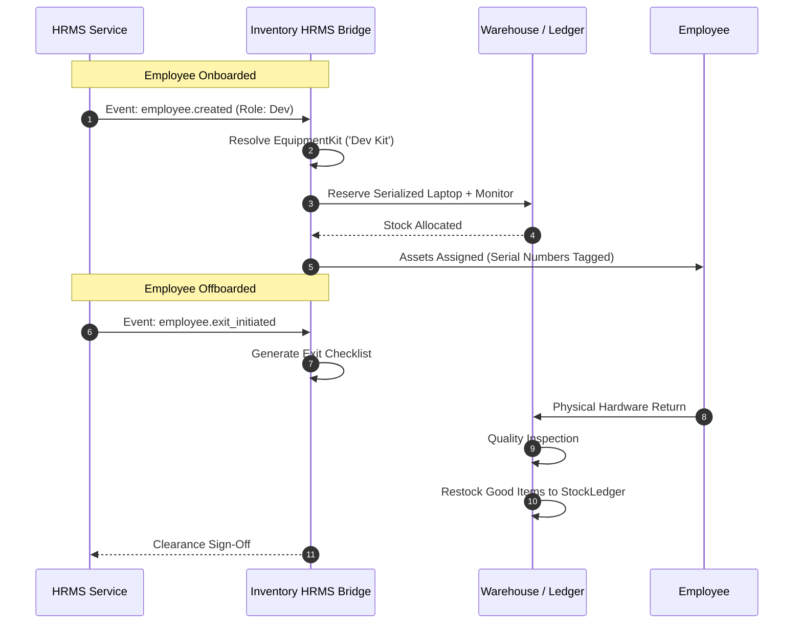

# Nebula HUB - Inventory Management Module Architecture

## 1. Executive Summary

The **Nebula Inventory Management Module** is an enterprise-grade, multi-tenant inventory control, procurement, warehouse logistics, and analytics engine built directly within the **Nebula HUB** ERP platform. Designed to handle high-velocity stock movements, strict financial compliance, and AI-driven supply chain forecasting, it adheres to modern ERP principles:

- **Strict Multi-Tenancy**: Every document, aggregation query, cache key, and AI operation is isolated by `organizationId`.
- **Append-Only Immutable Stock Ledger**: Inventory balances and cost valuations are derived from historical event logs (`StockLedger`), prohibiting manual database tampering and enabling compensating reversal entries.
- **Dual Cost Valuation**: Automatic real-time cost basis tracking supporting both **FIFO (First-In, First-Out)** cost tranche layering and **Moving Weighted Average Cost (WAC)**.
- **Anti-Oversell Concurrency Guard**: Atomic conditional queries and quantity validation to prevent race conditions and negative inventory balances.
- **Deep Cross-Module Integrations**: Bi-directional event hooks connecting Inventory to **Expenses** (budget hard-blocking), **HRMS** (equipment kit provisioning and exit asset returns), and **General Ledger Accounting** (double-entry journal events).
- **Embedded AI Supply Chain Intelligence**: Powered by Google Gemini 1.5/2.0 for demand run-rate forecasting, multi-modal invoice/challan OCR, shrinkage anomaly detection, and natural language copilot querying.

---

## 2. Technology Stack & Design Alignment

| Layer | Technology | Architecture Pattern |
| :--- | :--- | :--- |
| **Backend Runtime** | Node.js (v18+) / Express | Controller-Service-Model architecture with strict middleware isolation |
| **Database** | MongoDB / Mongoose | Tenant-keyed schemas, compound indexes, atomic `$inc` updates |
| **Frontend Framework** | React 19 / Vite / TypeScript | Functional components, custom hooks, typed API contracts |
| **State & Data Fetching** | TanStack Query v5 | Reactive cache invalidation, optimistic updates, query keys |
| **Styling & UI Shell** | Tailwind CSS / Framer Motion | Design tokens consistent with Nebula HUB, dark/light theme, glassmorphism |
| **AI / Machine Learning** | Google Gemini SDK (`@google/genai`) | Parameterized SQL/Mongoose whitelists, grounded JSON extraction |
| **Reporting / Export** | Native CSV Streamer & PDFKit | Server-rendered streaming CSVs and formatted enterprise PDFs |

---

## 3. High-Level System Architecture Diagram



---

## 4. Database Schema & Domain Model

### 4.1 Master Data Layer
- **`Item`**: Root inventory entity containing SKU, barcode, brand, tracking type (`none`, `batch`, `serial`), standard cost, base UoM, UoM conversion ratios, and minimum/maximum stock thresholds.
- **`ItemCategory`**: Self-referencing hierarchical tree (`parentId`) enabling nested product taxonomy.
- **`Warehouse`**: Physical storage location scoped to organization.
- **`WarehouseZone`**: Logical subdivision within a warehouse (e.g., Ambient, Cold Storage, Staging).
- **`WarehouseBin`**: Physical rack/shelf coordinate with cubic volume and maximum weight capacity constraints.
- **`Supplier`**: Vendor master storing tax IDs, currency, payment terms, delivery lead times, and performance scores.
- **`ItemSupplierPrice`**: Contracted unit rates, minimum order quantities (MOQ), and volume pricing tiers.

### 4.2 Stock Engine & Valuation Layer
- **`StockLedger`**: Append-only transactional ledger recording every unit inflow and outflow:
  ```typescript
  interface IStockLedger {
    organizationId: ObjectId;
    transactionType: 'receipt' | 'issue' | 'transfer_in' | 'transfer_out' | 'adjustment_in' | 'adjustment_out' | 'reversal';
    documentNumber: string;
    itemId: ObjectId;
    warehouseId: ObjectId;
    binId?: ObjectId;
    batchNumber?: string;
    serialNumbers?: string[];
    quantity: number; // Positive for inflow, negative for outflow
    unitCost: number;
    totalCost: number;
    runningBalanceQty: number;
    referenceType: 'GoodsReceiptNote' | 'StockMovement' | 'AssetIssue' | 'Reversal';
    referenceId: ObjectId;
    createdAt: Date;
  }
  ```
- **`StockMovement`**: Head document for physical operations (dispatch notes, cycle-count adjustments, inter-warehouse transfers).

### 4.3 Procurement & Matching Layer
- **`PurchaseRequisition`**: Internal demand request requiring 2-tier managerial approval.
- **`PurchaseOrder`**: Legal procurement contract with revision amendment tracking.
- **`GoodsReceiptNote (GRN)`**: Inbound physical delivery log with quality inspection results (`receivedQuantity`, `acceptedQuantity`, `rejectedQuantity`).
- **`SupplierInvoice`**: Billing record subject to algorithmic 3-way matching.
- **`ReturnToVendor`**: Outbound debit note and defective goods return.

### 4.4 Integrations & AI Layer
- **`EquipmentKit`**: Role-based starter template (e.g., Software Engineer Kit) mapping items to standard job roles.
- **`AssetAssignment`**: Tracks individual serialized assets issued to employees.
- **`InventoryAnomaly`**: Flagged discrepancies (shrinkage, dead stock, duplicate receipts, price shocks).
- **`AiRun`**: Audit trail recording user ID, input tokens, output tokens, response latency, and status of Gemini calls.

---

## 5. Core Architectural Patterns

### 5.1 Strict Multi-Tenancy & Data Isolation
Every Mongoose model enforces a required, indexed `organizationId` foreign key. Custom middleware automatically populates `req.organizationId` from authenticated JWT claims:
- Any service query without `{ organizationId }` is strictly prohibited.
- Aggregation pipelines (`$match`) prepend `{ organizationId: new ObjectId(orgId) }` as their first stage.
- Cross-tenant requests immediately fail with `403 Forbidden` or return empty result sets.

### 5.2 Immutable Append-Only Ledger & Reversals
Nebula Inventory does not perform `UPDATE` queries on stock quantities. Instead:
1. Physical receipts insert a positive `StockLedger` row (`quantity > 0`).
2. Issues and dispatches insert a negative `StockLedger` row (`quantity < 0`).
3. Running stock balance is mathematically derived from the sum of transactions or cached in `runningBalanceQty`.
4. If a correction is required, the system executes a **Compensating Reversal** by inserting an equal and opposite transaction referencing the original `ledgerId`.

### 5.3 FIFO Cost Layering Algorithm
When an outflow transaction occurs for an item governed by FIFO:
$$\text{Cost} = \sum_{k=1}^{n} Q_k \cdot C_k$$
where $Q_k$ is the consumed quantity from the $k$-th unexhausted inbound layer and $C_k$ is the historical unit purchase price of that layer. Outflow costs are recorded with pinpoint historical accuracy.

### 5.4 Anti-Oversell Concurrency Guard
To prevent overselling during simultaneous checkout or issue transactions, issues utilize atomic conditional operators:
```javascript
const availableStock = await StockLedgerService.getAvailableStock(orgId, itemId, whId);
if (availableStock < requestedQty) {
  throw new Error(`Insufficient stock. Available: ${availableStock}, Requested: ${requestedQty}`);
}
```
In high-throughput environments, this is reinforced by optimistic concurrency versioning or distributed Redis mutex locks.

---

## 6. Integration Architecture

### 6.1 Expenses Module Bridge
- **Pre-Approval Budget Check**: Whenever a Purchase Requisition is submitted, the Procurement Engine queries the Expenses module for the requesting department's allocated budget.
- **Hard-Blocking Policy**: If a department's budget mode is set to `hard_block` and cumulative spend + PR value exceeds the allocation, the requisition is automatically rejected with an audit log.
- **Spend Realization**: Upon Purchase Order fulfillment, the inventory system emits an event to increment actual department spend.

### 6.2 HRMS Onboarding & Offboarding Lifecycle


### 6.3 Accounting Hook (Double-Entry General Ledger)
Every inventory movement automatically emits a structured double-entry journal payload ready for consumption by any ERP General Ledger:

| Event | Debit Account | Credit Account |
| :--- | :--- | :--- |
| **Goods Receipt (GRN)** | Inventory Asset (1400) | Accounts Payable / Accrued Receipts (2000) |
| **Inventory Issue** | Cost of Goods Sold (5000) | Inventory Asset (1400) |
| **Shrinkage / Scrap** | Inventory Write-off Expense (5100) | Inventory Asset (1400) |
| **Inter-Warehouse Transit** | In-Transit Inventory (1450) | Source Warehouse Inventory (1400) |

---

## 7. AI & Supply Chain Intelligence Engine

The module integrates Google Gemini models under strict enterprise constraints:
1. **Zero Hallucination Grounding**: Natural language queries parse user intent via whitelisted regex patterns and execute strictly parameterized Mongoose queries. The resulting JSON dataset is then passed to Gemini solely for narrative synthesis.
2. **Multi-Modal Document OCR**: Invoices and delivery challans uploaded as base64 images/PDFs are parsed by Gemini using structured JSON schemas to extract line items, prices, and PO numbers.
3. **Statistical Anomaly Detection**:
   - Shrinkage spikes where scrap quantity exceeds 15% of total stock.
   - Stagnant capital tied up in stock without movement for $>90$ days.
   - Price shocks exceeding $20\%$ variance against historical PO rates.
   - Duplicate delivery challans submitted within 48 hours.
4. **Human-in-the-Loop**: All AI suggestions (reorder recommendations, anomaly alerts, match variances) are advisory and require human confirmation (`acknowledged`, `dismissed`, `resolved`).
