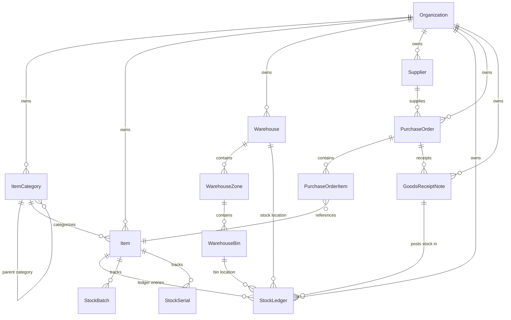

# Nebula HUB — ERP Inventory Management Module
## Phase 0: Architecture Discovery & Technical Blueprint

### 1. Stack Findings
- **Backend Architecture**: Node.js v24 + Express 4.19 (CommonJS), Mongoose 8.4 (MongoDB).
- **Security & Multi-Tenancy**: `requireAuth` JWT middleware, `scopedFilter` organization tenancy enforcement, `requireModuleAccess` / `requireRole` RBAC middleware, `helmet`, `express-rate-limit`, append-only `AuditLog` and `AiRun` tables.
- **Frontend Architecture**: React 19, TypeScript 5.7, Vite 6, Tailwind CSS 3.4, `@tanstack/react-query` v5, `framer-motion` v12, `recharts` v3, `lucide-react`, `react-toastify`.
- **Existing Document & Tooling Assets**: `qrcode` (native QR code generation), `pdfkit` (server-side PDF rendering), `nodemailer` (email automation), Zod 4 for schema validations.
- **AI Integration Pattern**: Gemini 1.5 Flash multimodal / Groq API gateway with strict JSON schemas, token tracking, fallback deterministic engines, human-in-the-loop validation, and full audit logging in `AiRun`.

---

### 2. Multi-Tenancy & Isolation Enforcement
- **Storage Scoping**: Every MongoDB collection MUST have `organizationId: { type: ObjectId, ref: 'Organization', required: true, index: true }`.
- **Compound Keys**: Unique constraints are scoped per tenant (e.g. `{ organizationId: 1, sku: 1 }`, `{ organizationId: 1, code: 1 }`).
- **Query Scoping**: Controllers MUST pass requests through `scopedFilter(req, { ... })` to prevent any cross-tenant data leakage.
- **Cache & File Storage**: Uploaded item images and generated PDFs/QRs are partitioned by `tenant_<organizationId>/inventory/...`.

---

### 3. RBAC Roles & Permissions Matrix
The inventory module integrates seamlessly with the existing `ROLES` configuration (`Backend/src/config/roles.js`) and `requireModuleAccess('inventory', action)`:

| Role | Module Enabled | Allowed Actions | Description |
| :--- | :--- | :--- | :--- |
| `super_admin` | Yes | `['view', 'create', 'edit', 'delete', 'approve']` | Full owner access & bypass |
| `admin` | Yes | `['view', 'create', 'edit', 'delete', 'approve']` | Tenant administrator |
| `inventory_manager` / `inventory_admin` | Yes | `['view', 'create', 'edit', 'delete', 'approve']` | Full inventory operations & approvals |
| `warehouse_manager` | Yes | `['view', 'create', 'edit', 'approve']` | Stock transfers, counts, bin operations |
| `procurement_officer` | Yes | `['view', 'create', 'edit']` | Requisitions, POs, supplier management |
| `storekeeper` | Yes | `['view', 'create', 'edit']` | GRN receipts, picking, dispatch |
| `manager` | Yes | `['view', 'create', 'edit', 'approve']` | Departmental requisitions & approvals |
| `auditor` | Yes | `['view']` | Read-only ledger, valuation & audit logs |
| `employee` | Yes | `['view', 'create']` | Create requisitions & view assigned assets |

---

### 4. UI Design Tokens & Reusable Component System
- **Theme & Palette**: Matches Nebula HUB dark/light styling (`#060a12`, `bg-slate-50`, `#fafafb` sidebar, `#f97316` brand orange accents, `#10b981` emerald status, `#6366f1` indigo, `#ef4444` rose alerts).
- **Navigation Shell**: Registered inside `Sidebar.tsx` via `SidebarNavGroup` with sub-items:
  - Overview / Dashboard (`/dashboard/inventory`)
  - Items & Catalog (`/dashboard/inventory/items`)
  - Warehouses & Bins (`/dashboard/inventory/warehouses`)
  - Stock Movements & Ledger (`/dashboard/inventory/movements`)
  - Procurement & POs (`/dashboard/inventory/procurement`)
  - Suppliers (`/dashboard/inventory/suppliers`)
  - Asset Equipment Kits (`/dashboard/inventory/assets`)
  - Analytics & Reports (`/dashboard/inventory/analytics`)
  - AI Assistant & Forecasts (`/dashboard/inventory/ai-copilot`)
- **Shared Components**: `Badge`, `Button`, `Input`, `FloatingDropdown`, `ModalDrawer`, `ConfirmationDialog`, `PaginationControls`, `Recharts` graphs, `ReactToastify`.

---

### 5. Proposed Database Schema (Mermaid ERD)

