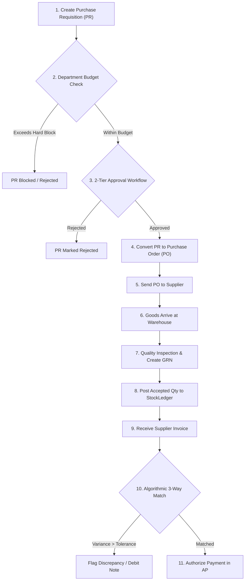

# Nebula HUB - Inventory Management User Workflows & Operational Guides

## 1. Overview

This document provides step-by-step standard operating procedures (SOP) for key organizational roles interacting with the **Nebula Inventory Management Module**:
- **Store & Warehouse Managers**: Stock counts, bin allocations, inter-warehouse transfers.
- **Procurement Officers**: Vendor price negotiation, requisitions, PO conversion, returns.
- **Quality Control Inspectors**: Inbound shipment verification, acceptance/rejection criteria.
- **HR & Operations Coordinators**: IT equipment kits, employee provisioning, offboarding returns.
- **Finance & Supply Chain Directors**: Budget governance, 3-way matching, ABC-XYZ strategic replenishment.

---

## 2. Procure-to-Pay Lifecycle Workflow

### Step-by-Step Procedure:

### Step 1: Demand Identification & PR Generation
1. Navigate to **Inventory > Procurement & POs**.
2. Click **Create Requisition**.
3. Select the requesting Department, Target Warehouse, Delivery Due Date, and Priority (`low`, `normal`, `high`, `urgent`).
4. Add line items by selecting SKUs, required quantities, and target unit costs. Line totals auto-calculate.
5. Click **Submit Requisition**.

### Step 2: Budget Evaluation & Approvals
1. The system automatically verifies the requesting department's available budget. If the department has a `hard_block` policy and insufficient remaining funds, the request cannot proceed.
2. The Requisition enters `pending_approval`.
3. In accordance with the **Anti-Self-Approval Rule**, the creator cannot approve their own PR.
4. Tier-1 Manager and Tier-2 Procurement Admin click **Approve Requisition**.

### Step 3: PO Issuance & Amendments
1. From the approved PR, click **Convert to Purchase Order**.
2. Select the designated vendor. The system loads contracted rates from `ItemSupplierPrice`.
3. Once generated, download the enterprise **Purchase Order PDF** and transmit it to the vendor.
4. If order revisions occur before fulfillment, click **Amend PO** to record a version increment with full historical tracking.

### Step 4: Goods Receipt & Quality Inspection
1. When the vendor delivers items, navigate to **Procurement > Inbound Shipments > New GRN**.
2. Select the PO number.
3. For each line item, input `receivedQuantity`, `acceptedQuantity`, and `rejectedQuantity` with rejection reasons (e.g. *Damaged in transit*, *Failed tolerance*).
4. If the item requires serial or batch tracking, enter the vendor batch code or serial numbers.
5. Click **Post to Stock Ledger**. Accepted quantities immediately increase physical available balance.

### Step 5: 3-Way Invoice Matching
1. When the vendor invoice arrives, click **Log Invoice**.
2. Enter the invoiced quantities and unit rates (or upload the invoice PDF to let **AI OCR** auto-extract the data).
3. Click **Run 3-Way Match**.
4. The system compares PO vs GRN vs Invoice:
   - **Exact Match**: Cleared for payment.
   - **Variance within Tolerance** ($\le 2\%$): Automatically flagged with warning note.
   - **Variance exceeding Tolerance**: Invoice blocked; option to issue a **Return to Vendor / Debit Note**.

---

## 3. Warehouse Logistics & Stock Control Workflow

### 3.1 Inter-Warehouse Stock Transfer
1. Navigate to **Inventory > Stock & Movements**.
2. Click **Initiate Transfer**.
3. Specify **Source Warehouse**, **Destination Warehouse**, SKU, and transfer quantity.
4. Click **Dispatch Transfer**:
   - Stock is immediately deducted from the source warehouse's available balance.
   - The status is set to `in_transit`.
   - General Ledger records an in-transit inventory asset transfer.
5. When the transit shipment arrives at the destination warehouse, the destination operator clicks **Receive Transfer**. Stock balance increments at the destination facility.

### 3.2 Anti-Oversell Safe Stock Issues
1. When fulfilling an internal consumption request, work order, or sales shipment, click **New Stock Issue**.
2. Select the source warehouse and SKU.
3. The system displays real-time `Available Stock`. If an operator attempts to issue more than available, the system immediately rejects the transaction with a safety alert.
4. Upon confirmation, a negative entry is recorded in `StockLedger`, recalculating running balances atomically.

### 3.3 Compensating Reversal Procedure
1. If a stock movement was logged with an erroneous quantity, locate the transaction in the **Stock Ledger** audit table.
2. Click **Create Reversal**.
3. The system appends an offsetting transaction of opposite sign referencing the original movement ID, leaving historical records intact.

---

## 4. HRMS Equipment Kit Lifecycle Workflow

### 4.1 Creating Equipment Kit Templates
1. Navigate to **Inventory > Equipment & Assets**.
2. Click **New Kit Template**.
3. Specify the target job title (e.g., *Frontend Engineer*).
4. Select standard items to be issued:
   - 1x Laptop (Serial Tracked)
   - 2x 27-inch Monitors
   - 1x Wireless Keyboard & Mouse
5. Save template.

### 4.2 Automated Employee Onboarding Provisioning
1. When a new employee is hired in HRMS, an automated webhook triggers the Inventory Provisioning Bridge.
2. The system checks available warehouse stock for the assigned role kit:
   - If stock is on hand, an `AssetAssignment` is queued in `pending_dispatch`.
   - If stock is depleted, the system flags a reorder alert.
3. The IT administrator scans or selects physical serial numbers and clicks **Issue Assets**.
4. The employee receives an email receipt, and stock ledger logs the outflow.

### 4.3 Offboarding Exit Return & Restocking
1. When an employee resignation or termination is scheduled in HRMS, an **Exit Return Checklist** is auto-generated.
2. During the employee exit interview, the IT manager inspects each returned asset:
   - Mark condition as `good`, `damaged`, or `unreturned`.
3. Click **Process Return**:
   - Items in `good` condition are automatically restocked into the default warehouse with a positive ledger entry.
   - Damaged items are routed to the repair/scrap bin.
   - Unreturned equipment flags a deduction against the employee's final payroll settlement.

---

## 5. AI-Assisted Replenishment & Anomaly Triage

### 5.1 Demand Forecasting & 1-Click Reorder
1. Navigate to **Inventory > AI Copilot & Radar**.
2. Under the **Demand Forecast** tab, select any catalog item.
3. The system calculates:
   - Moving average daily run-rate over the last 60 days.
   - Projected days of supply remaining on hand.
   - Safety stock threshold and reorder point recommendation.
   - A narrative synthesis generated by Google Gemini.
4. If stock is critical, click **Generate Draft PR**. A pre-filled Purchase Requisition is created instantly, complete with suggested order quantities and preferred vendor pricing.

### 5.2 Anomaly & Shrinkage Radar Triage
1. The AI engine runs periodic statistical sweeps of ledger movements.
2. When discrepancies occur, they appear in the **Anomaly Radar** feed:
   - **Shrinkage Alert**: High scrap percentage relative to total inventory.
   - **Dead Stock Alert**: Items with zero movements over the past 90 days tying up working capital.
   - **Price Spike Alert**: Supplier quotation $>20\%$ higher than historical purchase orders.
3. For each flagged anomaly:
   - Click **Investigate** to view the underlying ledger history.
   - Select **Acknowledge**, **Dismiss**, or **Mark Resolved** with human notes.

---

## 6. Executive Analytics & Pareto ABC-XYZ Optimization

1. Navigate to **Inventory > Analytics & Reports**.
2. **Review High-Level KPIs**:
   - Total balance sheet inventory valuation (FIFO vs WAC).
   - Inventory Turnover Ratio and Days Sales of Inventory (DSI).
   - Total dead stock capital tied up.
   - Supplier OTIF delivery compliance percentage.
3. **Analyze the 9-Cell ABC-XYZ Matrix**:
   - Click cell **AX** (High Value, Constant Demand) to review items suitable for Just-In-Time replenishment.
   - Click cell **CZ** (Low Value, Volatile Demand) to adjust minimum order quantities and avoid over-purchasing.
4. **Audit Stock Aging**:
   - Review items in the `> 90 Days` dead stock bucket.
   - Identify candidate SKUs for promotional clearance or vendor return.
5. **Export Official Reports**:
   - Click **Valuation CSV**, **ABC CSV**, or **Aging CSV** to stream structured spreadsheets for financial controllers and external auditors.
