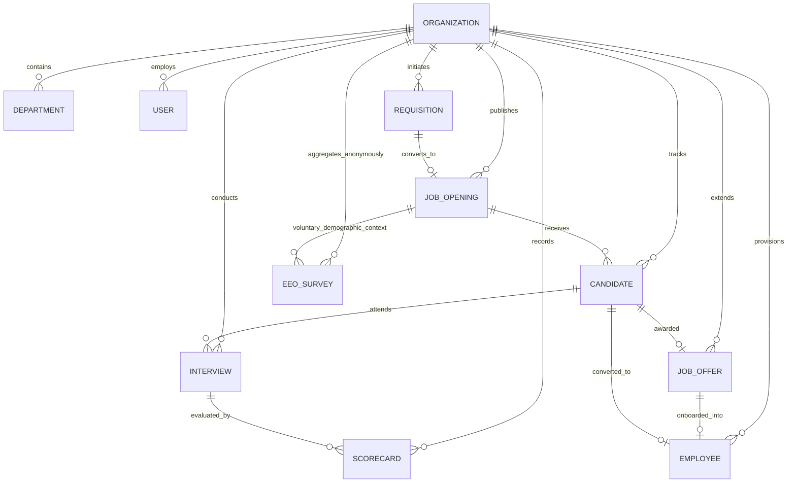

# Nebula Recruitment Module: Backend Architecture, APIs & Data Models

---

## 1. System Architecture Overview

The **Nebula Recruitment Engine Backend** is engineered on a resilient, multi-tenant Node.js and Express architecture backed by MongoDB with Mongoose object modeling. It provides enterprise security, mathematical compensation governance, strict anti-bias regulatory compliance, and a dual-provider AI pipeline.

### Core Architectural Principles
1. **Multi-Tenant Scope Isolation**: Every query is strictly isolated via `scopedFilter(req, query)` ensuring complete data isolation between organizations.
2. **Strict EEO Anti-Bias Decoupling**: Demographic survey responses are stored without any foreign keys to candidate profiles, ensuring 100% legal compliance and preventing cognitive bias in evaluators.
3. **Deterministic AI Resilience**: All AI features use Zod-validated prompt schemas with an automatic fallback provider guaranteeing zero downtime.
4. **Audit Immutability**: All state transitions (stage moves, interview reschedules, scorecard sealing, offer approvals, and e-signatures) emit append-only audit events in `RecruitmentActivity`.

---

## 2. Entity Relationship Diagram (ERD)

---

## 3. Database Schemas & Data Dictionary

### 3.1. `Requisition` (Headcount & Budget)
| Field | Type | Required | Description |
| :--- | :--- | :--- | :--- |
| `organizationId` | ObjectId | Yes | Multi-tenant tenant identifier |
| `reqCode` | String | Yes | Unique code (e.g., `REQ-2026-ENG-001`) |
| `title` | String | Yes | Approved role title |
| `departmentId` | ObjectId | Yes | Reference to Department |
| `openPositions` | Number | Yes | Number of positions approved (Min: 1) |
| `budget.min` | Number | Yes | Lower salary threshold |
| `budget.max` | Number | Yes | Upper salary cap |
| `budget.currency` | String | Yes | ISO currency code (`USD`, `EUR`, `INR`) |
| `reason` | Enum | Yes | `new_headcount`, `replacement`, `expansion` |
| `justification` | String | Yes | Business justification narrative |
| `approvalChain` | Array | Yes | Step-by-step role approvals (`pending`, `approved`, `rejected`) |
| `status` | Enum | Yes | `draft`, `pending_approval`, `approved`, `rejected`, `converted_to_job` |
| `jobOpeningId` | ObjectId | No | Linked JobOpening once converted |
| `requestedBy` | ObjectId | Yes | Reference to requesting User |

---

### 3.2. `JobOpening` (Published Position)
| Field | Type | Required | Description |
| :--- | :--- | :--- | :--- |
| `organizationId` | ObjectId | Yes | Multi-tenant tenant identifier |
| `jobCode` | String | Yes | Unique job identifier (e.g., `JOB-2026-001`) |
| `title` | String | Yes | Public role title |
| `departmentId` | ObjectId | Yes | Reference to Department |
| `locationType` | Enum | Yes | `remote`, `hybrid`, `on_site` |
| `employmentType` | Enum | Yes | `full_time`, `part_time`, `contract`, `intern` |
| `experienceLevel`| Enum | Yes | `entry`, `mid`, `senior`, `lead`, `executive` |
| `salaryRange` | Object | Yes | `min`, `max`, `currency` |
| `skills` | [String] | Yes | Array of core technical/role skills |
| `openPositions` | Number | Yes | Target headcount openings |
| `filledPositions`| Number | Yes | Number of filled hires (Default: 0) |
| `status` | Enum | Yes | `draft`, `published`, `on_hold`, `closed` |

---

### 3.3. `Candidate` (ATS Pipeline Record)
| Field | Type | Required | Description |
| :--- | :--- | :--- | :--- |
| `organizationId` | ObjectId | Yes | Multi-tenant tenant identifier |
| `candidateCode` | String | Yes | Unique code (e.g., `CAN-2026-001`) |
| `jobOpeningId` | ObjectId | No | Target JobOpening reference |
| `fullName` | String | Yes | Legal full name |
| `email` | String | Yes | Primary email address |
| `phone` | String | No | Contact phone number |
| `stage` | Enum | Yes | `applied`, `screening`, `interview_round_1`, `interview_round_2`, `technical_assessment`, `hr_round`, `offer_sent`, `hired`, `rejected`, `withdrawn` |
| `source` | Enum | Yes | `careers_page`, `linkedin`, `referral`, `recruiter_outreach`, `job_portal`, `agency`, `other` |
| `rating` | Number | No | Evaluator consensus star rating (1-5) |
| `skills` | [String] | No | Parsed or candidate-submitted competencies |
| `stageHistory` | Array | Yes | Audit log of stage transitions with timestamps |
| `convertedEmployeeId` | ObjectId | No | Linked Employee record once hired |
| `hiredAt` | Date | No | Timestamp of formal hire completion |

---

### 3.4. `Scorecard` (Competency Evaluation)
| Field | Type | Required | Description |
| :--- | :--- | :--- | :--- |
| `organizationId` | ObjectId | Yes | Multi-tenant tenant identifier |
| `interviewId` | ObjectId | Yes | Reference to Interview |
| `candidateId` | ObjectId | Yes | Reference to Candidate |
| `interviewerId` | ObjectId | Yes | Evaluator user reference |
| `competencyRatings` | Array | Yes | Array of `{ name, rating (1-5), weight, notes }` |
| `overallRating` | Number | Yes | 1-5 overall score |
| `recommendation` | Enum | Yes | `strong_hire`, `hire`, `neutral`, `no_hire`, `strong_no_hire` |
| `strengths` | String | No | Qualitative strengths text |
| `areasOfConcern` | String | No | Potential risks or skill gaps |
| `isSealed` | Boolean | Yes | Tamper-proof sealing flag (Immutable once true) |
| `sealedAt` | Date | No | Timestamp of sealing |

---

### 3.5. `JobOffer` (Compensation & E-Sign)
| Field | Type | Required | Description |
| :--- | :--- | :--- | :--- |
| `organizationId` | ObjectId | Yes | Multi-tenant tenant identifier |
| `offerCode` | String | Yes | Unique code (e.g., `OFF-2026-001`) |
| `candidateId` | ObjectId | Yes | Reference to Candidate |
| `jobOpeningId` | ObjectId | Yes | Reference to JobOpening |
| `designation` | String | Yes | Official job title extended |
| `departmentId` | ObjectId | Yes | Reference to Department |
| `offeredSalary` | Number | Yes | Total annual CTC figure |
| `compensationBreakdown` | Object | Yes | Itemized `{ baseSalary, variableBonus, equity, signOnBonus, relocation, allowances, totalCtc }` |
| `bandGovernance` | Object | Yes | `{ bandMin, bandMax, isDeviation, deviationPercent, justification }` |
| `approvalChain` | Array | Yes | Ordered approver steps (`recruiter`, `hiring_manager`, `finance_head`, `hr_director`) |
| `eSignature` | Object | Yes | Cryptographic `{ signToken, tokenExpiresAt, signedAt, signedIp, signedUserAgent, signerName, signatureImageUrl }` |
| `status` | Enum | Yes | `draft`, `pending_approval`, `approved`, `sent`, `accepted`, `declined`, `revoked` |

---

### 3.6. `EeoSurvey` (Anonymous Compliance Model)
> **LEGAL INVARIANCE**: This model contains **zero references** to `candidateId` or `applicantId`. All records belong only to `organizationId` and optional `jobOpeningId`.
| Field | Type | Required | Description |
| :--- | :--- | :--- | :--- |
| `organizationId` | ObjectId | Yes | Multi-tenant tenant identifier |
| `jobOpeningId` | ObjectId | No | Contextual job opening reference |
| `gender` | Enum | Yes | `male`, `female`, `non_binary`, `declined` |
| `ethnicity` | Enum | Yes | Standard EEOC categories or `declined` |
| `veteranStatus` | Enum | Yes | `veteran`, `non_veteran`, `declined` |
| `disabilityStatus`| Enum | Yes | `has_disability`, `no_disability`, `declined` |
| `stageReached` | Enum | Yes | Stage at submission (default: `applied`) |

---

## 4. API Endpoints Catalog

### 4.1. Public & Candidate Endpoints (Zero-Login)
| Method | Endpoint | Description |
| :--- | :--- | :--- |
| `GET` | `/api/v1/recruitment/public/careers/:tenantSlug` | Retrieves branded organization details and open positions |
| `GET` | `/api/v1/recruitment/public/careers/:tenantSlug/jobs/:jobId` | Retrieves job opening specifications and application form schema |
| `POST` | `/api/v1/recruitment/public/careers/:tenantSlug/jobs/:jobId/apply` | Ingests candidate application with resume upload & duplicate checks |
| `POST` | `/api/v1/recruitment/public/:tenantSlug/jobs/:jobId/eeo` | Ingests anonymous voluntary EEO demographic survey response |
| `GET` | `/api/v1/recruitment/public/offers/:token` | Retrieves full job offer letter document using cryptographic token |
| `POST` | `/api/v1/recruitment/public/offers/:token/sign` | Captures digital e-signature (IP, timestamp, signature base64) and transitions offer to `accepted` |
| `POST` | `/api/v1/recruitment/public/offers/:token/decline` | Records candidate offer decline with feedback rationale |

---

### 4.2. Internal Recruitment Operations Endpoints (Authenticated)
| Method | Endpoint | Required Role | Description |
| :--- | :--- | :--- | :--- |
| `GET` | `/api/v1/recruitment/overview` | `recruiter`, `hr`, `admin` | Aggregated KPI metrics and stage counts |
| `GET` | `/api/v1/recruitment/requisitions` | `recruiter`, `hr`, `admin` | List headcount requisitions with filters |
| `POST` | `/api/v1/recruitment/requisitions` | `hr`, `admin`, `manager` | Create new headcount requisition |
| `POST` | `/api/v1/recruitment/requisitions/:id/approve`| `manager`, `finance`, `admin` | Approve step in requisition approval chain |
| `POST` | `/api/v1/recruitment/requisitions/:id/convert-to-job` | `recruiter`, `hr`, `admin` | Convert approved requisition to Job Opening |
| `GET` | `/api/v1/recruitment/jobs` | Authenticated | List job openings with applicant metrics |
| `POST` | `/api/v1/recruitment/jobs` | `recruiter`, `hr`, `admin` | Create and publish new job opening |
| `GET` | `/api/v1/recruitment/pipeline` | `recruiter`, `hr`, `admin` | Full Kanban payload across all 7 stages |
| `PATCH`| `/api/v1/recruitment/candidates/:id/stage` | `recruiter`, `hr`, `admin` | Drag-and-drop candidate stage transition |
| `POST` | `/api/v1/recruitment/interviews` | `recruiter`, `hr`, `admin` | Schedule multi-evaluator interview |
| `POST` | `/api/v1/recruitment/interviews/:id/scorecards` | `interviewer`, `hr` | Submit structured 1-5 competency scorecard |
| `POST` | `/api/v1/recruitment/interviews/:id/scorecards/seal` | `interviewer`, `hr` | Seal scorecard against retrospective edits |
| `POST` | `/api/v1/recruitment/interviews/:id/consensus` | `manager`, `hr`, `admin` | Record calibration debrief & consensus outcome |
| `GET` | `/api/v1/recruitment/interviews/:id/ics` | Authenticated | Generate RFC 5545 iCalendar invite file |
| `POST` | `/api/v1/recruitment/offers` | `recruiter`, `hr`, `admin` | Create itemized offer with band governance check |
| `POST` | `/api/v1/recruitment/offers/:id/approve-step` | `manager`, `finance`, `admin`| Execute step in multi-role offer approval chain |
| `POST` | `/api/v1/recruitment/offers/:id/send` | `recruiter`, `hr`, `admin` | Generate cryptographic token and dispatch offer |
| `POST` | `/api/v1/recruitment/candidates/:id/onboard-employee` | `hr`, `admin` | Seamlessly convert hired candidate to HRMS Employee |
| `GET` | `/api/v1/recruitment/analytics/overview` | `recruiter`, `hr`, `admin` | Top-level recruitment velocity & hire KPIs |
| `GET` | `/api/v1/recruitment/analytics/funnel` | `recruiter`, `hr`, `admin` | Sequential stage pass-through and drop-off rates |
| `GET` | `/api/v1/recruitment/analytics/sources` | `recruiter`, `hr`, `admin` | Sourcing channel ROI and conversion rates |
| `GET` | `/api/v1/recruitment/analytics/velocity` | `recruiter`, `hr`, `admin` | Time-to-hire & Time-to-fill by department |
| `POST` | `/api/v1/recruitment/reports/export` | `recruiter`, `hr`, `admin` | Generate on-demand RFC 4180 CSV reports |
| `GET` | `/api/v1/recruitment/compliance/eeo` | `hr`, `admin` | Anonymous demographic breakdown summary |
| `GET` | `/api/v1/recruitment/compliance/adverse-impact` | `hr`, `admin` | Four-Fifths (80%) Rule disparate impact analysis |
| `POST` | `/api/v1/recruitment/search/semantic` | `recruiter`, `hr`, `admin` | Natural language candidate dossier retrieval |
| `GET` | `/api/v1/recruitment/jobs/:jobId/silver-medalists` | `recruiter`, `hr`, `admin` | Discover qualified late-stage runners-up |
| `POST` | `/api/v1/recruitment/ai/copilot` | `recruiter`, `hr`, `admin` | Recruiter AI Copilot dossier synthesis & briefing |

---

## 5. Mathematical Engines & Algorithms

### 5.1. Itemized CTC Calculation Formula
$$\text{Total CTC} = \text{Base Salary} + \text{Variable Bonus} + \text{Equity Estimated Value} + \text{Sign-on Bonus} + \text{Relocation} + \sum \text{Allowances}$$

### 5.2. Compensation Band Governance & Deviation Percentage
$$\text{Deviation } \% = \begin{cases} 
0 & \text{if } \text{Total CTC} \le \text{Band Max} \\
\frac{\text{Total CTC} - \text{Band Max}}{\text{Band Max}} \times 100 & \text{if } \text{Total CTC} > \text{Band Max}
\end{cases}$$
- **Threshold Rule**: If $\text{Deviation } \% > 0$, the offer is automatically flagged `isOutOfBand = true` and dynamically injects `finance_head` approval into the authorization chain.

### 5.3. EEOC Four-Fifths (80%) Rule Adverse Impact Diagnostic
1. **Selection Rate per Group $i$**:
   $$SR_i = \frac{\text{Hires}_i}{\text{Total Applicants}_i}$$
2. **Benchmark Selection Rate ($SR_{\text{bench}}$)**:
   $$SR_{\text{bench}} = \max_{i} (SR_i)$$
3. **Impact Ratio ($IR_i$)**:
   $$IR_i = \frac{SR_i}{SR_{\text{bench}}}$$
4. **Adverse Impact Determination**:
   $$\text{Adverse Disparity} = \begin{cases} 
   \text{TRUE (Alert Flagged)} & \text{if } IR_i < 0.80 \text{ and } \text{Total Applicants}_i \ge 5 \\
   \text{FALSE (Compliant)} & \text{if } IR_i \ge 0.80
   \end{cases}$$

### 5.4. Recruitment Funnel Conversion & Drop-off
$$\text{Pass-Through Rate}_k = \frac{\text{Count}_k}{\text{Count}_{k-1}} \times 100$$
$$\text{Drop-Off Rate}_k = 100 - \text{Pass-Through Rate}_k$$
$$\text{Overall Conversion} = \frac{\text{Hired Count}}{\text{Total Applied}} \times 100$$

### 5.5. Hiring Velocity
- **Time-to-Hire**: Calendar days elapsed between `candidate.appliedAt` and `candidate.hiredAt`.
- **Time-to-Fill**: Calendar days elapsed between `jobOpening.openedAt` and `jobOpening.closedAt`.
