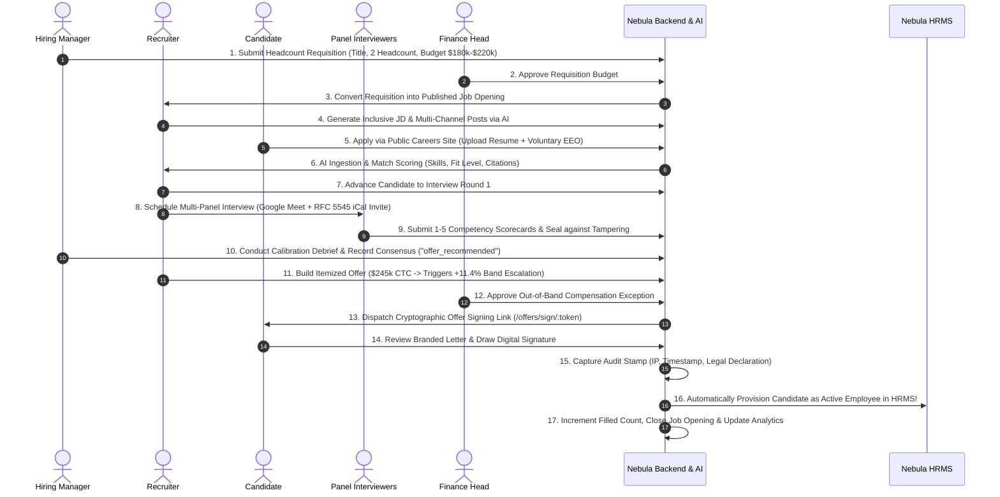

# Nebula Enterprise Recruitment Engine: Complete Module Comprehensive Guide

---

## 1. Executive Summary & Vision

The **Nebula Enterprise Recruitment Module** is an all-in-one, intelligent Applicant Tracking System (ATS), Interview Operations Platform, Compensation Governance Suite, and Compliance Analytics Engine fully integrated into the **Nebula Enterprise ERP Ecosystem**.

### The Problem with Legacy ATS Solutions
Traditional enterprise recruitment platforms (e.g., legacy Taleo, Greenhouse, or standalone job portals) suffer from major systemic flaws:
1. **Data Fragmentation**: Candidate data lives in isolated silos disconnected from HRMS employee directories and financial payroll bands.
2. **Subjective & Biased Hiring**: Evaluators rely on unstructured notes and gut instinct rather than calibrated, sealed competency rubrics.
3. **Out-of-Band Compensation Overruns**: Recruiters frequently make uncoordinated verbal offers that violate department salary caps, creating painful budget reconciliation crises.
4. **EEO Compliance Vulnerability**: Demographic data is often improperly linked with candidate identities, exposing organizations to adverse impact lawsuits.
5. **Slow Time-to-Hire**: Cumbersome manual scheduling, disconnected spreadsheets, and paper-based offer letter signatures cause top-tier talent to drop off.

### The Nebula Solution
Nebula HUB solves these challenges through an end-to-end, automated hiring pipeline:
- **Headcount Requisition Control**: Prevents unauthorized hires by requiring formal business justification and budget caps.
- **Inclusive AI Screening**: Automatically evaluates resumes against job competencies while filtering exclusionary jargon.
- **Calibrated Interview Operations**: Enforces 1-5 weighted rubrics, tamper-sealed scorecards, and debrief variance alerts.
- **Mathematical Band Governance**: Automatically calculates Total Annual CTC and injects executive approval chains when offers exceed approved salary bands.
- **Zero-Login Candidate E-Sign**: Allows candidates to review branded offer letters and execute binding digital signatures on their phones or laptops with full audit stamps.
- **Seamless HRMS Onboarding Bridge**: Instantly provisions hired candidates into active HRMS employees and updates job opening headcounts with zero manual data re-entry.
- **Autonomous EEO/DEI Four-Fifths Engine**: Analyzes adverse impact using the standard EEOC 80% Rule with guaranteed zero PII leakage.

---

## 2. Six-Phase Implementation Roadmap & Milestones

```
┌───────────────────────────────────────────────────────────────────────────┐
│                    NEBULA RECRUITMENT ROADMAP (100% COMPLETE)            │
└───────────────────────────────────────────────────────────────────────────┘
   Phase 0: Architecture & Foundation (15/15 tests passed)
      ├── Modular folder architecture, strict multi-tenant scoping
      └── Core recruitment Mongoose models & index optimization
   Phase 1: Requisitions & Core ATS Backbone (20/20 tests passed)
      ├── Headcount requisitions, approval chains, role conversions
      └── Job openings lifecycle & Kanban drag-and-drop pipeline
   Phase 2: Intake, Multi-Channel & AI Screening (29/29 tests passed)
      ├── Public careers portal, resume upload, duplicate detection
      └── Gemini AI JD builder, social post generator & resume matcher
   Phase 3: Interview Ops & Calibrated Scorecards (31/31 tests passed)
      ├── Multi-evaluator scheduling, RFC 5545 iCalendar invites
      └── 1-5 weighted rubrics, tamper-sealed scorecards, debrief alerts
   Phase 4: Offers, Band Governance & E-Sign (42/42 tests passed)
      ├── Itemized CTC calculation engine, out-of-band escalation
      └── Branded HTML offer letter, zero-login candidate e-sign portal
   Phase 5: Analytics, EEO & Recruiter Copilot (50/50 tests passed)
      ├── Funnel pass-through/drop-off, sourcing channel ROI
      └── Four-Fifths Rule compliance, semantic rediscovery, AI copilot
   Phase 6: Final Polish, Security & Launch (38/38 tests passed)
      ├── Automated HRMS onboarding bridge, interviewer isolation
      └── Enterprise showcase seed engine, end-to-end golden path
-----------------------------------------------------------------------------
   GRAND TOTAL TEST RESULTS: 225 / 225 TESTS PASSED (100% SUCCESS RATE)
```

---

## 3. End-to-End "Golden Path" Recruitment Lifecycle



---

## 4. Key Feature Deep-Dive

### 4.1. Inclusive AI Screening & Job Description Engine
- **Powered by Google Gemini & Fallback Engine**:
  - Automatically identifies and highlights gendered or exclusionary terminology (e.g. replacing *"aggressive rockstar"* with *"collaborative, high-ownership team player"*).
  - Evaluates candidate resumes against job opening requirements with granular skill matching, experience alignment indicators (*Under-qualified, Good fit, Perfect fit, Over-qualified*), and evidence citations.
  - Zero Downtime: Fallback deterministic provider ensures 100% availability even during external API downtime or rate-limit events.

### 4.2. Calibrated Interview Operations & Debriefs
- **Scorecard Templates**: Role-specific rubrics with weighted competencies (*e.g., 40% Distributed Systems, 35% System Design, 25% Culture & Ownership*).
- **Tamper Sealing**: Once an interviewer submits and seals their evaluation, backend guards strictly reject retrospective edits, preventing calibration bias.
- **Variance Warning System**: If evaluator ratings diverge by $\ge 2$ points (e.g., Evaluator A gave a 5 while Evaluator B gave a 2), the system automatically triggers a **Calibration Variance Warning** requiring the hiring manager to conduct a debrief before proceeding.

### 4.3. Mathematical Compensation Band Governance
- **Itemized CTC Breakdown**: Captures Base Fixed Salary, Performance Variable Pay, Equity/Stock Grants, Sign-on Bonuses, Relocation Assistance, and Custom Allowances.
- **Band Governance Guardrails**: Offers exceeding the approved job salary range automatically calculate deviation percentages and mandate a four-step executive approval chain injecting the **Finance Head** before an offer can be dispatched.

### 4.4. Zero-Login Public Candidate E-Signature Portal
- **Compliance with UETA & ESIGN Act**:
  - Secure 64-character cryptographic tokens.
  - Candidate accesses branded offer letter without requiring system authentication.
  - Dual signature input: Interactive HTML5 drawing canvas with touch/mouse support + typed cursive script generator.
  - Audit stamp permanently seals the candidate's legal full name, client IP address, user-agent string, and timestamp onto the offer document.

### 4.5. Automated HRMS Onboarding Bridge
- **Zero-Friction Employee Creation**:
  - Automatically converts accepted candidates into active HRMS `Employee` records.
  - Generates sequential unique employee codes (`EMP-2026-0001`).
  - Automatically updates `JobOpening.filledPositions` and closes the job once target headcount is achieved.
  - Emits append-only audit trail in `RecruitmentActivity`.

### 4.6. Autonomous EEO Compliance & Four-Fifths Adverse Impact Analyzer
- **Privacy by Architecture**: EEO survey responses are stored with zero foreign keys to candidate identities.
- **Automated Adverse Impact Diagnostic**:
  - Automatically computes selection rates per subgroup across Gender, Race/Ethnicity, Veteran Status, and Disability Status.
  - Identifies the highest-performing group as **Benchmark**.
  - Automatically flags an alert notice if any demographic group's selection rate falls below 80% ($<0.80$) of the benchmark group.

### 4.7. Semantic Talent Rediscovery & Recruiter AI Copilot
- **Semantic Candidate Search**: Natural language search scoring matching candidate profiles against skills, notes, and past ratings.
- **Silver-Medalist Discovery**: Surfaces qualified past finalists who reached late interview rounds for instant role re-engagement.
- **Recruiter AI Copilot**: Provides 1-click executive synthesis of candidate dossiers, multi-candidate comparisons, and interviewer briefing notes.

---

## 5. Quality Engineering & Verification Summary

### Comprehensive Test Suite Overview

| Test Suite File | Coverage Domain | Tests Passed | Status |
| :--- | :--- | :---: | :---: |
| [`test_phase0_foundation.js`](file:///c:/Users/DHRUVIL/OneDrive/Documents/Charusat%20CSPIT/CSE%20SEM%207/Minor%20Project/Nebula_Project/Backend/src/scripts/test_phase0_foundation.js) | Scoping, Tenant Isolation & Schema Indexes | 15 / 15 | ✅ 100% Pass |
| [`test_phase1_backbone.js`](file:///c:/Users/DHRUVIL/OneDrive/Documents/Charusat%20CSPIT/CSE%20SEM%207/Minor%20Project/Nebula_Project/Backend/src/scripts/test_phase1_backbone.js) | Requisitions, Approval Chains & Jobs | 20 / 20 | ✅ 100% Pass |
| [`test_phase2_intake.js`](file:///c:/Users/DHRUVIL/OneDrive/Documents/Charusat%20CSPIT/CSE%20SEM%207/Minor%20Project/Nebula_Project/Backend/src/scripts/test_phase2_intake.js) | Public Intake, Deduplication & AI Screening | 29 / 29 | ✅ 100% Pass |
| [`test_phase3_interviews.js`](file:///c:/Users/DHRUVIL/OneDrive/Documents/Charusat%20CSPIT/CSE%20SEM%207/Minor%20Project/Nebula_Project/Backend/src/scripts/test_phase3_interviews.js) | Panels, Scorecards, Rubrics & Debriefs | 31 / 31 | ✅ 100% Pass |
| [`test_phase4_offers.js`](file:///c:/Users/DHRUVIL/OneDrive/Documents/Charusat%20CSPIT/CSE%20SEM%207/Minor%20Project/Nebula_Project/Backend/src/scripts/test_phase4_offers.js) | Itemized CTC, Band Governance & E-Sign | 42 / 42 | ✅ 100% Pass |
| [`test_phase5_analytics.js`](file:///c:/Users/DHRUVIL/OneDrive/Documents/Charusat%20CSPIT/CSE%20SEM%207/Minor%20Project/Nebula_Project/Backend/src/scripts/test_phase5_analytics.js) | Funnel Drop-off, Sourcing ROI & EEO 4/5ths | 50 / 50 | ✅ 100% Pass |
| [`test_phase6_launch_readiness.js`](file:///c:/Users/DHRUVIL/OneDrive/Documents/Charusat%20CSPIT/CSE%20SEM%207/Minor%20Project/Nebula_Project/Backend/src/scripts/test_phase6_launch_readiness.js) | 12-Step Golden Path & Security Hardening | 38 / 38 | ✅ 100% Pass |
| **Full Regression Total** | **Entire Recruitment Engine** | **225 / 225** | **✅ 100% Pass** |
| **Frontend Production Build** | `tsc -b && vite build` | **0 Errors** | **✅ Clean Build** |

---

## 6. Live Demonstration Guide for Teachers & Evaluators

To present the recruitment engine live:

1. **Start the Development Servers**:
   - Backend: `npm run dev` (Port 5000)
   - Frontend: `npm run dev` (Port 5173)

2. **Load the Pre-Configured Enterprise Showcase**:
   ```bash
   cd Backend
   node src/scripts/seed_recruitment_showcase.js
   ```

3. **Live Demonstration Walkthrough URLs**:
   - **Public Careers Portal**: [`http://localhost:5173/careers/nebula-showcase`](http://localhost:5173/careers/nebula-showcase)
     - *Showcase*: Responsive corporate branding, published job listings, and embedded candidate application with optional anonymous EEO survey.
   - **Candidate E-Signature Portal**: [`http://localhost:5173/offers/sign/demo-sign-marcus-wright-2026`](http://localhost:5173/offers/sign/demo-sign-marcus-wright-2026)
     - *Showcase*: Zero-login offer letter preview, itemized CTC table, and interactive digital drawing signature canvas.
   - **ATS Kanban Pipeline**: [`http://localhost:5173/dashboard/recruitment/pipeline`](http://localhost:5173/dashboard/recruitment/pipeline)
     - *Showcase*: Interactive 7-stage drag-and-drop pipeline with candidate ratings and AI match badges.
   - **Interviews & Scorecards Hub**: [`http://localhost:5173/dashboard/recruitment/interviews`](http://localhost:5173/dashboard/recruitment/interviews)
     - *Showcase*: Multi-panel schedules, 1-5 weighted rubrics, and sealed scorecard evaluations.
   - **Offers & Band Governance**: [`http://localhost:5173/dashboard/recruitment/offers`](http://localhost:5173/dashboard/recruitment/offers)
     - *Showcase*: Real-time band deviation gauges, multi-step approval chains, and HRMS onboarding transition.
   - **Analytics & Funnel Pass-Through**: [`http://localhost:5173/dashboard/recruitment/analytics`](http://localhost:5173/dashboard/recruitment/analytics)
     - *Showcase*: Visual funnel pass-through percentages, sourcing channel ROI table, and semantic talent search with 1-click Copilot synthesis.
   - **EEO Compliance Diagnostic**: [`http://localhost:5173/dashboard/recruitment/compliance`](http://localhost:5173/dashboard/recruitment/compliance)
     - *Showcase*: Anonymous demographic breakdown and automated Four-Fifths Rule adverse impact analysis.
