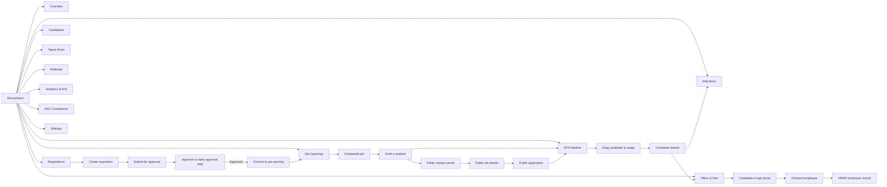
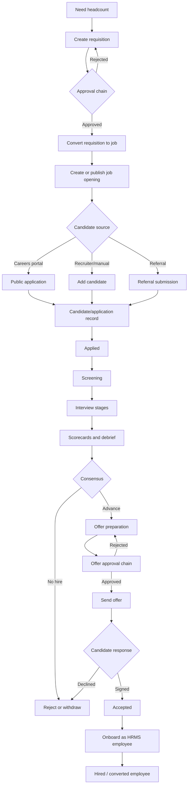
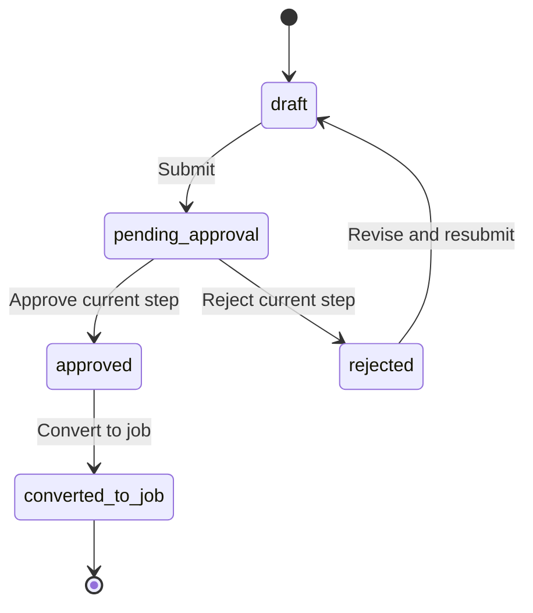
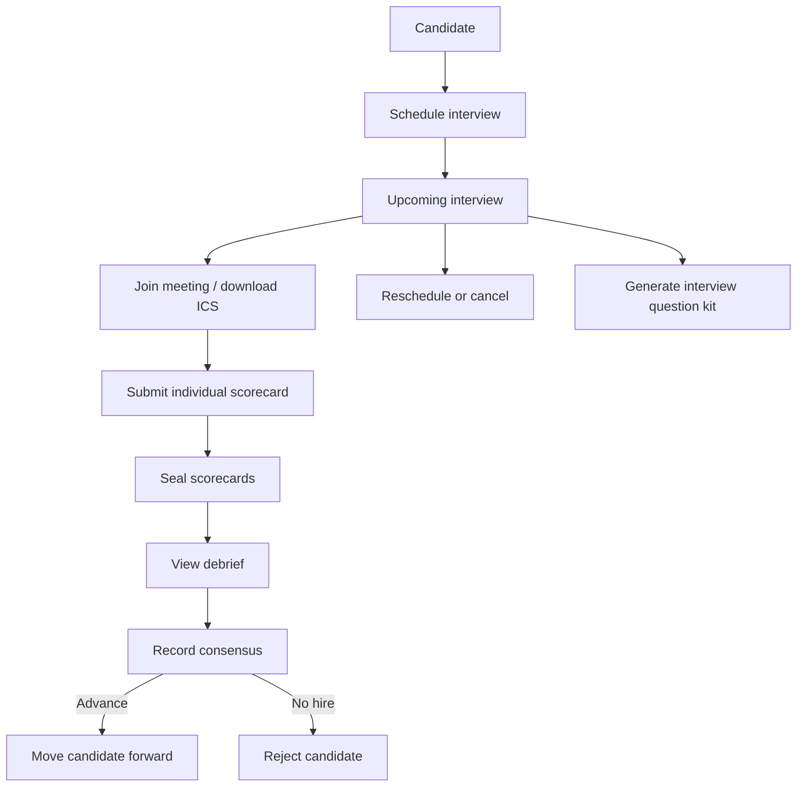

# Recruitment Module — UI Flow, Sub-menu Flowchart, Architecture and Bug Review

> **Scope:** Recruitment/ATS only.  
> **Analysis basis:** Current frontend routes/components, recruitment hooks/API client, backend recruitment routes/controllers, and the existing recruitment documentation.  
> **Review date:** 20 October 2026  
> **Change policy:** This document is analysis-only. No Recruitment implementation file or non-Recruitment module was changed.

## 1. Module purpose

Recruitment is a multi-tenant applicant-tracking workflow that connects:

1. Headcount planning through requisitions.
2. Job creation and publishing.
3. Candidate/application intake.
4. Pipeline stage management.
5. Interviews, scorecards and debrief consensus.
6. Offer approval, e-signature and onboarding into HRMS.
7. Talent pools, referrals, AI assistance, analytics and EEO reporting.

The internal UI is mounted below `/dashboard/recruitment`. Public candidate journeys are separate from the authenticated application:

- Careers portal: `/careers/:tenantSlug`
- Public job details/application: `/careers/:tenantSlug/jobs/:jobId`
- Candidate offer signing: `/offers/sign/:token`

## 2. Entry points and access boundary

```mermaid
flowchart TD
    A[Landing page or authenticated dashboard] --> B{Recruitment entry}
    B -->|Authenticated| C[/dashboard/recruitment]
    B -->|Public careers link| D[/careers/:tenantSlug]
    B -->|Offer sign link| E[/offers/sign/:token]

    C --> F[ProtectedRoute]
    F --> G[AppShell and Recruitment sidebar group]
    G --> H[Recruitment page route]

    D --> I[Public careers controller]
    E --> J[Public offer controller]
    H --> K[Recruitment API]
    K --> L[requireAuth]
    L --> M[requireModuleAccess recruitment/action]
```

Internal backend routes are mounted by `Backend/src/app.js` as `/api/v1/recruitment`. Public careers and public offer routes are declared before `requireAuth`; all internal routes after that middleware require an authenticated session and module permission.

The permission actions used by the route layer are:

| Action | Typical meaning |
|---|---|
| `view` | Read pages, dashboards, lists, analytics and generated previews |
| `create` | Create jobs, candidates, interviews, offers and requisitions |
| `edit` | Update records, move stages, reschedule and edit settings |
| `approve` | Approve/reject requisitions and offer steps, send offers, reach consensus, onboard |
| `delete` | Delete jobs, candidates, interviews and talent pools |

## 3. Complete internal UI sitemap and sub-menu flow

The sidebar group is defined in `Frontend/src/components/shell/Sidebar.tsx`. The matching route components are registered in `Frontend/src/App.tsx`.



### Route-to-screen table

| Sidebar label | UI route | Page component | Main purpose |
|---|---|---|---|
| Overview | `/dashboard/recruitment` | `RecruitmentDashboardPage` | KPIs, stage summary, active jobs, upcoming interviews and quick actions |
| Requisitions | `/dashboard/recruitment/requisitions` | `RequisitionsPage` | Headcount request, approval and conversion |
| Job Openings | `/dashboard/recruitment/jobs` | `JobsPage` | Job CRUD, status, departments, LinkedIn/social generation |
| ATS Pipeline | `/dashboard/recruitment/pipeline` | `PipelinePage` | Kanban candidate movement and candidate quick actions |
| Candidates | `/dashboard/recruitment/candidates` | `CandidatesPage` | Search/filter candidate directory, drawer, bulk actions and onboarding |
| Talent Pools | `/dashboard/recruitment/talent-pools` | `TalentPoolsPage` | Create pools and add/remove candidates |
| Referrals | `/dashboard/recruitment/referrals` | `ReferralsPage` | Submit referrals and update referral status |
| Interviews | `/dashboard/recruitment/interviews` | `InterviewsPage` | Upcoming/past interviews, reschedule/cancel, question kits and debrief |
| Offers & Hire | `/dashboard/recruitment/offers` | `OffersPage` | Create, approve, reject, send, preview, sign and onboard offers |
| Analytics & ROI | `/dashboard/recruitment/analytics` | `RecruitmentAnalyticsPage` | Overview, funnel, sources, velocity, semantic search and export |
| EEO Compliance | `/dashboard/recruitment/compliance` | `EeoCompliancePage` | Demographic aggregation and adverse-impact metrics |
| Settings | `/dashboard/recruitment/settings` | `RecruitmentSettingsPage` | Pipeline templates, rejection reasons, AI governance and retention controls |

## 4. End-to-end business flow



### Candidate stage model

The backend candidate model defines the stage vocabulary used by the Kanban:

`applied` → `screening` → `interview_round_1` → `interview_round_2` → `technical_assessment` → `hr_round` → `offer_sent` → `hired`

Terminal/alternate stages include `rejected` and `withdrawn`. The UI can drag between the configured stage columns, while the backend validates the target against `CANDIDATE_STAGES`, records `stageHistory`, updates the candidate, and creates a `RecruitmentActivity` record.

## 5. Screen-level UI flows

### 5.1 Overview

1. Load summary KPIs through `useRecruitmentSummary`.
2. Load published jobs for the active job list.
3. Show candidate pipeline stage counts.
4. Show upcoming interviews and quick links.
5. If the user can create, expose **Add Candidate** and **Create Job**.
6. Candidate/job quick actions open the corresponding modal or navigate to pipeline.

### 5.2 Requisitions



The page supports department/status filtering, creation, submit, approval/rejection comments, and conversion of an approved requisition into a job opening.

### 5.3 Jobs

1. Filter by status, department, employment type and search.
2. Create a job in `CreateJobModal`.
3. Persist job data through `POST /jobs`.
4. Toggle/update status or edit job details.
5. Generate a LinkedIn or multi-channel post using the AI endpoints.
6. Delete only when the user has delete permission.
7. Open the related ATS pipeline from a job row.

Publishing a job makes it available to the public careers endpoints when its status is eligible.

### 5.4 Pipeline and candidate drawer

`RecruitmentKanban` uses `@dnd-kit/core`:

1. Candidate cards are draggable.
2. Stage columns are droppable.
3. On drag end, the UI calls `PATCH /candidates/:id/stage`.
4. The mutation invalidates recruitment queries and reloads the board.
5. Clicking a card opens `CandidateDrawer`.
6. The drawer can schedule an interview, create an offer, or start onboarding.

The pipeline also supports job filtering, text search and adding a candidate.

### 5.5 Candidate directory

The candidate page provides search, source/stage filters, refresh, row selection, a candidate drawer, bulk action bar, add candidate, schedule interview, create offer and onboarding. The candidate detail endpoint returns the candidate plus related interviews, offer and activity records.

### 5.6 Interviews and evaluations



The page has all/upcoming/past views, question-kit generation, scorecard/debrief actions, rescheduling and cancellation.

### 5.7 Offers and hire

1. Select a candidate and create an offer.
2. Backend calculates total CTC and compensation band governance.
3. Offer enters draft or pending approval.
4. Approvers approve/reject the current step.
5. Approved offers can be sent to the candidate.
6. Candidate receives a tokenized public offer link.
7. Candidate previews PDF, signs or declines.
8. Internal user onboards the accepted candidate into HRMS.

### 5.8 Analytics, compliance and settings

- **Analytics:** overview, funnel by job, source ROI, velocity, report export, semantic candidate search and silver-medalist rediscovery.
- **EEO:** public voluntary survey submission, demographic aggregation and adverse-impact analysis. The UI should be treated as aggregate reporting, not candidate-level evaluation.
- **Settings:** pipeline templates, rejection reasons, recruitment settings, AI governance, data retention and operational configuration.

## 6. Public candidate flows

```mermaid
flowchart TD
    A[/careers/:tenantSlug] --> B[List public jobs]
    B --> C[/careers/:tenantSlug/jobs/:jobId]
    C --> D[Submit application]
    D --> E[Optional EEO survey]
    D --> F[Internal candidate/application pipeline]

    G[Offer email/link] --> H[/offers/sign/:token]
    H --> I[Load public offer]
    I --> J[Preview PDF]
    I --> K[Sign]
    I --> L[Decline with reason]
    K --> M[Internal accepted offer]
    M --> N[Onboard employee]
```

Public endpoints intentionally sit outside `requireAuth`, but still need tenant/job/offer-token validation and rate limiting at the controller or surrounding middleware level.

## 7. Frontend architecture

```mermaid
flowchart TD
    A[App.tsx route registry] --> B[AppShell]
    B --> C[Sidebar recruitment submenu]
    B --> D[Recruitment page]
    D --> E[Page-local state and modals]
    D --> F[useRecruitment.ts]
    F --> G[recruitmentApi.ts]
    G --> H[apiClient]
    H --> I[/api/v1/recruitment]
    E --> J[Recruitment components]

    F --> K[TanStack Query cache]
    K --> D
```

Important frontend building blocks:

- `useRecruitment.ts`: query/mutation hooks and cache invalidation.
- `recruitmentApi.ts`: typed API calls and public URL helpers.
- `types/recruitment.ts`: domain types and stage/status vocabulary.
- `components/recruitment/`: reusable Kanban, drawer, modal, pill and action components.
- `useModuleAccess('recruitment')`: action-level UI gating.

## 8. Backend architecture

```mermaid
flowchart TD
    A[Express app] --> B[/api/v1/recruitment router]
    B --> C{Public route}
    B --> D[requireAuth]
    D --> E[requireModuleAccess]
    E --> F[Controller]
    F --> G[Mongoose model]
    F --> H[RecruitmentActivity audit]
    F --> I[AI / calendar / PDF / email services]
    G --> J[(MongoDB)]

    F --> K[HRMS bridge]
    K --> L[Employee record]
```

The route file groups endpoints into summary, jobs, pipeline, candidates, interviews, scorecards, offers, onboarding, requisitions, applications, talent pools, referrals, AI, settings, analytics and compliance.

## 9. API capability map

| Capability | Representative endpoints |
|---|---|
| Summary | `GET /summary` |
| Jobs | `GET/POST /jobs`, `GET/PATCH/DELETE /jobs/:id`, `PATCH /jobs/:id/status` |
| Pipeline | `GET /pipeline`, `PATCH /candidates/:id/stage` |
| Candidates | `GET/POST /candidates`, `GET/PATCH/DELETE /candidates/:id` |
| Interviews | `GET/POST /interviews`, `PATCH /interviews/:id`, `/reschedule`, `/ics`, `/scorecard` |
| Scorecards | `/interviews/:interviewId/scorecards`, `/debrief`, `/consensus`, `/scorecards/:id/seal` |
| Offers | `GET/POST /offers`, submit/approve/reject/send/status/letter/PDF actions |
| Onboarding | `POST /candidates/:id/onboard-employee` |
| Requisitions | CRUD/read plus submit, approve, reject and convert-to-job |
| Applications | Read, stage move, bulk move/reject/tag |
| Pools/referrals | Talent-pool CRUD/membership and referral create/status |
| AI | Resume parse, match score, JD, social posts, question kit, copilot |
| Reporting | Analytics, EEO, adverse impact, export, semantic search |

## 10. Bug and risk findings

These findings are static-analysis findings from the current code. They are documented only; no fixes were applied.

| ID | Severity | Evidence | Finding | Impact |
|---|---|---|---|---|
| R-01 | High | `Backend/src/controllers/offerController.js:87` | Offer creation loads `JobOpening.findById(resolvedJobId)` without `organizationId` scoping, even though the candidate lookup is scoped. | A cross-tenant job ID can be read for compensation-band evaluation and can influence the new offer's job relationship. Use a tenant-scoped lookup and verify the candidate/job relationship. |
| R-02 | Medium | `Backend/src/controllers/offerController.js:87`, subsequent `compensationService.checkBandGovernance(jobOpening, ...)` | `resolvedJobId` is accepted from the request or candidate without an explicit existence check. The compensation service tolerates a missing job and falls back to an empty salary band, so invalid input is not rejected at the controller boundary. | The offer can receive zeroed band-governance values or fail later at model validation with a generic 500 instead of a clear 400/404. Validate the resolved job ID and return a clear error before compensation processing. |
| R-03 | High | `Backend/src/controllers/recruitmentPipelineController.js:91-104` | Moving a candidate to `hired` increments `JobOpening.filledPositions`, but moving the same candidate away from `hired` does not decrement it. The transition also does not guard against repeated hire/rehire transitions. | Headcount and vacancy counts can drift, affecting dashboards, job capacity and analytics. Make the transition accounting symmetric and atomic. |
| R-04 | Medium | `Backend/src/controllers/offerController.js` and related offer flow | Offer creation accepts `candidateId` and `jobOpeningId` independently. The candidate is tenant-scoped, but the selected job is not verified to belong to the candidate's organization or to be the candidate's target job. | An offer can be associated with an unrelated job opening; this also compounds R-01. Validate both tenant ownership and relationship consistency. |
| R-05 | Medium | Existing `docs/recruitment/AUDIT.md` (October 2026 findings) | The prior audit identifies non-atomic sequential code-generation hazards and several unscoped ID-based updates in the broader recruitment implementation history. Some locations have since been improved, so each finding should be revalidated before remediation. | Under concurrent creation, duplicate human-readable codes or cross-tenant updates may occur if any old path remains active. |
| R-06 | Low | `Frontend/src/lib/recruitmentApi.ts:352` and `:640` | Several AI client inputs use `any` (`generateInterviewQuestionKit` payload and resume parsing response path). | Compile-time protection is reduced at AI boundaries; malformed payloads can reach the server without frontend feedback. Replace with domain input/output types and validate server responses. |

### Recommended verification tests

1. Attempt offer creation with a valid candidate and a job ID from another organization; expect rejection and no offer.
2. Attempt offer creation without a resolvable job opening; expect a validation response, not a 500.
3. Move one candidate `screening → hired → screening → hired`; verify `filledPositions` equals one, not two.
4. Run concurrent job/candidate/offer creation for one tenant and assert unique codes.
5. Run every recruitment endpoint with a second tenant's IDs and assert no data disclosure or mutation.
6. Exercise public application and offer-token flows with invalid tenant slugs, job IDs, expired tokens and replayed sign requests.

## 11. Documentation consistency notes

The older recruitment UI documentation describes some intended behavior and names that do not exactly match the current implementation. The current source of truth for navigation is `App.tsx` plus `Sidebar.tsx`; the current source of truth for backend capability is `recruitmentRoutes.js`. In particular:

- The implemented candidate detail component is `CandidateDrawer`, not `CandidateDossierModal`.
- The implemented Kanban does use `@dnd-kit/core`; drag completion calls the candidate stage endpoint.
- Applications have backend bulk endpoints and hooks, but the principal visible pipeline/candidate pages operate on candidate records and should not be assumed to expose every application operation.
- Public careers and offer signing are route-level experiences outside the authenticated AppShell.

## 12. Files examined

- `Frontend/src/App.tsx`
- `Frontend/src/components/shell/Sidebar.tsx`
- `Frontend/src/pages/recruitment/*.tsx`
- `Frontend/src/pages/public/CareersPortalPage.tsx`
- `Frontend/src/pages/public/PublicJobDetailsPage.tsx`
- `Frontend/src/pages/public/CandidateOfferSigningPage.tsx`
- `Frontend/src/components/recruitment/*.tsx`
- `Frontend/src/hooks/useRecruitment.ts`
- `Frontend/src/lib/recruitmentApi.ts`
- `Frontend/src/types/recruitment.ts`
- `Backend/src/app.js`
- `Backend/src/routes/recruitmentRoutes.js`
- Recruitment controllers, middleware, models and services referenced by those routes
- Existing `docs/recruitment/*.md` documentation for comparison
