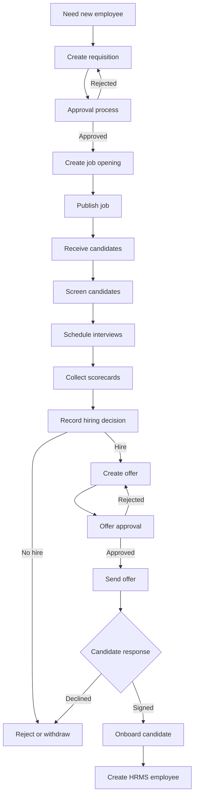

# Recruitment Module — Simple Technical Explanation

## 1. What is the Recruitment Module?

The Recruitment Module is an **Applicant Tracking System (ATS)** inside Nebula.

It helps an organization manage the complete hiring process:

```text
Need employee
    ↓
Create requisition
    ↓
Get approval
    ↓
Create job opening
    ↓
Receive candidates
    ↓
Screen and interview candidates
    ↓
Select candidate
    ↓
Create and approve offer
    ↓
Candidate signs offer
    ↓
Create employee in HRMS
```

In simple words, it is a **digital hiring pipeline**. It replaces spreadsheets, emails and disconnected hiring tools with one organized system.

## 2. Recruitment submenu

| Menu | Simple meaning |
|---|---|
| Overview | Hiring dashboard and important numbers |
| Requisitions | Request permission to hire someone |
| Job Openings | Create and manage vacancies |
| ATS Pipeline | Move candidates through hiring stages |
| Candidates | View and manage applicants |
| Talent Pools | Save promising candidates for future jobs |
| Referrals | Manage employee-referred candidates |
| Interviews | Schedule interviews and collect feedback |
| Offers & Hire | Create offers and onboard selected candidates |
| Analytics & ROI | View hiring reports and performance |
| EEO Compliance | View anonymous diversity and compliance data |
| Settings | Configure recruitment rules and stages |

## 3. Complete recruitment flow



## 4. Requisition flow

A requisition is an internal request that says:

> “We need permission and budget to hire one or more people for this role.”

Example:

```text
The Engineering department needs two developers.
```

A requisition normally contains:

- Job title
- Department
- Number of positions
- Salary budget
- Reason for hiring
- Business justification

Its status flow is:

```text
Draft
  ↓
Pending Approval
  ↓
Approved or Rejected
  ↓
Converted into Job Opening
```

## 5. Job opening flow

A job opening is the actual vacancy that candidates can apply for.

It may contain:

- Job title
- Department
- Location
- Employment type
- Experience level
- Salary range
- Required skills
- Job description
- Number of open positions

The job status can move through:

```text
Draft → Published → On Hold → Closed
```

When a job is published, it can appear on the public Careers Portal.

The module can also help generate:

- LinkedIn posts
- Multi-channel recruitment posts
- AI-assisted job descriptions

## 6. Candidate flow

Candidates can enter the system through several sources:

- Company Careers Portal
- Recruiter manually adding a candidate
- Employee referral
- Job portals
- LinkedIn
- Recruitment agencies

A candidate record may contain:

- Name
- Email and phone
- Resume
- Skills
- Experience
- Current company
- Expected salary
- Application source
- Applied job
- Current recruitment stage

## 7. ATS pipeline

The ATS pipeline works like a Kanban board. Each column represents one hiring stage.

```text
Applied
  ↓
Screening
  ↓
Interview Round 1
  ↓
Interview Round 2
  ↓
Technical Assessment
  ↓
HR Round
  ↓
Offer Sent
  ↓
Hired
```

Other possible outcomes are:

```text
Rejected
Withdrawn
```

### What happens when a candidate is dragged?

1. The recruiter drags the candidate card to another column.
2. The frontend detects the target stage.
3. The frontend sends the change to the backend.
4. The backend validates the stage.
5. The candidate record is updated.
6. The stage change is added to the candidate history.
7. A recruitment activity log is created.
8. The frontend refreshes the pipeline.

Therefore, drag-and-drop is not only a visual action. It also updates the database.

## 8. Candidate details

Clicking a candidate opens a details drawer. It can show:

- Personal details
- Resume
- Skills
- Job applied for
- Interview history
- Interview scorecards
- Offer details
- Activity history
- HRMS conversion information

From the candidate drawer, authorized users can:

- Schedule an interview
- Create an offer
- Start onboarding
- Review candidate information

## 9. Interview flow

The Interviews page manages interview operations.

```text
Candidate selected
    ↓
Schedule interview
    ↓
Interview takes place
    ↓
Interviewer submits scorecard
    ↓
Scorecards are sealed
    ↓
Recruiter views debrief
    ↓
Hiring team records consensus
    ↓
Candidate advances or is rejected
```

The module supports:

- Interview scheduling
- Rescheduling
- Cancellation
- Meeting links
- Calendar `.ics` downloads
- Interview question kits
- Individual interviewer scorecards
- Multi-interviewer debriefs
- Hiring consensus

A scorecard can include:

- Competency ratings
- Overall rating
- Strengths
- Areas of concern
- Hiring recommendation
- Interviewer comments

## 10. Offer and hiring flow

When the hiring team decides to select a candidate, an offer is created.

An offer may contain:

- Designation
- Salary
- Benefits
- Joining date
- Validity date
- Compensation breakdown
- Salary-band comparison
- Approval chain

The flow is:

```text
Create Offer
    ↓
Pending Approval
    ↓
Hiring Manager Approval
    ↓
Finance or HR Approval, if required
    ↓
Send Offer to Candidate
    ↓
Candidate Signs or Declines
    ↓
Onboard Candidate
```

The candidate receives a secure tokenized offer link:

```text
/offers/sign/:token
```

The candidate can:

- View the offer
- Download the offer PDF
- Sign the offer
- Decline the offer

After acceptance, an authorized user can convert the candidate into an employee in the HRMS module.

## 11. Public Careers Portal

The Recruitment Module also provides public pages that do not require internal login:

```text
/careers/:tenantSlug
/careers/:tenantSlug/jobs/:jobId
```

A visitor can:

1. Open the company's careers page.
2. Browse published jobs.
3. Open a job details page.
4. Submit an application.
5. Optionally submit anonymous EEO information.

The submitted application then enters the internal recruitment pipeline.

## 12. Talent pools

A talent pool is a saved group of candidates.

Examples:

```text
Frontend Developers
Senior Backend Engineers
Future Leadership Candidates
```

Recruiters can:

- Create a talent pool
- Add candidates
- Remove candidates
- Search candidates for future roles
- Delete a pool

This is useful when a candidate is good but is not selected for the current job.

## 13. Employee referrals

Employees can refer people for open jobs.

```text
Employee submits referral
    ↓
Recruiter reviews referral
    ↓
Referral is accepted or rejected
    ↓
Candidate enters recruitment process
```

A referral can include:

- Candidate name
- Email
- Phone
- Job opening
- Relationship with the employee
- Notes
- Resume link

## 14. Analytics and compliance

### Analytics

Analytics helps answer questions such as:

- How many candidates are in each stage?
- Which recruitment source performs best?
- How long does hiring take?
- Where are candidates dropping out?
- Which departments hire fastest?
- Which rejected candidates may be suitable for another role?

The module supports:

- Funnel analytics
- Source ROI
- Hiring velocity
- Report export
- Semantic candidate search
- Silver-medalist candidate discovery
- Recruiter Copilot

### EEO compliance

The EEO page shows aggregate demographic information such as:

- Gender distribution
- Race and ethnicity distribution
- Veteran status
- Disability accommodation data
- Adverse-impact analysis

The purpose is to identify possible hiring bias using aggregate data. EEO information should not be used to influence an individual candidate's selection.

## 15. How the technology works

The module has several technical layers:

```text
React UI
   ↓
React Query Hooks
   ↓
Recruitment API Client
   ↓
Express Backend Routes
   ↓
Controllers and Services
   ↓
MongoDB Database
```

### Frontend

The frontend is built with React and TypeScript.

Important parts:

- `App.tsx` — defines recruitment routes.
- `Sidebar.tsx` — defines the Recruitment submenu.
- Recruitment page components — display each screen.
- Recruitment modals and drawers — handle user actions.
- `useRecruitment.ts` — manages API queries and mutations.
- `recruitmentApi.ts` — sends requests to the backend.
- `types/recruitment.ts` — defines TypeScript domain types.

### Backend

The backend is built with Node.js and Express.

The main route file is:

```text
Backend/src/routes/recruitmentRoutes.js
```

It connects URLs to controllers such as:

- Job controller
- Candidate controller
- Interview controller
- Offer controller
- Requisition controller
- Analytics controller
- Compliance controller

### Database

MongoDB stores records such as:

- Candidates
- Job openings
- Interviews
- Scorecards
- Offers
- Requisitions
- Talent pools
- Referrals
- Recruitment activities

Each organization's records are separated using `organizationId`.

## 16. Security and permissions

Internal Recruitment APIs generally use this sequence:

```text
Authentication
    ↓
Recruitment module access check
    ↓
Controller action
```

Common permission actions are:

| Permission | Meaning |
|---|---|
| `view` | Read recruitment information |
| `create` | Create records |
| `edit` | Modify records |
| `approve` | Approve or reject controlled actions |
| `delete` | Delete records |

For example:

- A recruiter may view candidates.
- A hiring manager may approve an offer.
- An administrator may configure recruitment settings.
- A public applicant does not need an internal login to apply.

## 17. Important bugs and risks found

The module analysis identified these issues for future fixing:

### 1. Job lookup is not fully organization-scoped

During offer creation, the selected job is looked up by ID without always checking the organization.

This could allow an offer to reference a job belonging to another organization.

### 2. Invalid job IDs are not clearly rejected

If a candidate does not have a valid job opening and the request does not provide one, the backend may continue with an empty salary band instead of immediately returning a clear validation error.

### 3. Hiring count can become incorrect

When a candidate moves to `hired`, the job's `filledPositions` increases. If the same candidate later moves away from `hired`, the count may not decrease.

Example:

```text
Candidate moves to hired       → filledPositions = 1
Candidate moves back           → filledPositions remains 1
Candidate moves to hired again → filledPositions = 2
```

This can produce incorrect vacancy and hiring statistics.

### 4. Candidate and job relationship is not strongly checked

The offer request accepts both a candidate ID and a job ID. The backend should confirm that:

- Both records belong to the same organization.
- The job belongs to the candidate's intended recruitment process.

### 5. Sequential-code concurrency risk

Human-readable codes such as job, candidate and offer codes must remain unique when multiple users create records at the same time. Any code-generation path that depends on a non-atomic count can create duplicate-code risks.

### 6. Some AI API data uses weak typing

Some AI-related frontend functions use `any`, which reduces TypeScript protection and can allow malformed data to reach the backend.

## 18. Simple final summary

The Recruitment Module is a complete hiring system:

```text
Plan hiring
→ Get approval
→ Publish job
→ Receive applicants
→ Screen candidates
→ Schedule interviews
→ Collect feedback
→ Approve compensation
→ Send offer
→ Get candidate signature
→ Create employee record
```

The frontend provides the screens and user interactions. The backend validates requests and applies business rules. MongoDB stores the recruitment data. The module also includes public job applications, AI tools, analytics, compliance reporting and HRMS onboarding.

