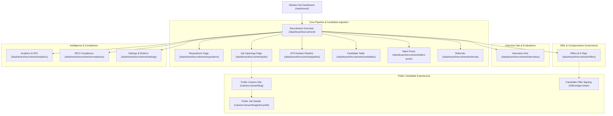

# Nebula Recruitment Module: User Interface & Interaction Flow Documentation

---

## 1. Executive Summary & Design System

The **Nebula HUB Recruitment Engine** provides an enterprise-grade applicant tracking, interview management, offer governance, and analytics user experience. Designed strictly according to the **Nebula Warm Light 2.0 Design System**, the interface delivers high visual contrast, intuitive navigation, responsive micro-animations, and zero clutter.

### Design Tokens & Typography
- **Primary Brand Color**: `#f97316` (Nebula Warm Orange)
- **Background Accent**: `#FBF8F4` (Warm Alabaster Canvas)
- **Surface & Cards**: `#FFFFFF` with `#ECE0D6` crisp borders and subtle multi-tier box shadows (`shadow-sm`, `shadow-md`).
- **Typography**: Inter / Outfit sans-serif with monospace accents for identifiers (`CAN-2026-001`, `JOB-ENG-001`, `OFF-2026-001`).
- **Status Badges**:
  - `applied`: Slate `#64748B` / Slate-50
  - `screening`: Sky `#0284C7` / Sky-50
  - `interview_round_1` & `interview_round_2`: Indigo `#6366F1` / Indigo-50
  - `technical_assessment`: Purple `#8B5CF6` / Purple-50
  - `hr_round`: Amber `#D97706` / Amber-50
  - `offer_sent`: Orange `#EA580C` / Orange-50
  - `hired`: Emerald `#059669` / Emerald-50
  - `rejected`: Rose `#E11D48` / Rose-50

---

## 2. High-Level Navigation & Screen Sitemap

---

## 3. Screen-by-Screen UI & Interaction Breakdown

### 3.1. Recruitment Overview Dashboard (`/dashboard/recruitment`)
- **Header**: Active tenant breadcrumbs, quick "Create Job" button, "Schedule Interview" button, and "Recruiter Copilot" AI trigger.
- **Top Metrics Row**:
  - *Active Job Openings* (Count + trend vs last month)
  - *Total In-Flight Candidates* (Active in pipeline)
  - *Interviews Scheduled This Week*
  - *Pending Offer Approvals*
  - *Hired This Quarter*
- **Visual Kanban Stage Breakdown**: Linear stage progress bar visualizing distribution across all 7 ATS stages.
- **Recent Activities Feed**: Real-time chronological audit trail of stage changes, scorecard seals, offer approvals, and hire transitions.
- **Upcoming Interviews Widget**: Quick preview cards with Google Meet / Teams launch links and 1-click scorecard evaluation triggers.

---

### 3.2. Headcount Requisitions Page (`/dashboard/recruitment/requisitions`)
- **Purpose**: Internal headcount budgeting and business justification governance.
- **Main View**:
  - Filter by Department, Status (`draft`, `pending_approval`, `approved`, `converted_to_job`), and Employment Type.
  - Requisition cards displaying requested headcount count, approved salary range (Min - Max), target start date, and multi-step approval badges.
- **Modal: Create Requisition (`CreateRequisitionModal.tsx`)**:
  - **Inputs**: Role Title, Department selector, Target Headcount (e.g. 2 positions), Justification, Min & Max Salary Budget, Reason (`new_headcount`, `replacement`, `expansion`).
  - **Dynamic Chain Preview**: Displays visual approval steps (Department Head $\rightarrow$ Finance Head $\rightarrow$ HR Director).
- **Actions**:
  - *Approve / Reject Step*: Allows managers to action approval with timestamped comments.
  - *Convert to Job Opening*: 1-click button on approved requisitions that auto-populates the Job Opening creation wizard.

---

### 3.3. Job Openings Hub (`/dashboard/recruitment/jobs`)
- **Main View**:
  - Search bar with live debouncing, filters by department, location type (`remote`, `hybrid`, `on_site`), and job status (`draft`, `published`, `closed`).
  - Job Cards showing applicant count, days open, assigned recruiters, target salary band, and live status toggle.
- **Modal: Job Opening Wizard (`CreateJobModal.tsx`)**:
  - **Tab 1: Basic Info**: Job Title, Department, Location, Employment Type.
  - **Tab 2: Description & Skills**: Rich text description, required skills pill tags, and experience level.
  - **Tab 3: Compensation & AI JD Enhancer**: Salary range, benefits, and 1-click "Generate Inclusive JD" button powered by AI to automatically remove exclusionary jargon.
  - **Tab 4: Publishing & Channels**: Multi-channel social preview (LinkedIn post, Twitter card, Careers portal toggle).

---

### 3.4. ATS Kanban Pipeline (`/dashboard/recruitment/pipeline`)
- **Main View**:
  - Full-screen drag-and-drop Kanban board spanning 7 active recruitment columns:
    1. **Applied / Ingested**
    2. **Resume Screening**
    3. **Initial Interview**
    4. **Technical Assessment**
    5. **HR / Leadership Round**
    6. **Offer Extended**
    7. **Hired & Onboarded**
- **Candidate Card Details**:
  - Candidate Name, Candidate Code (`CAN-2026-001`), Target Role, Source badge, Star rating (1-5), and AI Match Score Badge (e.g., `92% Fit` with color coding).
  - Quick actions dropdown: View Dossier, Schedule Interview, Create Offer, Reject with Reason, AI Copilot Summary.
- **Drag & Drop Interactions**:
  - Dragging a card between columns triggers an optimistic UI update, emits a backend stage change mutation, opens stage notes modal, and appends to `RecruitmentActivity`.

---

### 3.5. Candidates Dossier & Management (`/dashboard/recruitment/candidates`)
- **Main View**:
  - Searchable data table with multi-select bulk actions (Bulk Email, Bulk Reject, Bulk Export).
  - Columns: Candidate Name, Email, Phone, Current Designation & Company, Target Role, ATS Stage, Source, AI Match Rating, Applied Date.
- **Candidate Detail Drawer / Modal (`CandidateDossierModal.tsx`)**:
  - **Header**: Avatar, Name, Email, Phone, Stage Pill, Star rating, and Resume PDF preview link.
  - **Tab 1: Overview & AI Match**: AI breakdown showing matched skills, missing skills, experience fit level, and evidence citations.
  - **Tab 2: Interview History & Scorecards**: Chronological interview cards with evaluator names, weighted competency scorecards, strengths, and concerns.
  - **Tab 3: Offer & Terms**: Itemized CTC breakdown, band deviation indicator, and live e-signature execution audit status.
  - **Tab 4: Activity Log**: Chronological audit trail of all candidate interactions.

---

### 3.6. Interview Operations & Scorecards (`/dashboard/recruitment/interviews`)
- **Main View**:
  - Multi-tab view: *Upcoming Interviews*, *Completed Interviews*, *Pending Debrief / Calibration*.
  - Interview cards featuring: Time with local timezone indicator, Round Type badge (*Technical, Culture Fit, Executive*), Panel avatars, Direct Google Meet / Teams join button, and RFC 5545 `.ics` calendar file download.
- **Modal: Schedule Interview (`ScheduleInterviewModal.tsx`)**:
  - Multi-interviewer selection with conflict warnings, round title, platform selector, datetime picker, candidate timezone converter, and auto-generated meeting link.
- **Modal: Evaluator Scorecard Rubric (`ScorecardModal.tsx`)**:
  - Displays structured 1-5 competency rubrics (e.g. *1: No awareness of failure modes*, *3: Basic caching knowledge*, *5: Consensus mastery*).
  - Evaluators select ratings, enter qualitative evidence notes, write key strengths and areas of concern, and choose overall recommendation (*Strong Hire, Hire, Neutral, No Hire, Strong No Hire*).
  - **Tamper-Proof Sealing**: Checking "Seal Scorecard" locks the evaluation to prevent retrospective calibration bias.
- **Modal: Calibration Debrief (`InterviewDebriefModal.tsx`)**:
  - Evaluator ratings side-by-side comparison table.
  - **Variance Alert**: Automatically warns hiring manager if evaluator scores diverge by $\ge 2$ points.
  - Consensus decision selector (*Advance, Recommend Offer, Follow-up, Reject*) with rationale notes.

---

### 3.7. Offers, E-Sign & Compensation Governance (`/dashboard/recruitment/offers`)
- **Main View**:
  - Metrics cards: Total Offers Extended, Acceptance Rate (%), Pending Sign-offs, Hired Count.
  - Interactive table showing: Offer Code, Candidate Name, Designation, Total CTC, Live Band Status badge (*Within Band* vs *+15% Deviation*), Approval Chain progress bar, and E-Sign status.
- **Modal: Create Itemized Offer (`CreateOfferModal.tsx`)**:
  - **Tab 1: Terms & Role**: Candidate picker, Job Opening picker, Designation, Department, Joining Date, Validity Date.
  - **Tab 2: Itemized CTC Compensation Builder**:
    - Interactive inputs for Base Salary, Performance Variable Bonus, Equity/Stock Grants (shares, estimated value, vesting schedule), Sign-on Bonus, Relocation, and Allowances.
    - Live Total CTC summation in real time with currency selector (`USD`, `EUR`, `GBP`, `INR`).
  - **Tab 3: Live Band Governance & Approval Chain**:
    - Visual gauge comparing Total CTC against job opening salary range.
    - If Total CTC $> Max$, automatically displays amber escalation banner: *"Compensation exceeds approved maximum by +12.5%. Finance Head approval injected."*
    - Requires justification text before submission.
- **Candidate Offer Signing Page (`/offers/sign/:token`) (Public / Zero-Login)**:
  - Clean, distraction-free branding page displaying official company logo.
  - Full formal letter preview with formatted compensation tables, benefits schedule, and legal contingencies.
  - **Dual E-Signature Input**:
    1. *Draw Mode*: HTML5 canvas with touch and mouse drawing for real digital signature.
    2. *Type Mode*: Cursive script generation based on typed legal full name.
  - Signer declaration checkbox ("I acknowledge this agreement constitutes a legally binding electronic signature under UETA & ESIGN Act").
  - "Accept & Sign Offer" button $\rightarrow$ Triggers audit logging (IP address, timestamp, user agent) and automatically transitions candidate to `hired`!
  - "Decline Offer" button opening polite feedback modal.

---

### 3.8. Analytics & Funnel Pass-Through (`/dashboard/recruitment/analytics`)
- **Executive KPI Cards**: Active Pipeline Candidates, Open Requisitions, Total Hires, Average Days-to-Hire, Offer Acceptance Rate (%).
- **Interactive Funnel Drop-off Chart**:
  - Sequential progression bars from Applied (100%) through Hired.
  - Displays pass-through rate (%) and drop-off rate (%) at every single transition stage.
- **Sourcing Channel ROI Comparison Table**:
  - Channels ranked by Volume, Hires, Hire Conversion %, and Average Candidate Quality Rating.
- **Department Hiring Velocity Progress Bars**:
  - Visual breakdown of filled vs open positions per department.
- **On-Demand Report Export Modal (`ExportReportModal.tsx`)**:
  - 1-click download of RFC 4180 CSV reports for Candidate Pipelines and Job Offers.
- **Semantic Talent Rediscovery Drawer**:
  - Natural language search query box (e.g., *"Distributed Systems Kafka Architect"*).
  - Search cards displaying relevancy score (0-100%), matching skills, and 1-click Recruiter AI Copilot synthesis trigger.

---

### 3.9. EEO & DEI Compliance Portal (`/dashboard/recruitment/compliance`)
- **Strictly Decoupled Anonymous Architecture**:
  - Explicit notification reminding evaluators that demographic data is stored with zero candidate PII links.
- **Demographic Distribution Cards**:
  - Interactive percentage breakdown across Gender, Race/Ethnicity, Veteran Status, and Disability Status.
- **Four-Fifths (80%) Rule Adverse Impact Diagnostic Table**:
  - Calculates selection rate per subgroup.
  - Identifies the highest-performing group as **Benchmark**.
  - Displays Impact Ratio $(Group\ Rate / Benchmark\ Rate)$.
  - Automatically flags an alert badge: *"Adverse Impact Flag: Group selection rate is below 80% of benchmark ($<0.80$)"*.

---

### 3.10. Public Careers Portal (`/careers/:tenantSlug`)
- **Header**: Organization branding, custom logo, industry badge, and tagline.
- **Search & Filters**: Keyword search bar, department dropdown, and location type filter (*Remote, Hybrid, On-site*).
- **Job Cards**: Title, department, location, employment type, salary band preview, and "View Details" link.
- **Public Job Details Page (`/careers/:tenantSlug/jobs/:jobId`)**:
  - Complete job description, responsibilities, requirements, and benefits.
  - **Embedded Application Form**: Full name, email, phone, current company, experience years, skills, portfolio URL, and resume file upload.
  - **Voluntary Anonymous EEO Demographic Survey**: Optional, confidential dropdowns for gender, ethnicity, veteran status, and disability status.
