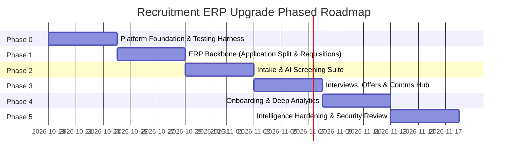

# Nebula HUB — Recruitment ERP Upgrade Plan
**Target Architecture, Module Map, AI Suite, Data Models, APIs, and Roadmap**
*Source: Recruitment ERP Upgrade Plan (October 2026)*

---

## 1. Gap Analysis: Today vs ERP Level

| Area | Current Implementation | ERP-Level Target |
|---|---|---|
| **Requisition** | HR creates a job directly without approval | Manpower requisition with justification, budget verification, multi-level approval chain, then automated draft job creation |
| **Candidate Model** | Candidate is locked 1:1 to a single `jobOpeningId` | Decoupled **Candidate (the person)** plus **Application (person applied to specific role)**; talent pools, silver-medalist tagging, re-application history |
| **Pipeline** | Fixed hard-coded 10 stages | Configurable stage templates per department/job, stage SLA day tracking, automation triggers, bulk actions, categorized rejection reasons |
| **Sourcing** | Manual addition by recruiter only | Public branded careers site, employee referral portal, agency vendor portal, job board multiposting, bulk resume import (ZIP/CSV) |
| **AI Capabilities** | Basic LinkedIn post text generator | End-to-end AI suite: resume parsing, blind match scoring, JD generator with inclusivity check, semantic talent search, interview kits, feedback-to-scorecard summarizer, recruiter copilot |
| **Interviews** | Manual static meeting links | Calendar sync (Google/Outlook), free/busy conflict detection, candidate self-scheduling links, automated reminders, question banks, scorecard templates, panel debriefs |
| **Job Offers** | Single gross salary number, basic status flag | Offer templates, comprehensive CTC breakdown, salary-band validation, multi-level approval chain, PDF generation & e-signature, negotiation audit log, expiration countdown |
| **Onboarding** | 1-click basic employee creation | Pre-boarding checklist, candidate self-document submission, background verification tracking, IT/asset requisition handoff, transactional HRMS employee creation |
| **Analytics** | 5 high-level KPI counts and stage distribution | Advanced analytics: time-to-hire, time-in-stage vs SLA, source ROI, cost-per-hire, offer acceptance rate, recruiter velocity, forecasting, CSV/XLSX exports |
| **Communication** | None internal to recruitment module | In-app & email notification hub, rich templates with merge fields, candidate timeline communication log, AI message drafter |
| **Compliance & Governance**| Basic RBAC and tenant scoping | Candidate consent records, GDPR/data retention policies, automatic PII anonymization, salary visibility gating, interviewer blinding |
| **Platform Services** | Synchronous Express request execution | Resilient asynchronous job queue (BullMQ/Redis), file service with MIME validation & virus scan, signed expiring URLs, webhooks |

---

### Four Fundamental Architectural Problems to Fix

1. **Candidate is Locked to One Job**:
   - *Current Flaw*: `Candidate.jobOpeningId` forces a 1:1 relationship. If a candidate applies to multiple roles or is considered for another vacancy, duplicate records are created, splintering communication and interview history.
   - *ERP Solution*: Split into **`Candidate` (the person)** and **`Application` (the person applying to a specific job opening)**. Stage, stage history, rating, match score, interviews, and offers belong to the `Application`.
2. **Sequential Codes Can Collide Under Concurrency**:
   - *Current Flaw*: `JOB-`, `CAND-`, `OFF-`, and `EMP-` codes are generated by counting documents (`countDocuments()`). Concurrent requests generate colliding identifiers, and deleted records cause duplicate numbering.
   - *ERP Solution*: Implement a centralized atomic `Counter` collection using `findOneAndUpdate({ organizationId, model }, { $inc: { seq: 1 } }, { upsert: true, new: true })`.
3. **Gemini 1.5 Flash is Hard-Coded**:
   - *Current Flaw*: Direct REST URL points to `gemini-1.5-flash` with inline API key queries in controllers.
   - *ERP Solution*: Decouple into a dedicated `aiService` provider interface reading `GEMINI_MODEL` from environment variables, supporting model version fallbacks and local deterministic prompt generation.
4. **Resumes Are Only Unvalidated URLs**:
   - *Current Flaw*: Resumes accept arbitrary external strings without file verification, size limits, or access controls.
   - *ERP Solution*: Implement a dedicated `fileService` with MIME-type sniffing, file-size enforcement, virus scanning hooks, and temporary signed URLs.

---

## 2. Target Module Map

| Code | Module Name | ERP Capabilities Added |
|---|---|---|
| **M1** | **Requisition & Headcount** | Manpower requests with hiring reason (new vs replacement), budget cap, departmental justification, and configurable approval chains. Approved requisitions automatically instantiate draft `JobOpening` records. |
| **M2** | **Careers Site & Intake** | Public, per-tenant careers portal (`/careers/:tenantSlug`), responsive application forms, resume parsing upload, candidate consent capture, duplicate detection, employee referral portal, agency portal, and bulk ZIP/CSV imports. |
| **M3** | **Talent CRM** | Cross-job talent pools, saved semantic searches, silver-medalist re-engagement, tags, do-not-hire registries, and candidate profile merging. |
| **M4** | **Configurable Pipeline** | Stage templates assignable per job or department, stage SLA tracking (days in stage), automated triggers, bulk actions (bulk move, bulk reject), and structured rejection reason catalog. |
| **M5** | **Interview Management** | Google and Outlook calendar integration, panel conflict detection, token-based candidate self-scheduling links, automated reminders, question banks, per-round scorecard templates, and collaborative panel debriefs. |
| **M6** | **Assessments** | Assign technical take-homes, coding tests, or behavioral assessments with due dates, scoring rubrics, and automated score attachment to the application. |
| **M7** | **Offer Management** | Reusable offer templates, comprehensive CTC component breakup, automated salary-band validation, multi-step approval workflows, PDF contract generation, e-sign links, negotiation logs, and expiration alerts. |
| **M8** | **Pre-Boarding & Onboarding** | Candidate pre-boarding checklist, document collection portal, background verification tracking, IT/asset allocation handoffs, extending the transactional 1-click HRMS bridge. |
| **M9** | **Communication Hub** | Rich email and SMS/WhatsApp templates with merge fields, candidate timeline communication logs, automated notifications, and AI candidate message drafting. |
| **M10** | **Analytics & Reporting** | Time-to-hire, time-in-stage vs SLA, recruitment funnel conversions, source ROI, cost-per-hire, offer acceptance ratios, recruiter productivity metrics, forecasting, and CSV/XLSX export. |
| **M11** | **Compliance & Governance** | Data consent tracking, retention & anonymization policies, salary visibility restrictions, interviewer evaluation blinding, and immutable audit logs. |
| **M12** | **Platform Services** | Resilient background job queue, secure file storage service with signed URLs, outgoing webhooks, rate limiters, feature flags, and tenant recruitment settings. |

---

## 3. AI Feature Suite

### 3.1 AI Platform Layer (Core Infrastructure)
- **Provider Interface**: Universal `aiService.generate({ task, input, schema })`. Gemini is the default cloud provider with a deterministic local engine fallback.
- **Prompt Registry**: Versioned code prompts (`src/prompts/recruitment/<task>.v1.ts`) avoiding raw string concatenation in controllers.
- **Structured Output**: Every AI task returns structured JSON validated strictly with **Zod** schemas, featuring automatic schema-repair retry.
- **`AiRun` Audit Trail**: Dedicated collection logging every execution: task, prompt version, model, input hash, output payload, token consumption, latency, user ID, target entity, and user acceptance status (accepted / edited / discarded).
- **Controls & Guardrails**: Tenant-level AI enable/disable toggle, monthly token budgets, and background job delegation for tasks >5 seconds.
- **Algorithmic Fairness**: Scoring tasks run strictly on **blinded views** (candidate name, gender, photo, age, nationality, address stripped). AI operates purely as a suggestion engine—**it is forbidden from auto-rejecting or auto-advancing candidates**.

### 3.2 AI Features Catalog

| ID | Feature Name | Description | Placement |
|---|---|---|---|
| **A1** | **Resume Parser** | Converts PDF/DOCX resumes into structured JSON profiles (skills, career timeline, education, links) with per-field confidence scores for recruiter verification. | Add Candidate, Careers apply form, Bulk import |
| **A2** | **Match Scoring & Explanation** | 0–100 fit score against Job Description detailing matched skills, missing skills, and experience fit with evidence citations. | Kanban cards, Candidates table, Candidate Drawer |
| **A3** | **JD Generator & Inclusivity Check** | Generates detailed job descriptions from role title, seniority, and skills; flags exclusionary or biased wording; recommends salary bands from historical data. | Requisition creation, Create Job modal |
| **A4** | **Multi-Channel Job Posts** | Expands LinkedIn post generation to Naukri, Indeed, WhatsApp, Email announcements, and X (Twitter) with tone presets and A/B variations. | `LinkedInPostModal` (expanded to `SocialPostModal`) |
| **A5** | **Semantic Talent Search** | Natural-language query search across talent pool (e.g., *"Senior Node.js developer with fintech experience under 30 days notice"*) using vector embeddings and metadata filters. | Talent CRM search bar |
| **A6** | **Duplicate Detection & Merge Assist** | Fuzzy matching on email, phone, name similarity, and resume text hash; recommends merge actions. | Add Candidate, Public Intake, Talent CRM |
| **A7** | **Interview Kit Generator** | Generates role- and round-specific technical/behavioral questions, benchmark sample answers, and scoring rubrics tied to the scorecard template. | Schedule Interview modal, Interview details |
| **A8** | **Notes to Scorecard Drafter** | Converts unstructured rough interviewer notes into structured, competency-mapped scorecard draft for reviewer sign-off. | Scorecard modal |
| **A9** | **Panel Debrief Summary** | Consolidates scorecards across all interviewers for an application, highlighting consensus, key discrepancies, and recommendations. | Panel Debrief view |
| **A10** | **Candidate Message Drafter** | Drafts personalized rejection letters with feedback, interview invites, follow-ups, and offer cover letters (editable, never auto-sent). | Communication Hub, Candidate Drawer |
| **A11** | **Offer Advisor** | Recommends competitive offer figures within the approved band based on candidate expectations, internal equity, and market percentiles; flags out-of-band anomalies. | Create Offer modal |
| **A12** | **Predictive Insights** | Calculates statistical offer-acceptance probabilities, drop-off risks, and estimated time-to-fill forecasts. | Dashboard, Offers list, Job details |
| **A13** | **Recruiter Copilot** | Natural-language chat sidebar answering operational queries through RBAC-scoped read tools (e.g., *"Which requisitions are past SLA?"*); requiring human confirmation for actions. | Global side panel |
| **A14** | **Onboarding Assistant** | Synthesizes accepted offer terms into a custom pre-boarding task checklist and welcome communication email. | Onboarding Checklist view |

---

## 4. Data Model Changes

Existing collections (`JobOpening`, `Candidate`, `Interview`, `JobOffer`, `RecruitmentActivity`) are retained and upgraded. The primary shift decouples the person from the application:

```
┌─────────────────────────────────┐           ┌─────────────────────────────────┐
│        Candidate (Person)       │ 1       * │      Application (Job-Role)     │
│  • fullName, email, phone       ├───────────┤  • candidateId, jobOpeningId    │
│  • resumeFileId, parsedProfile  │           │  • stage, rating, matchScore    │
│  • talentPoolIds, consent       │           │  • stageHistory, rejectionReason│
└─────────────────────────────────┘           └──────────────┬──────────────────┘
                                                             │ 1
                                                             ├─────────────┐
                                                           * │             │ 1
                                              ┌──────────────▼───┐  ┌──────▼───────────┐
                                              │    Interview     │  │     JobOffer     │
                                              │ • applicationId  │  │ • applicationId  │
                                              │ • scorecards[]   │  │ • ctcBreakup     │
                                              └──────────────────┘  └──────────────────┘
```

### New & Modified Collections

1. **`Candidate` (Modified — Person Profile)**:
   - Holds person-level identity: `fullName`, `email`, `phone`, `currentCompany`, `currentDesignation`, `totalExperienceYears`, `skills`, `resumeFileId`, `parsedProfile`, `embedding`, `talentPoolIds`, `consent`, `doNotHire`, `mergedInto`.
2. **`Application` (New — Person + Job Relationship)**:
   - Links `candidateId` and `jobOpeningId`. Holds: `pipelineStageKey`, `stageHistory`, `rating`, `matchScore`, `matchExplanation`, `source`, `referredBy`, `vendorId`, `rejectionReason`, `status` (`active`, `hired`, `rejected`, `withdrawn`).
3. **`Requisition` (New — Manpower Request)**:
   - Requisition tracking: `reqCode`, `departmentId`, `reason` (`new`, `replacement`), `budget`, `justification`, `approvalChain`, `status` (`draft`, `pending_approval`, `approved`, `rejected`), `jobOpeningId`.
4. **`ApprovalWorkflow` (New — Generic Approval Engine)**:
   - Reusable for Requisitions and Offers: `entityType`, `steps: [{ approver, role, order, condition }]`.
5. **`PipelineTemplate` (New — Configurable Stages)**:
   - Department- or role-specific stages: `stages: [{ key, name, type, slaDays, automations }]`.
6. **`ScorecardTemplate` & `QuestionBank` (New — Evaluation Library)**:
   - Round criteria: `roundType`, `criteria: [{ name, weight, rubric }]`, `questions: [String]`.
7. **`Interview` (Modified)**:
   - Repointed from `candidateId` to `applicationId`. Adds: `calendarEventId`, `selfScheduleToken`, `remindersSent`, `scorecards: [{ interviewerId, rating, decision, scores, notes, submittedAt }]`.
8. **`JobOffer` (Modified)**:
   - Repointed to `applicationId`. Adds: `templateId`, `ctcBreakup: { basic, hra, allowances, bonus, esops }`, `approvalChain`, `negotiationLog`, `pdfFileId`, `esignStatus`, `expiresAt`.
9. **`OnboardingChecklist` (New)**:
   - Tasks linked to `applicationId`: `tasks: [{ title, owner, dueDate, status, documentRequired }]`.
10. **`CommunicationTemplate` & `CommunicationLog` (New)**:
    - Template definitions with merge tags and outbound delivery tracking.
11. **`Counter` (New — Atomic Sequencing)**:
    - `{ organizationId, entityType, seq }` for collision-free numbering.
12. **`AiRun` & `RecruitmentSettings` (New)**:
    - Operational audits of AI execution and per-tenant recruitment configuration toggles.

### Migration Strategy
- Fully scripted, idempotent, dry-run by default per organization.
- For every existing `Candidate` record: creates one `Application` containing `stage`, `stageHistory`, `rating`, and `jobOpeningId`.
- Repoints existing `Interview` and `JobOffer` records to the new `applicationId`.
- Preserves legacy fields on `Candidate` behind a compatibility layer for seamless rollback.

---

## 5. API Additions (`/api/v1/recruitment/*`)

All endpoints are strictly organization-scoped via `scopedFilter` and permission-gated:

- **Requisitions**: `GET /requisitions`, `POST /requisitions`, `GET /requisitions/:id`, `PATCH /requisitions/:id`, `POST /requisitions/:id/approve`, `POST /requisitions/:id/reject`, `POST /requisitions/:id/convert-to-job`.
- **Applications**: `GET /applications`, `GET /applications/:id`, `PATCH /applications/:id/stage`, `POST /applications/bulk-move`, `POST /applications/bulk-reject`, `POST /applications/:id/match-score`.
- **Candidates & Talent CRM**: `GET /candidates/search`, `POST /candidates/merge`, `GET /talent-pools`, `POST /talent-pools`, `POST /candidates/upload-resume`.
- **Public Endpoints (Tenant Slug, Rate-Limited, No Auth)**: `GET /public/:tenantSlug/jobs`, `GET /public/:tenantSlug/jobs/:id`, `POST /public/:tenantSlug/jobs/:id/apply`, `GET /public/interviews/self-schedule/:token`, `POST /public/interviews/self-schedule/:token`, `GET /public/offers/view/:token`, `POST /public/offers/respond/:token`.
- **Templates & Settings**: `GET/POST /settings/pipelines`, `GET/POST /settings/scorecards`, `GET/POST /settings/questions`, `GET/POST /settings/communication`, `GET/PATCH /settings/recruitment`.
- **Interview Suite**: `GET /interviews/availability`, `POST /interviews/check-conflicts`, `POST /interviews/:id/sync-calendar`, `POST /interviews/:id/reminders`, `GET /interviews/debrief/:applicationId`.
- **Offer Engine**: `POST /offers/calculate-ctc`, `POST /offers/:id/generate-pdf`, `POST /offers/:id/negotiate`.
- **Onboarding**: `GET /onboarding/:applicationId`, `PATCH /onboarding/tasks/:taskId`, `POST /onboarding/:applicationId/upload-doc`.
- **Analytics & Exports**: `GET /analytics/time-to-hire`, `GET /analytics/funnel`, `GET /analytics/source-roi`, `GET /analytics/cost-per-hire`, `GET /analytics/recruiter-velocity`, `GET /analytics/export`.
- **AI Endpoints**: `POST /ai/parse-resume`, `POST /ai/match`, `POST /ai/generate-jd`, `POST /ai/job-posts`, `POST /ai/interview-kit`, `POST /ai/notes-to-scorecard`, `POST /ai/debrief`, `POST /ai/draft-message`, `POST /ai/offer-advisor`, `POST /ai/copilot`, `GET /ai/runs`.

---

## 6. RBAC & Security Additions

1. **Granular Permission Actions**: Extends beyond `view`, `create`, `edit`, `delete`, `approve` to include:
   - `export` (Exporting candidate dossiers, salaries, analytics).
   - `manage_settings` (Altering pipeline templates, approval workflows).
   - `use_ai` (Invoking generative AI pipelines).
   - `view_salary` (Inspecting compensation expectations and offer breakdowns).
   - `manage_pii` (Accessing unmasked candidate contact details, handling data deletion).
2. **Interviewer Blinding**: Panel interviewers only have access to candidates assigned to their scheduled rounds. Expected compensation, offer details, and other panelists' scorecards remain hidden until the interviewer submits their own evaluation.
3. **Public Endpoint Hardening**: Strict rate-limiting, captcha hooks, MIME-sniffing file validation, size limits (max 5MB), and no disclosure of internal system errors.
4. **Data Protection & Retention**: Explicit candidate consent timestamp captured upon application submission. Automated retention job flags or anonymizes inactive candidates after tenant-configured $N$ days.

---

## 7. Phased Implementation Roadmap



- **Phase 0: Foundation**: Codebase & UI audits, atomic `Counter` sequencing, central `aiService` layer, secure `fileService`, background job queue, feature flags, test harness.
- **Phase 1: ERP Backbone**: `Candidate` / `Application` split, idempotent migration, `Requisition` module & approval engine, configurable `PipelineTemplate`, bulk actions, Recruitment Settings UI.
- **Phase 2: Intake & AI Screening**: Public careers portal, resume parser (A1), blind match scoring (A2), duplicate detection (A6), AI JD generator (A3), multi-channel job posts (A4), referral portal, bulk resume import.
- **Phase 3: Interview, Offer & Communication**: Calendar sync, candidate self-scheduling, scorecard templates, notes-to-scorecard (A8), panel debriefs (A9), offer templates & CTC calculator, PDF/e-sign, offer advisor (A11), communication hub.
- **Phase 4: Onboarding & Analytics**: Pre-boarding checklist, transactional HRMS bridge extension, recruitment analytics dashboard, scheduled reports, CSV/XLSX exports.
- **Phase 5: Intelligence & Hardening**: Semantic talent search (A5), predictive insights (A12), Recruiter Copilot (A13), webhooks, security & performance audits, final release documentation.
