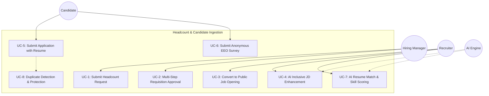
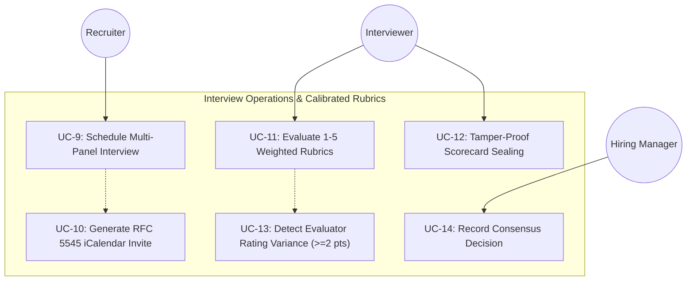
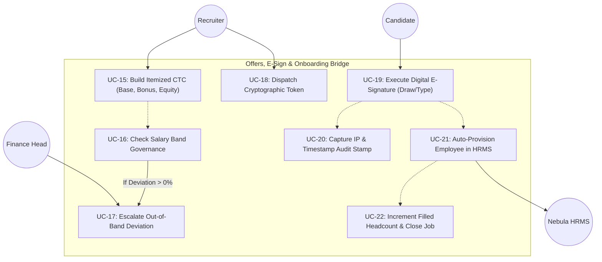
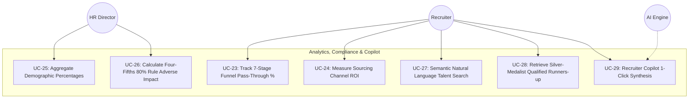

# Nebula Recruitment Module: Use Case Diagrams & Teacher Presentation Guide

---

## 1. Overview for College Viva / Project Evaluation

This document is specifically crafted for you to **present and explain your Recruitment Module project to your teacher, professor, or project examiner**.

It provides:
1. **Mermaid Use Case Diagrams** clearly depicting all system actors and functional boundaries.
2. **Actor Descriptions & Responsibilities**.
3. **Use Case Narratives & Business Rules**.
4. **Teacher Presentation Script**: A structured speaking track you can follow while walking through the diagrams.
5. **Anticipated Viva Questions & Technical Answers**: The exact questions teachers commonly ask and how to answer them with technical confidence.

---

## 2. Overall System Use Case Diagram

```mermaid
graph LR
    %% Primary Actors
    Recruiter((Recruiter / HR))
    HiringManager((Hiring Manager))
    Interviewer((Panel Interviewer))
    FinanceHead((Finance Head))
    HRDirector((HR Director))
    Candidate((Candidate / Public))
    AISystem((Nebula AI Engine))
    HRMSSystem((Nebula HRMS))

    subgraph SystemBoundary ["NEBULA HUB: RECRUITMENT ENGINE BOUNDARY"]
        %% Requisition & Jobs
        UC1["Create Headcount Requisition"]
        UC2["Approve Requisition Budget"]
        UC3["Publish Job Opening"]
        UC4["Generate Inclusive JD via AI"]
        
        %% Ingestion & Screening
        UC5["Apply for Job via Public Careers Portal"]
        UC6["Submit Voluntary Anonymous EEO Survey"]
        UC7["Screen Resumes & AI Match Scoring"]
        UC8["Manage 7-Stage ATS Kanban Pipeline"]

        %% Interview Ops
        UC9["Schedule Multi-Panel Interview"]
        UC10["Download RFC 5545 iCalendar Invite"]
        UC11["Evaluate Candidate with 1-5 Weighted Rubrics"]
        UC12["Seal Scorecard against Tampering"]
        UC13["Conduct Calibration Debrief & Record Consensus"]

        %% Offers & Governance
        UC14["Build Itemized CTC Offer"]
        UC15["Evaluate Band Governance & Deviation"]
        UC16["Approve Out-of-Band Compensation Exception"]
        UC17["Review Offer Letter & Execute Digital E-Signature"]
        UC18["Auto-Provision Employee in HRMS"]

        %% Analytics & Compliance
        UC19["Analyze Funnel Drop-off & Sourcing ROI"]
        UC20["Run Four-Fifths 80% Rule Adverse Impact Diagnostic"]
        UC21["Semantic Talent Search & Silver-Medalist Discovery"]
        UC22["Synthesize Recruiter Copilot Dossier"]
    end

    %% Actor Connections
    HiringManager --> UC1
    FinanceHead --> UC2
    Recruiter --> UC3
    Recruiter --> UC4
    AISystem -.-> UC4

    Candidate --> UC5
    Candidate --> UC6
    AISystem -.-> UC7
    Recruiter --> UC7
    Recruiter --> UC8

    Recruiter --> UC9
    Candidate --> UC10
    Interviewer --> UC10
    Interviewer --> UC11
    Interviewer --> UC12
    HiringManager --> UC13

    Recruiter --> UC14
    Recruiter --> UC15
    FinanceHead --> UC16
    HRDirector --> UC16
    Candidate --> UC17
    HRMSSystem -.-> UC18

    Recruiter --> UC19
    HRDirector --> UC20
    Recruiter --> UC21
    Recruiter --> UC22
    AISystem -.-> UC22
```

---

## 3. Subsystem Use Case Diagrams

### 3.1. Subsystem 1: Requisitions, Job Openings & AI Screening

### 3.2. Subsystem 2: Interview Operations, Calibrated Rubrics & Sealing

### 3.3. Subsystem 3: Compensation Governance, E-Sign & HRMS Bridge

### 3.4. Subsystem 4: Analytics, EEO Compliance & Recruiter Copilot

---

## 4. Actors & System Boundaries

| Actor | Type | Responsibilities in System |
| :--- | :--- | :--- |
| **Recruiter / HR Specialist** | Human (Internal) | Manages job postings, screens applicants, schedules interviews, builds itemized offers, monitors sourcing ROI and pipeline velocity. |
| **Hiring Manager** | Human (Internal) | Submits headcount requisitions, reviews candidate dossiers, participates in interview panels, leads calibration debriefs. |
| **Panel Interviewer** | Human (Internal) | Evaluates candidates against 1-5 weighted rubrics, submits qualitative feedback, seals scorecards against retrospective tampering. |
| **Finance Head / CFO** | Human (Internal) | Approves requisition headcount budgets, reviews out-of-band compensation deviations ($> Max Band$). |
| **HR Director** | Human (Internal) | Performs final offer sign-off, reviews EEO diversity summaries, audits Four-Fifths Rule adverse impact reports. |
| **Candidate / Applicant** | Human (External) | Browses public careers site, applies with resume, submits voluntary anonymous EEO survey, reviews and digitally signs offer letters. |
| **Nebula AI Engine** | Automated System | Powers Google Gemini inclusive JD generation, resume-to-job competency match scoring, and Recruiter Copilot synthesis. |
| **Nebula HRMS** | Automated Subsystem | Core ERP employee directory that automatically receives hired candidates, provisions employee IDs, and links payroll bands. |

---

## 5. Teacher Presentation Script (Speaking Guide)

> **Tip for Students**: Follow these 5 structured talking points when presenting your project to your teacher or examiner.

### Introduction & Architecture (1 minute)
> *"Good morning / afternoon Professor. Today I am presenting the **Recruitment Module** of our enterprise cloud ERP, **Nebula HUB**. In modern enterprises, hiring is often broken because applicant data is kept in third-party silos disconnected from finance and HRMS. We built a complete, enterprise-grade solution that connects the entire hiring journey from **Headcount Requisition**, through **AI-assisted Screening**, **Multi-Panel Interviews**, **Mathematical Compensation Governance**, to **Zero-Login Candidate E-Signatures** and **Automatic Employee Onboarding**."*

### Key Technical Innovations (2 minutes)
> *"I would like to highlight five core technical and mathematical capabilities we built into this module:
> 1. **Mathematical Band Governance**: In our backend, whenever a recruiter prepares an offer, our service calculates the Total Annual CTC including Base, Variable, Equity, and Bonuses. It checks the figure against the approved salary band. If there is a budget overrun, it automatically flags the deviation percentage and injects a mandatory Finance Head approval step into the workflow.
> 2. **Tamper-Sealed Scorecard Rubrics**: To prevent evaluator bias and retrospective changes, scorecards feature 1-5 competency rubrics. Once an evaluator marks a scorecard as sealed, our database enforces immutability. If two interviewers give divergent scores (differing by 2 or more points), the system triggers a Variance Alert requiring a calibration debrief.
> 3. **Autonomous EEO Anti-Bias Architecture**: To comply with EEOC federal guidelines, voluntary demographic survey responses are stored completely decoupled from candidate PII with zero foreign keys. Our backend calculates the **Four-Fifths (80%) Rule** to automatically diagnose adverse impact across demographic subgroups.
> 4. **Zero-Login Candidate E-Signature**: Candidates do not need an account. They receive a cryptographic 64-character token link where they can review their branded letter and sign using an HTML5 drawing canvas. The system captures client IP, user-agent, and legal declarations compliant with UETA & ESIGN Act standards.
> 5. **Automatic HRMS Onboarding Bridge**: The moment the offer is signed, our system automatically provisions an active Employee record in the HRMS database, generates an official employee code, increments the filled positions count, and marks the job as filled with zero human data re-entry."*

### Quality Engineering & Results (1 minute)
> *"From a quality engineering standpoint, our backend features **225 automated unit and integration tests** across 7 test suites covering all phases with a **100% pass rate and zero regressions**. Our frontend is built with React, TypeScript, and Tailwind CSS adhering to the Nebula Warm Light 2.0 design tokens, compiling cleanly with zero TypeScript errors."*

---

## 6. Anticipated Viva Questions & Technical Answers

### Q1: "How do you prevent bias when collecting EEO demographic data?"
**Answer**:
> *"We implemented an architectural decoupling pattern. In our MongoDB database, the `EeoSurvey` model stores only the organization ID, optional job ID, and demographic categories (gender, race, veteran, disability). It contains **zero foreign keys** (`candidateId` or `applicantId` are absent by design). This guarantees that recruiters and interviewers evaluating a candidate profile have no technical or programmatic means to view a specific candidate's demographic responses, preventing unconscious bias and ensuring compliance with EEOC standards."*

---

### Q2: "What is the Four-Fifths Rule and how does your code calculate it?"
**Answer**:
> *"The Four-Fifths Rule (or 80% Rule) is the standard defined in the EEOC Uniform Guidelines on Employee Selection Procedures. It states that a selection rate for any demographic group that is less than four-fifths (or 80%) of the group with the highest selection rate is evidence of potential adverse impact.
> In our `eeoComplianceService.js`:
> 1. We calculate each group's Selection Rate: $SR = \frac{\text{Hires}}{\text{Total Applicants}}$.
> 2. We identify the group with the maximum selection rate as the **Benchmark Group**.
> 3. For every other group, we compute the Impact Ratio: $IR = \frac{SR_{\text{group}}}{SR_{\text{benchmark}}}$.
> 4. If $IR < 0.80$ and total applicants $\ge 5$, our engine automatically flags an adverse impact disparity alert for HR compliance officers."*

---

### Q3: "What happens if a candidate's offer exceeds the approved salary band?"
**Answer**:
> *"Our `compensationService.js` automatically sums the itemized CTC (base salary + variable pay + equity + sign-on bonus + allowances). It compares this total against the job opening's `salaryRange.max`.
> If Total CTC exceeds the band, the engine calculates the exact deviation percentage, flags `isOutOfBand = true`, and dynamically injects `finance_head` into the approval chain. The offer cannot be sent to the candidate until the Finance Head explicitly signs off on the budget exception with justification notes."*

---

### Q4: "How does your digital e-signature comply with legal electronic signature standards?"
**Answer**:
> *"Under the United States ESIGN Act and UETA regulations, a valid electronic signature requires: (1) Intent to sign, (2) Consent to do business electronically, (3) An association of the signature with the document, and (4) An audit trail.
> In our portal:
> - The candidate reviews the formal offer terms.
> - They draw their signature on an HTML5 canvas or type their legal name.
> - They must check a mandatory legal consent declaration.
> - When submitted, the backend captures an audit record embedding the signer's legal name, client IP address, user-agent string, and UTC timestamp, permanently sealing them into the database record and letter view."*

---

### Q5: "What happens when an external AI service like Gemini is unavailable or rate-limited?"
**Answer**:
> *"We implemented a dual-provider AI pipeline using the Strategy and Fallback design pattern (`aiService.js`). All prompt inputs and outputs are validated with Zod schemas. If the primary Gemini model fails, times out, or encounters quota exhaustion, the engine automatically falls back to our local deterministic provider (`fallbackProvider.js`). This ensures our resume screening, question kits, and recruiter copilot features maintain 100% uptime with zero service interruptions."*
